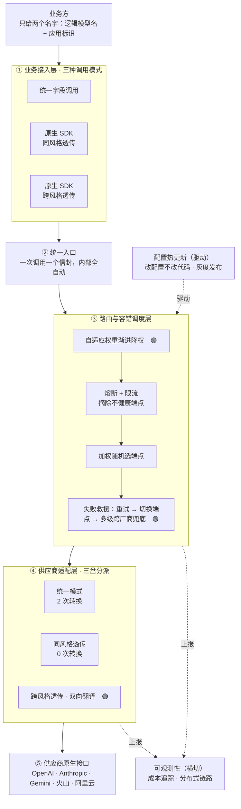
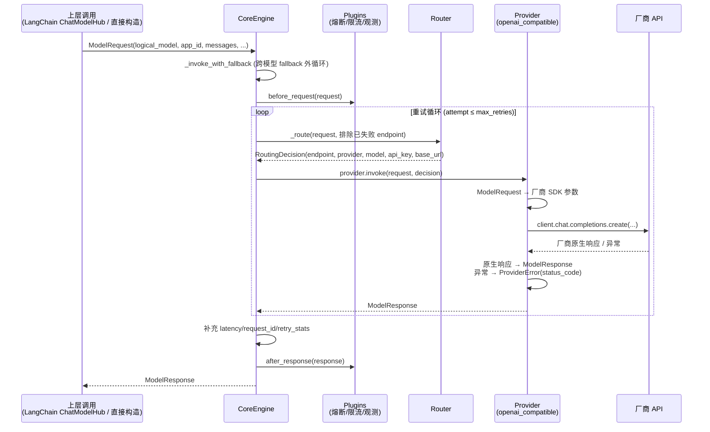
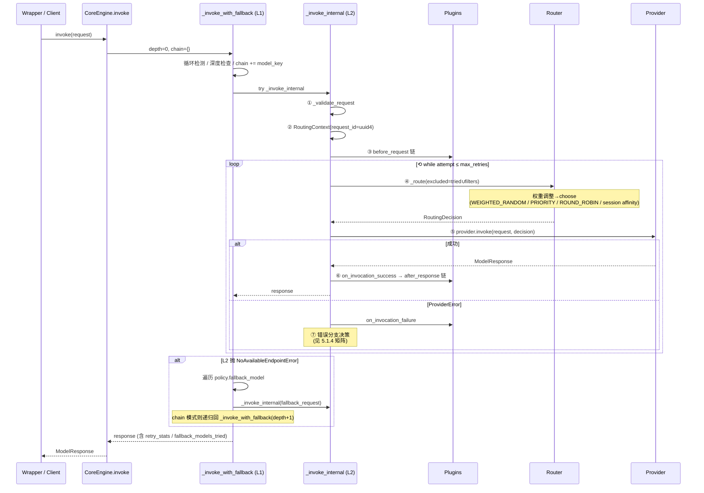
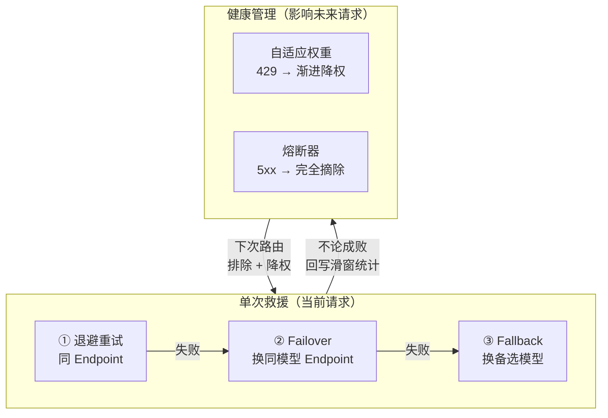
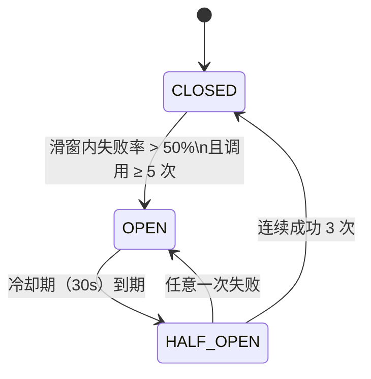
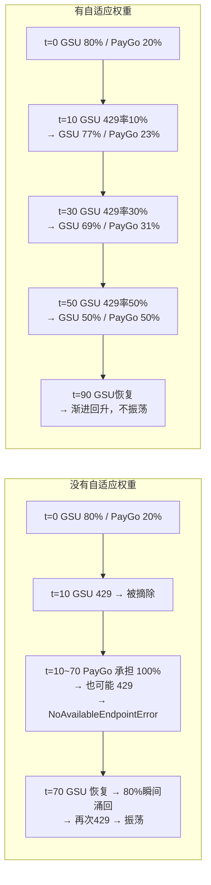

# Plaud Model Hub 完全指南：全景架构、核心机制与生产实战手册

> 📂 **对应源码**：`/Users/liangzhu/Documents/work/plaud-model-hub`  
> 🏷 **文档定位**：Plaud AI Platform 统一大模型调用基础设施的唯一权威全景指南。集合了系统定位、三大调用模式、数据链路时序、参数透传与方言治理、七大插件协议、调度与三层容错、自适应权重重分配数学推演、跨风格适配器、生产配置规范、技术难点（STAR）与面试表达、宣讲脚本及源码速查于一体。本文档无法直接回答的细节，可直接到该源码目录查阅（关键路径见第二十三章）。

---

## 目录

1. [一、项目定位与全景概览](#一项目定位与全景概览)
   - 1.1 一句话定位与核心心智模型
   - 1.2 电梯陈述（30 秒版 / 60 秒技术深度版）
   - 1.3 核心痛点与应对措施全景映射（三大类别两大维度）
   - 1.4 业务痛点六大具体场景实录
   - 1.5 业务收益与核心商业指标
   - 1.6 Monorepo 架构与包依赖关系（核心引擎零硬依赖）
   - 1.7 整体关系拓扑与问题-方案速查
2. [二、整体架构与核心设计原则](#二整体架构与核心设计原则)
   - 2.1 全局架构拓扑图
   - 2.2 Passthrough 架构：为什么需要它？
   - 2.3 三种调用模式对比与选型决策
   - 2.4 十大核心组件（按数据流生命周期展开）
   - 2.5 全模式能力复用矩阵
   - 2.6 四大关键设计原则
   - 2.7 统一信封模型：ModelRequest 与 ModelResponse
   - 2.8 核心术语对照表
3. [三、统一模式数据链路与方言隔离](#三统一模式数据链路与方言隔离)
   - 3.1 统一模式端到端数据链路（Mermaid 完整时序）
   - 3.2 抽象层：上层是如何被「统一」的
   - 3.3 Engine 编排职责边界（只管打谁与容错，不碰格式）
   - 3.4 Router：从业务逻辑名到物理坐标解析
   - 3.5 Provider：最后一米翻译官与厂商方言隔离带
   - 3.6 一次调用的数据形态演变全景
4. [四、参数透传机制与 Provider 方言治理](#四参数透传机制与-provider-方言治理)
   - 4.1 完整透传链路图示与核心结论
   - 4.2 双通道入参机制：构造器白名单 vs 调用 kwargs
   - 4.3 BaseChatModel 的 extra='ignore' 实证陷阱
   - 4.4 为什么 temperature / max_tokens 需要特殊提取
   - 4.5 reasoning 模型与 temperature=None 踩坑实录
   - 4.6 三类 Provider 的处理机制差异（OpenAI vs Anthropic vs Gemini）
   - 4.7 Gemini max_output_tokens 静默丢弃 Bug 与修复方案
   - 4.8 生产实操：参数到底该写在哪里？
   - 4.9 参数透传关键代码位置速查
5. [五、使用方式与快速上手](#五使用方式与快速上手)
   - 5.1 SDK Wrapper（推荐，0 改造成本无感接入）
   - 5.2 ModelHubClient（统一 API 模式）
   - 5.3 LangChain 集成（ChatModelHub）
   - 5.4 获取原生 Client 规范与限制
6. [六、配置系统全解](#六配置系统全解)
   - 6.1 v2 配置格式设计
   - 6.2 Key 格式与凭证管理
   - 6.3 支持的 Provider 家族
   - 6.4 三种模型配置格式与 Endpoint 字段定义
   - 6.5 多 Endpoint 应用场景与属性优先级继承
   - 6.6 Provider 级别硬禁用
   - 6.7 v2 Inline 凭证简化
   - 6.8 配置校验机制（JSON Schema 与 Pydantic）
   - 6.9 ConfigStore 存储后端与热更新（File / AppConfig / Http 零停机刷新）
   - 6.10 生产完整配置骨架（全字段速查模板）
7. [七、CoreEngine 核心引擎编排](#七coreengine-核心引擎编排)
   - 7.1 请求完整生命周期与两层循环（Fallback 外循环 + Retry 内循环）
   - 7.2 一次调用的端到端旅程
   - 7.3 重试与 Failover 机制
   - 7.4 429 退避策略与 Retry-After 处理
   - 7.5 三层调用结构深度拆解
   - 7.6 流式传输（Streaming）特殊处理与 Chunk 调度
8. [八、路由策略与流量分发](#八路由策略与流量分发)
   - 8.1 policies 路由策略总览（WEIGHTED_RANDOM、ROUND_ROBIN、PRIORITY）
   - 8.2 weight vs priority 深度辨析与交互规则
   - 8.3 Endpoint 动态过滤机制（健康度与功能匹配）
9. [九、插件系统与七大能力扩展](#九插件系统与七大能力扩展)
   - 9.1 插件系统定位与设计哲学（为什么选择 Protocol 而非 ABC）
   - 9.2 七大能力接口（Protocol 接口骨架详解）
   - 9.3 CoreEngine 插件调度实现机制（构造期稳定排序、分类缓存、运行时零 isinstance 开销）
   - 9.4 权重合并算法（多插件协同计算）
   - 9.5 容错隔离原则（插件崩溃绝不阻断核心主链）
   - 9.6 内置可观测性插件（Langfuse、OpenTelemetry）
   - 9.7 自定义插件编写指南与三条铁律
10. [十、调度与多层容错体系](#十调度与多层容错体系)
    - 10.1 三层容错体系总览（单次救援链 -> Endpoint健康管理 -> 熔断器）
    - 10.2 三大健康信号各司其职（429 限流 vs 5xx 故障 vs 突发流量）
    - 10.3 熔断器状态机与恢复探测（CLOSED -> OPEN -> HALF_OPEN）
    - 10.4 限流器令牌桶与被动 429 消化（soft_limit_on_429）
    - 10.5 一次完整失败请求的端到端处理旅程
11. [十一、自适应权重插件深度剖析](#十一自适应权重插件深度剖析)
    - 11.1 核心设计理念：429 是"太忙"不是"坏了"
    - 11.2 滑动窗口环形缓冲区与错误率计算
    - 11.3 惩罚乘数（multiplier）与下限保护（min_weight_ratio）
    - 11.4 动态权重重分配算法（为什么分母效应不够、重分配数学公式、原权重比例分配论证、66:34:1:1 完整数值演练、总和守恒与单调性）
    - 11.5 recovery_rate 限速恢复（防 429 结束流量涌回雪崩机制与 Mock 时间源）
    - 11.6 与限流器的联动机制（soft_limit_on_429）
    - 11.7 三 Endpoint 突发流量演练全程推演
12. [十二、Fallback 跨模型降级机制](#十二fallback-跨模型降级机制)
    - 12.1 触发条件与多级降级链
    - 12.2 Fallback 两种模式（统一模式 vs 跨风格透传模式）
    - 12.3 环路检测与安全防护
    - 12.4 多 Endpoint 与 Fallback 协同交互
    - 12.5 元数据回写（effective_model, fallback_chain 用于成本归因）
13. [十三、Provider 适配层与 Client 连接池](#十三provider-适配层与-client-连接池)
    - 13.1 Provider 统一基类与三岔分派实现
    - 13.2 OpenAI-Compatible Provider 家族与复用设计
    - 13.3 Adapter 跨风格双向翻译矩阵（4 个核心方法：request, response, stream, error）
    - 13.4 跨供应商错误码统一映射体系
    - 13.5 ClientPool 原生客户端复用与连接池管理
14. [十四、SDK Wrapper 实现原理](#十四sdk-wrapper-实现原理)
    - 14.1 动态属性代理与方法劫持
    - 14.2 响应与异常对象的零侵入还原
15. [十五、核心数据模型速查](#十五核心数据模型速查)
    - 15.1 ModelRequest / ModelResponse 关键字段
    - 15.2 RoutingDecision 与 RetryStats
    - 15.3 统一错误体系与 ErrorCategory
    - 15.4 分布式追踪与多级 Trace ID
    - 15.5 EngineConfig 完整字段速查（📍 core/engine.py:58）
16. [十六、CLI 工具集](#十六cli-工具集)
    - 16.1 config-validator（配置校验）
    - 16.2 config-migrate（版本迁移）
    - 16.3 llm-importer（模型导入）
    - 16.4 sync-appconfig（配置热同步）
17. [十七、生产配置最佳实践](#十七生产配置最佳实践)
    - 17.1 环境隔离与多区域部署
    - 17.2 限流、熔断与自适应权重的黄金组合
    - 17.3 多 Endpoint 权重与主备规划
    - 17.4 生产完整标准 YAML 模板
18. [十八、常见问题与高频故障排查](#十八常见问题与高频故障排查)
    - 18.1 核心机制 Q&A（Q1~Q9 深入剖析）
    - 18.2 调度与容错专题深度 Q&A（机制原理与决策逻辑）
    - 18.3 429 处理与多 Endpoint 自动转移流程速查
    - 18.4 错误恢复时间参考表
19. [十九、快速查询表](#十九快速查询表)
    - 19.1 429 处理流程与转移动作表
    - 19.2 错误类型与恢复机制对照表
20. [二十、项目复盘、技术难点（STAR）与面试深度表达](#二十项目复盘技术难点star与面试深度表达)
    - 20.1 个人角色与核心贡献明细（5 大模块职责与代码量）
    - 20.2 四大核心技术难点 STAR 结构化解析
      - STAR 1：参数透传的「方言」差异与 Gemini 静默丢弃 Bug 攻坚
      - STAR 2：多 Endpoint 的熔断、限流与自适应权重三元协同（避免重复惩罚）
      - STAR 3：自适应权重插件的动态权重重分配与防雪崩限速恢复
      - STAR 4：跨风格适配器的复杂性处理（流式 chunk 与 tool_calls 双向翻译）
    - 20.3 竞品横向深度对比矩阵（Model Hub vs LiteLLM vs LangChain vs Portkey vs OneAPI）
    - 20.4 高并发质量保障体系（单元测试覆盖率、429 连锁故障仿真压测、时间源 Mock）
    - 20.5 系统边界与未来演进方向
    - 20.6 技术栈全景
21. [二十一、架构宣讲与技术分享脚本](#二十一架构宣讲与技术分享脚本)
    - 21.1 10 分钟快速架构宣讲脚本（架构破局、数据流与复用矩阵）
    - 21.2 30 分钟容错与调度深入分享脚本（GSU+PayGo实战、重分配数学与雪崩防范）
22. [二十二、设计模式与关键架构决策](#二十二设计模式与关键架构决策)
    - 22.1 项目中运用的经典设计模式（适配器、装饰器、责任链、策略、状态机、对象池）
    - 22.2 关键架构决策与取舍（ADR 记录）
    - 22.3 基础设施复用矩阵
23. [二十三、关键文件与源码符号速查](#二十三关键文件与源码符号速查)
    - 23.1 核心贡献模块代码坐标（被要求看代码时首选）
    - 23.2 Monorepo 完整文件速查表


---

## 一、项目定位与全景概览

Model Hub 是 Plaud AI Platform 的 **统一大模型调用基础设施层**。

**核心理念：**

> 业务方只需关心 `app_id` + `logical_model`，供应商 Key、路由策略、熔断降级全部由 Model Hub 内部管理。

### 1.1 一句话定位与核心心智模型

**Model Hub 是 Plaud AI Platform 的统一大模型调用基础设施层**：通过 Logical Model / Endpoint / Provider 三层抽象屏蔽供应商差异，内部托管**路由、容错、可观测性**，让业务方只需 `app_id + logical_model` 两个名字即可调用任何 LLM。

我作为**核心贡献者**，独立负责其中三个关键模块：① 自适应权重插件（解决 429 连锁故障）② 跨风格路由适配（OpenAI ↔ Anthropic / Gemini 双向翻译）③ Fallback 增强（多级降级链 + 环路检测）+ LangChain 集成 + AppConfig 热更新。

### 1.2 电梯陈述（30 秒版 / 60 秒技术深度版）

### 30 秒版

> Plaud 业务线同时调用多家 LLM（Gemini / GPT / Claude / 火山 / 阿里云），每家 API 格式不同、配额限流各异。Model Hub 把这些通用问题一次性下沉：业务方只写 `client.invoke("summary-gemini", ...)` 一行代码，路由、降权、重试、降级全自动。我主导的核心创新是**自适应权重插件**——按 429 频率渐进降权取代二值切流，让 GSU 预付费和 PayGo 按量付费平滑切换，节省 30% 成本的同时可用性提升 4.3 个百分点；还有**跨风格透传**——业务方用 OpenAI SDK 写的代码可以无缝 Fallback 到 Claude，0 次转换的同时保留完整容错能力。

### 60 秒版（加技术深度）

> 在 30 秒版基础上补充：Hub 架构的核心是"单一入口 + 三种调用模式"——统一模式走 Hub 抽象字段（2 次转换），同风格透传走 0 次转换（WrappedOpenAI → OpenAI endpoint），跨风格透传走 Adapter 翻译（WrappedOpenAI → Claude endpoint）。三种模式共享同一套基础设施（路由 / 熔断 / 限流 / Fallback）。自适应权重的关键设计有三个：① 权重重分配机制（降权部分按健康 endpoint 的原权重比例重新分配，让小权重 endpoint 在应急时也能承接流量）② recovery_rate 限速恢复（multiplier 下行立即生效、上行受速率限制，避免恢复时流量瞬涨再次 429）③ 下限保护（multiplier 最低 0.1，保留 10% 探测流量，配额恢复后自动感知）。Fallback 支持多级链（gemini → gpt → claude），环路检测防循环引用，元数据回写让降级路径可追溯。

---

### 1.3 核心痛点与应对措施全景映射（三大类别两大维度）

业务线（录音总结 / RAG 问答 / 项目摘要）要同时调用多家供应商（OpenAI / Anthropic / Google / 火山 / 阿里云）。如果让业务代码自己扛，痛点落在两个互不相干的维度上：

- **维度一 · 接口不统一（静态问题）**：各家 SDK 参数与响应格式不一样，且模型 / 端点还常变。
- **维度二 · 运行时不可控（动态问题）**：上线后会限流、会故障、成本会漂。

对应两把武器：

- **接口不统一 → 用「抽象」屏蔽**：三层抽象 + 三种调用模式 + Adapter 翻译，把差异挡在业务视线之外。
- **运行时不可控 → 用「调度」兜住**：路由 + 救援链 + 自适应权重，把波动收在基础设施之内。

> [!important] 成本控制不是独立的第三类问题
> Model Hub 里没有任何单独的"成本模块"——成本效果全部由「调度」这一套机器产出：权重配置表达"先用便宜的档"，自适应权重在故障时守住这个偏好。所以**调度这一个维度同时优化两个目标：可用性 + 成本**。
> 自适应权重正是二者耦合的证据：如果没有 GSU（便宜有限）和 PayGo（贵而弹性）之间的成本落差，一个普通的二值熔断器就够用了，渐进降权根本没有存在的必要。正因为"二值摘除 GSU → 100% 流量砸向 PayGo → 成本爆炸"，才必须改成按 429 率的渐进降权。

### 2.2 问题 → 措施 全景映射

两个维度的措施各自成体系，先记骨架再看表：

- **维度一 = 一个底座 + 三种接入**：三层抽象是底座，三种调用模式是接入姿势，业务按自己情况挑姿势，差异全被底座挡住。
- **维度二 = 一条救援阶梯 + 三条横切**：线上的坏情况按烈度递增（阶梯 1 → 3），每级各有对策；再加贯穿全程的成本、运维、观测三条横切。维度二比维度一多一列「服务目标」，因为只有它才分「可用性 / 成本」。

措施只列到机制级；内部子设计（如自适应权重的限速恢复）下沉到 §5 展开，不在总表平铺。

**维度一 · 接口不统一 → 抽象**

| 分类 | 具体痛点 | 不处理的后果 | Model Hub 的措施 | 详见 |
| ---- | ------ | -------- | -------------- | ---- |
| **底座** | 换模型 / 加端点都要改业务代码再发版 | 迭代慢、上线有风险 | **三层抽象**（逻辑模型 / 端点 / 供应商）：业务只认逻辑模型名，换模型只改配置 | §0 全局图、§5.5 |
| **接入** | 各家 SDK 字段格式不同（Anthropic 的 `max_tokens` 必填、Gemini 的 `temperature` 要塞进 Config 对象） | 业务代码重复写转换逻辑 | **统一模式**：填 ModelRequest 抽象字段，各 Provider 子类各自翻译成原生 SDK | §4.1、§5.2 |
| **接入** | 已有原生 SDK 代码，不愿为接入 Hub 重写 | 迁移成本挡住推广 | **同风格透传**：`raw_request` 原样喂 SDK，0 次转换 | §4.1 |
| **接入** | 想让 OpenAI 代码跨厂商降级到 Claude / Gemini | 容错被锁死在同一家厂商 | **跨风格透传 + Adapter**：请求 / 响应 / 流式双向翻译 | §5.2 |

**维度二 · 运行时不可控 → 调度**（同一套机制，同时服务「可用性」与「成本」两个目标）

| 分类 | 具体痛点 | 不处理的后果 | Model Hub 的措施 | 服务目标 | 详见 |
| ---- | ------ | -------- | -------------- | ---- | ---- |
| **阶梯 1** | 单次调用偶发失败 / 超时 | 请求直接失败 | **Retry**：同 endpoint 指数退避重试 | 可用性 | §5.3 |
| **阶梯 2** | 某 endpoint 5xx 坏了 | 坏端点仍被选中，持续失败 | **熔断器**摘除该端点 + **Failover** 换同模型的其他端点 | 可用性 | §5.3、§6.2 |
| **阶梯 2** | 便宜档被打满持续 429（成本敏感，不能一刀切摘除） | 二值熔断 → 流量全甩贵档 → 成本爆炸 + 备份被压垮雪崩 | **自适应权重**：按 429 率渐进降权 + 权重按原比例重分配（配套：限速恢复、下限探测） | 可用性 + 成本 | §5.1 |
| **阶梯 3** | 整个模型 / 厂商级故障（如 Gemini 宕 2 小时） | 单厂商拖垮整条业务 | **多级跨厂商 Fallback 链**（gemini → gpt → claude），阶梯的最后一级 | 可用性 | §5.3.4 |
| **横切·成本** | 便宜档常年跟跑，账单偏高 | 成本长期偏高 | **权重配「便宜档优先」**，贵档只在便宜档降权时才兜底 | 成本 | §5.1 |
| **横切·运维** | 线上切流 / 降权要人工改配置发版 | MTTR 高（≈15 min） | **AppConfig 热更新** + 灰度，改配置分钟级生效 | 可用性 + 成本 | §5.5 |
| **横切·观测** | 降级后不知实际走了哪条路、花了多少钱 | 无法做成本审计与归因 | **元数据回写** `effective_model` / `fallback_chain` + Langfuse / OTel | 成本 | §5.3、§7.2 |

> 措施在一次真实调用里如何串起来协同，看 §0 全局架构图与 §4.2 整体数据流。

### 1.4 业务痛点六大具体场景实录

下面通过 6 个生产环境中的实际场景，具象化说明 Model Hub 如何解决上述痛点。

---

#### 场景一：多 Provider 碎片化 —— 各业务各管各的

**没有 Model Hub 时的痛点：**

Summary 服务用 OpenAI，Transcription 用 Anthropic，翻译用 Google Gemini。每个团队各自管理 API Key、用不同的 SDK、写不同的错误处理逻辑：

```python
# summary 服务 —— 用 OpenAI
import openai
client = openai.OpenAI(api_key="sk-xxx")
response = client.chat.completions.create(model="gpt-4o", ...)

# transcription 服务 —— 用 Anthropic
import anthropic
client = anthropic.Anthropic(api_key="sk-ant-xxx")
response = client.messages.create(model="claude-3-haiku", ...)
```

想换模型？改代码 → 改 SDK → 改错误处理 → 发版。一次切换影响全链路。

**Model Hub 怎么解决：统一抽象层**

所有业务方只需要一个 client，传 `logical_model` 名字：

```python
from model_hub_sdk import ModelHubClient

client = ModelHubClient(app_id="summary")
response = client.chat(model="gpt-4.1", messages=[...])
```

底层是 OpenAI、Anthropic 还是 Google，业务方完全不关心。切换模型 **只需改 YAML 配置，不用改代码、不用发版**。

---

#### 场景二：同一模型多个 Endpoint —— 负载均衡与高可用

**痛点**：为了可用性和成本优化，公司同时购买了 OpenAI 直连和 Azure OpenAI 的 GPT-4o 服务。但业务代码只调一个 URL，无法利用两个入口做负载均衡。

**Model Hub 怎么解决：一个 Logical Model → 多个 Endpoint**

这是 Model Hub **最核心的抽象**——Logical Model（逻辑模型）与 Endpoint（物理入口）的分离：

```yaml
models:
  summary:gpt-4.1:
    endpoints:
    - provider: openai          # OpenAI 直连，权重 60%
      model: gpt-4o-mini
      weight: 60
      priority: 10
    - provider: azure           # Azure OpenAI，权重 40%
      model: gpt-4o-mini
      weight: 40
      priority: 5
```

业务方调用 `model="gpt-4.1"` 时，Router 根据策略自动选择走哪个 endpoint：


| 策略           | 行为                               | 适用场景   |
| ------------ | -------------------------------- | ------ |
| **加权随机**（默认） | 按权重概率分配，60% 走 OpenAI，40% 走 Azure | 日常负载均衡 |
| **轮询**       | 依次轮流，均匀分配                        | 严格均分流量 |
| **优先级**      | 优先用高优先级的 endpoint，同级内加权随机        | 主备模式   |


还支持 **会话粘性**（Session Affinity）：同一个 `session_id` 的请求始终路由到同一个 endpoint（基于一致性哈希），适合多轮对话场景。

**三层关系总结**：

```
Logical Model "gpt-4.1"            ← 业务方只认这个名字
├── Endpoint: OpenAI GPT-4o-mini   ← 具体的 API 入口
│   └── Provider: openai           ← 底层 SDK 类型
└── Endpoint: Azure GPT-4o-mini
    └── Provider: azure_openai
```

- **Logical Model**（逻辑模型）：业务方的调用入口，如 `"gpt-4.1"`、`"claude-3"`
- **Endpoint**（端点）：一个具体的 API 入口 = Provider + Model + 凭证 + 配置
- **Provider**（供应商）：底层 SDK 类型（openai、anthropic、genai 等）

一个 Logical Model 可以有多个 Endpoint，一个 Provider 可以被多个 Endpoint 引用。

> 详见 [六、路由策略](#六路由策略)

---

#### 场景三：调用失败的容错机制 —— 单次救援 + Endpoint 健康管理

**痛点**：Provider 调用会以各种方式失败——429 限流、5xx 宕机、发送过快、某个 endpoint 持续不健康。这些问题看似零散，其实可以按**作用时机**统一归纳为两个互补层次：

- **层 1：单次请求救援**（事后）——这一次调用失败了，怎么把它救回来
- **层 2：Endpoint 健康管理**（事前 + 状态维护）——基于历史统计，决定后续请求要不要走这个 endpoint

层 1 关心"这一次"，层 2 关心"长期趋势"。两层互相喂数据，共同保证系统韧性。

---

##### 层 1：单次请求救援 —— 三级救援链

目标：让一次失败的调用最终成功。三级按递进关系串联：

```
请求 → Endpoint A
  ├─ 成功 → 返回
  └─ 失败 →
      ├─ ① Retry 退避重试（同 endpoint）
      │    └─ 仍然失败 ↓
      ├─ ② Failover 故障转移（换 endpoint）
      │    └─ 所有 endpoint 都失败 ↓
      └─ ③ Fallback 跨模型降级（换 logical model）
```

**① Retry 退避重试**

CoreEngine 按错误类型采用不同策略：


| 错误类型          | 策略                                       | 原因               |
| ------------- | ---------------------------------------- | ---------------- |
| **429 限流**    | 先在同 endpoint 退避重试 → 再失败后 failover        | 限流可能只是暂时的，退避一下就好 |
| **5xx 服务端错误** | 直接 failover 到其他 endpoint，不在原 endpoint 重试 | 服务端出问题，换个入口更有效   |


退避算法：**指数退避 + 随机抖动**。优先读取服务端返回的 `Retry-After` 头，没有则 `backoff_factor × 2^attempt`，再叠加随机抖动避免"惊群效应"。

**② Failover 故障转移**

退避仍失败后，Router 把当前 endpoint 加入 `tried_endpoints` 排除集合，从剩余可用 endpoint 中重新选择——在同一个 logical model 的多个 endpoint 间切换。

**③ Fallback 跨模型降级**

当一个 logical model 的**所有 endpoint 都耗尽**（抛出 `NoAvailableEndpointError`）时才触发，切换到另一个 logical model：

```yaml
policies:
  summary:gpt-4.1:
    fallback_model: "summary:claude-3"   # GPT-4o 全挂 → 降级到 Claude
  summary:claude-3:
    fallback_model: "summary:gpt-4.1"    # Claude 全挂 → 降级到 GPT-4o
```

降级流程：

```
请求 model="gpt-4.1"
├── Endpoint A (OpenAI GPT-4o) → 失败
├── Endpoint B (Azure GPT-4o)  → 失败
├── 所有 endpoint 耗尽 → NoAvailableEndpointError
│
└── 触发 Fallback → 切到 model="claude-3"
    ├── Endpoint C (Anthropic Haiku) → 成功
    └── 返回结果（Response 附带 fallback 统计）
```

防护机制：

- **循环检测**：A fallback 到 B，B 又 fallback 到 A → 自动终止，防无限递归（**仅 Chain 模式**）
- **深度限制**：默认最多降级 3 层（`max_fallback_depth` 可配置，**仅 Chain 模式生效**）
- **列表模式**：`fallback_model` 支持配置为列表，按顺序逐个尝试（List 模式不受深度限制）

> 详见 [五、CoreEngine 核心引擎](#五coreengine-核心引擎) 和 [八、Fallback 降级机制](#八fallback-降级机制)

---

##### 层 2：Endpoint 健康管理 —— 三种信号各司其职

目标：基于历史统计识别不健康的 endpoint，避免流量浪费在已知有问题的节点上。三种机制**按错误类型分工**：


| 机制                  | 应对错误         | 响应方式     | 粒度      |
| ------------------- | ------------ | -------- | ------- |
| **Rate Limiter**    | 429 限流       | 标记不可用/控速 | 二值 / 控频 |
| **Adaptive Weight** | 429 频发       | 渐进降权     | 连续      |
| **Circuit Breaker** | 非 429（5xx 等） | 完全熔断     | 二值      |


**Rate Limiter 限流器（两层防护）**

解决的问题是**怎么防止自己把 Provider 打爆**：

- **主动层（令牌桶）**：桶容量 + 补充速率控制发送速率。例如容量 50 + 每秒补 10 个——允许 50 个突发，长期钳制在 10 次/秒。无令牌时 Router 直接跳过该 endpoint，请求根本不发出去
- **被动层（429 解析）**：解析服务端 `Retry-After` 头（缺省时默认 60s），标记 `is_limited=True`。限流期内 Router 排除 endpoint，过期自动恢复

一句话：**令牌桶是预防（控制自己别发太快），429 解析是治疗（对方说太快了就听话等着）**。

> ⚠️ **以上描述是限流器的默认行为**。启用自适应权重插件后，`soft_limit_on_429=true` 联动会**关闭被动层的"硬排除"那一步**——限流器收到 429 时**不再**标记 `is_limited=True`，Router 不排除 endpoint，由 AW 按错误率渐进降权接管。但限流器仍负责把 `Retry-After`（或兜底窗口 60s）写入 `quota.retry_after_seconds`，供 Engine 单次重试退避使用。详见 §7.5「Retry-After 的两个独立用途」与 §7.6「soft_limit_on_429 联动」。
>
> ⚠️ 此外，**主动层（令牌桶）当前未接入引擎**，配置无实际效果——详见 §7.5「实现状态速查」。

**Adaptive Weight 自适应权重（专治 429 频发）**

限流器对 429 的处理是**二值的**——要么可用，要么完全不可用。在多 endpoint 配置下容易"连锁失败"：

```
gemini(w=60) : gpt(w=30) : claude(w=10)
       ↓ gemini 429 被限流器标记为不可用
0% : 75% : 25%          # 流量突然全部涌向 gpt 和 claude
       ↓ gpt/claude 也扛不住 → 也 429
       ↓ 三个都不可用 → NoAvailableEndpointError → 业务中断
```

自适应权重改为**按滑动窗口 429 频率渐进降权**：

```
gemini(w=60) : gpt(w=30) : claude(w=10)          # 正常 6:3:1
       ↓ gemini 429 增多（error_rate=20%）
gemini(w=42) : gpt(w=30) : claude(w=10)          # 自动降权
       ↓ gemini 429 持续（error_rate=60%+）
gemini(w=6)  : gpt(w=30) : claude(w=10)          # 大幅降权但保留探测流量
       ↓ gemini 恢复正常（旧记录滑出窗口）
gemini(w=60) : gpt(w=30) : claude(w=10)          # 自动回升
```

核心保证：**即使所有 endpoint 都在 429，权重降到下限仍保留最低探测流量，不会 NoAvailableEndpointError**。

**典型场景 GSU + PayGo**：Vertex AI 两种计费模式（GSU 便宜但容量有限 / PayGo 贵但充足）共用同一 logical model。没有自适应权重时 GSU 一限流 PayGo 瞬间承担 100% 流量，成本飙升还可能连锁 429；有自适应权重后流量按实时错误率渐进转移，给 PayGo 缓冲时间。

**Circuit Breaker 熔断器（专治持续高错误率）**

某个 endpoint 非 429 错误率持续过高时（如 50% 的请求返回 5xx），每次调用都要等它超时再 failover 就是浪费。熔断器自动识别并完全排除：

```
CLOSED（正常放行）
  ↓ 滑动窗口（60s）内失败率 > 50% 且调用次数 ≥ 5 次
OPEN（熔断中 —— Router 直接跳过此 endpoint）
  ↓ 30 秒后自动进入
HALF_OPEN（探测中 —— 放少量请求试探）
  ├── 连续成功 3 次 → 回到 CLOSED
  └── 出现失败 → 回到 OPEN
```

endpoint 恢复后，半开探测自动将其重新纳入。

**三者协同口诀**：

```
429            → 自适应权重降权（渐进）
5xx            → 熔断器熔断（二值）
发送速率过快    → 限流器令牌桶（主动预防）

推荐：exclude_429_from_circuit_breaker=true + soft_limit_on_429=true
避免三者对 429 重复动手造成双重惩罚
```

> 详见 [七、插件系统](#七插件系统)

---

##### 两层如何配合：一次完整失败的处理路径

```
请求进来
  │
  ├─ ① 选 Endpoint（层 2 干活）
  │    ├─ 熔断器 / 限流器：排除不可用 endpoint
  │    └─ 自适应权重：调整剩余 endpoint 权重
  │
  ├─ ② 发请求前（层 2 继续）
  │    └─ 令牌桶判断是否放行
  │
  ├─ ③ 请求结果
  │    ├─ 成功 → 统计回写层 2（刷新滑动窗口）→ 返回
  │    └─ 失败 → 层 1 接手
  │         ├─ 429 → 退避重试 or failover
  │         ├─ 5xx → failover
  │         └─ 不论成败都回写层 2 统计
  │
  └─ ④ 当前模型所有 endpoint 耗尽
       └─ 层 1 触发 Fallback → 换 logical model → 递归回到 ①
```

**关键理念**：层 1 是"事后救火"，层 2 是"事前预防 + 状态记忆"。层 1 的每次成功/失败会更新层 2 的滑动窗口，层 2 的健康判断又影响层 1 后续的 endpoint 选择——两层构成闭环。

---

#### 场景四：不想改代码 —— 原生 SDK 透传

**痛点**：团队已经用 OpenAI SDK 写了大量业务代码，不可能全部改成 Model Hub 的统一 API。

**Model Hub 怎么解决：Wrapper 透传模式（Passthrough）**

只需加一行 `wrap_openai()`，其余代码完全不变：

```python
# 改动前 —— 原生 OpenAI SDK
from openai import OpenAI
client = OpenAI()

# 改动后 —— 加一行包装，其余不变
from model_hub_sdk.wrappers import wrap_openai
client = wrap_openai(app_id="summary", config_store=...)

# 用法和原生完全一样，返回的也是原生 ChatCompletion 对象
response = client.chat.completions.create(
    model="gpt-4.1",
    messages=[{"role": "user", "content": "Hello"}],
    temperature=0.7,
)
```

底层：你的参数**原封不动**透传给 Provider（零转换），返回的也是原生响应对象，但中间自动获得了路由、重试、熔断、降级、可观测性等全部能力。

如果路由到了不同风格的 Provider（比如你写 OpenAI 风格但路由到了 Anthropic），Adapter 层会自动做双向格式转换，对业务方完全透明。

> 详见 [2.1 Passthrough 架构](#21-passthrough-架构为什么需要它) 和 [十、Wrapper 实现原理](#十wrapper-实现原理)

---

### 1.5 业务收益与核心商业指标

- **开发效率**（维度一·接口不统一被屏蔽）：业务只认逻辑模型名（如 `summary-gpt-4.1`），换模型改配置不改代码，路由 / 重试 / 降级 100% 自动。
- **可用性**（维度二·调度目标之一）：三层容错兜住单点与单厂商故障，可用性从 95.2% 提升到 99.5%（+4.3 个百分点）。
- **成本**（维度二·调度目标之二）：便宜档优先 + 只在故障时才兜底，生产环境节省约 30% LLM 成本。

### 1.6 Monorepo 架构与包依赖关系（核心引擎零硬依赖）

```
┌─────────────────────────────────────────────────────────────────┐
│                         plaud-model-hub/                         │
│                                                                  │
│   packages/                                                      │
│   ├── core/         → model-hub-core   （零硬依赖核心引擎）         │
│   └── sdk-python/   → model-hub-sdk    （依赖 core）              │
│                                                                  │
│   services/                                                      │
│   └── model-hub-api/    FastAPI 服务（依赖 core，不依赖 sdk）       │
│                                                                  │
│   schemas/         配置 JSON Schema                               │
│   examples/        集成示例                                        │
│   tools/           开发工具                                        │
└─────────────────────────────────────────────────────────────────┘

依赖规则：
    Core    ──▶ 不依赖 SDK、不依赖 Transport
    SDK     ──▶ 依赖 Core
    Service ──▶ 依赖 Core，不依赖 SDK
```

---

---

### 1.2 整体关系图

```
┌──────────── 你的业务代码 ─────────────┐
│  client.chat(model="gpt-4.1", ...)  │
└──────────────────┬──────────────────┘
                   │
         ┌─────────▼─────────┐
         │   Logical Model   │  ← 逻辑模型：业务方只认这个名字
         │   "gpt-4.1"       │
         └─────────┬─────────┘
                   │
         ┌─────────▼──────────────────────────┐
         │              Router                │
         │  加权随机 / 轮询 / 优先级 / 会话粘性   │
         └───┬──────────┬──────────┬──────────┘
             │          │          │
      ┌──────▼───┐ ┌────▼─────┐ ┌──▼─────────┐
      │ Endpoint │ │ Endpoint │ │ Endpoint   │
      │ OpenAI   │ │ Azure    │ │ Anthropic  │  ← 跨模型 Fallback
      │ GPT-4o   │ │ GPT-4o   │ │ Claude 3   │
      └──────────┘ └──────────┘ └────────────┘
             │          │          │
         ┌───▼──────────▼──────────▼───┐
         │       容错机制（自动）         │
         │  重试 → Failover → Fallback  │
         │  熔断器 → 限流器              │
         └─────────────────────────────┘
```

### 1.3 问题-方案速查


| 问题                        | Model Hub 的解决方案                         | 对应机制                  |
| ------------------------- | --------------------------------------- | --------------------- |
| 多个 Provider，各自 SDK/Key 分散 | 统一 client，只传 logical_model              | Provider 抽象层          |
| 同一模型多个 API 入口             | 一个 logical model 配多个 endpoint           | Router 路由策略           |
| 某个 endpoint 限流/宕机         | 自动退避重试 + failover 到其他 endpoint          | CoreEngine 重试机制       |
| 所有 endpoint 都挂了           | 自动降级到其他模型                               | Fallback 降级链          |
| 某个 endpoint 持续高错误率        | 熔断器自动跳过，恢复后自动纳入                         | Circuit Breaker 插件    |
| 发送速率过快 / Provider 返回 429  | 令牌桶预防 + 429 解析被动响应，双层防护                 | Rate Limiter 插件       |
| 429 频发导致多 endpoint 连锁失败   | 按错误率渐进降权，流量平滑转移，保证不 NoAvailableEndpoint | Adaptive Weight 插件    |
| 不想改已有代码                   | wrap_openai() 一行改动，透传模式                 | Wrapper + Passthrough |
| 缺少统一可观测性                  | Langfuse（成本追踪）+ OpenTelemetry（指标/追踪）    | 插件系统                  |
| 换模型要改代码发版                 | 只改 YAML 配置，代码零改动                        | 配置与代码分离               |


---


---

## 二、整体架构与核心设计原则

### 2.1 全局架构拓扑图

> 讲法：顺着箭头从上往下走一条主干——**业务方只给"逻辑模型名 + 应用标识"两个名字，路由、容错、可观测全由 Hub 内部完成，最终落到多家供应商**。🟢 标注的三块是我独立负责的核心模块。



> **三层抽象贯穿全程**：逻辑模型（业务只认它）→ 端点（同一模型的多个计费档 / 区域实例）→ 供应商（具体厂商）。业务方停在"逻辑模型"这一层，端点与供应商的差异全部被 Hub 屏蔽。
>
> **对应正文**：① 三种调用模式 → §4「整体架构：三种调用模式」；③ 自适应权重 → §5.1「我做的核心模块 · 自适应权重插件」，失败救援 → §5.3「Fallback 增强」；④ 跨风格双向翻译 → §5.2「跨风格路由适配」；横切两块 → §7.2「可观测性」、§5.5「AppConfig 热更新」。🟢 = 我独立负责的模块。

#### 运行时分层总览（自上而下）

```
╔═══════════════════════════════════════════════════════════════════════╗
║                        ① 业务接入层 (SDK)                              ║
║   packages/sdk-python/src/model_hub_sdk/                              ║
║                                                                       ║
║   ┌─ Wrappers (原生 SDK 透传) ──────────────────────────────────────┐  ║
║   │  wrap_openai / wrap_async_openai                              │  ║
║   │  wrap_anthropic / wrap_async_anthropic                        │  ║
║   │  wrap_genai / wrap_async_genai                                │  ║
║   └───────────────────────────────────────────────────────────────┘  ║
║   ┌─ ModelHubClient (统一 API) ───────────────────────────────────┐   ║
║   │  chat / embed / generate_image / transcribe / speak /        │   ║
║   │  moderate / rerank / get_openai_client …                     │   ║
║   └──────────────────────────────────────────────────────────────┘   ║
║   ┌─ Integrations ─────────────────────────────────────────────┐     ║
║   │  LangChain: ChatModelHub / EmbeddingsModelHub              │     ║
║   └────────────────────────────────────────────────────────────┘     ║
╚══════════════════════════════╤════════════════════════════════════════╝
                               │  ModelRequest / RoutingContext
                               ▼
╔═══════════════════════════════════════════════════════════════════════╗
║                     ② Transport 传输层                                 ║
║   sdk/transport/                                                      ║
║   ┌──────────────────────────┐  ┌────────────────────────────────┐   ║
║   │ DirectProviderTransport  │  │ HttpApiTransport (规划中, P2)   │   ║
║   │ 进程内调用 CoreEngine      │  │ 通过 HTTP 调用 model-hub-api    │   ║
║   └──────────────────────────┘  └────────────────────────────────┘   ║
╚══════════════════════════════╤════════════════════════════════════════╝
                               │
                               ▼
╔═══════════════════════════════════════════════════════════════════════╗
║                     ③ CoreEngine 执行引擎                              ║
║   packages/core/src/model_hub_core/engine.py                          ║
║                                                                       ║
║   ┌─────────────────────────────────────────────────────────────┐   ║
║   │                   请求生命周期                                │   ║
║   │                                                             │   ║
║   │  ① Router 选 Endpoint ──▶ ② Plugin before_request          │   ║
║   │        ▲                        │                           │   ║
║   │        │                        ▼                           │   ║
║   │        │                  ③ Provider.invoke                 │   ║
║   │        │                        │                           │   ║
║   │        │             ┌──────────┴──────────┐                │   ║
║   │        │             │                     │                │   ║
║   │        │         成功                    失败               │   ║
║   │        │             │                     │                │   ║
║   │        │             ▼                     ▼                │   ║
║   │        │   ④ Plugin after_response   ⑤ Retry/Failover      │   ║
║   │        │             │                     │                │   ║
║   │        │             ▼                     └── loop ─▶      │   ║
║   │        │         return                                    │   ║
║   │        │                                                   │   ║
║   │        └─── ⑥ 所有 endpoint 耗尽 → Fallback 换 logical model│   ║
║   └─────────────────────────────────────────────────────────────┘   ║
║                                                                      ║
║   ┌─ Router (router.py) ──────────┐  ┌─ PluginChain ───────────┐   ║
║   │ weighted / round-robin /      │  │ EndpointFilterProvider  │   ║
║   │ priority / session-affinity   │  │ WeightAdjustmentProvider│   ║
║   │ tried_endpoints 排除集合        │  │ InvocationLifecycleHook │   ║
║   └──────────────────────────────┘  │ RetryInfoProvider       │   ║
║                                     │ RetryLifecycleHook      │   ║
║   ┌─ Retry / Fallback ───────────┐  └─────────────────────────┘   ║
║   │ 指数退避 + 抖动                │                                 ║
║   │ Retry-After 头优先             │  内置状态码: 408/409/429/5xx   ║
║   │ Fallback Chain / List 两种模式 │  max_fallback_depth 防递归    ║
║   └──────────────────────────────┘                                 ║
╚══════════════════════════════╤════════════════════════════════════════╝
                               │
              ┌────────────────┼────────────────┐
              │                │                │
              ▼                ▼                ▼
╔════════════════════╗ ╔═══════════════════╗ ╔══════════════════════╗
║  ④ Plugin 插件层    ║ ║  ⑤ Provider 适配层 ║ ║  ⑥ Config 配置层      ║
║  core/plugins/     ║ ║  core/providers/   ║ ║  core/config/        ║
║                    ║ ║                    ║ ║                      ║
║ • rate_limit       ║ ║ Registry           ║ ║ ConfigStore (抽象)    ║
║   令牌桶+429解析    ║ ║ (registry.py)      ║ ║   │                  ║
║ • circuit_breaker  ║ ║   │                ║ ║   ├── FileConfigStore ║
║   CLOSED/OPEN/     ║ ║   ├── openai       ║ ║   │     YAML / JSON  ║
║   HALF_OPEN        ║ ║   ├── azure_openai ║ ║   │                  ║
║ • adaptive_weight  ║ ║   ├── anthropic    ║ ║   ├── AppConfigStore  ║
║   滑窗 429 渐进降权  ║ ║   ├── genai        ║ ║   │     AWS AppConf  ║
║                    ║ ║   ├── google       ║ ║   │                  ║
║ SDK 侧可选插件:      ║ ║   ├── vertex_ai    ║ ║   └── HttpConfigStore ║
║ • langfuse (成本)   ║ ║   ├── bedrock      ║ ║         model-hub-api║
║ • otel    (指标)    ║ ║   ├── volcengine   ║ ║                      ║
║ Service 侧:         ║ ║   ├── dashscope    ║ ║ parser / validator / ║
║ • prometheus        ║ ║   └── openai_compat║ ║ resolver / env_utils ║
║                    ║ ║                    ║ ║                      ║
║ 钩子点:             ║ ║ ModelProvider.invoke║ ║ Policy / Endpoint /  ║
║ before_request      ║ ║  ├─ _invoke_unified║ ║ LogicalModel 数据模型  ║
║ after_response      ║ ║  ├─ _invoke_passthru║ ║                      ║
║ on_error            ║ ║  └─ _invoke_adapted║ ║                      ║
╚════════════════════╝ ╚═════════╤══════════╝ ╚══════════════════════╝
                                 │
                                 ▼
                       ╔════════════════════╗
                       ║  ⑦ Adapter 跨风格   ║
                       ║  core/adapters/    ║
                       ║                    ║
                       ║ registry.py        ║
                       ║ openai_to_anthropic║
                       ║ openai_to_genai    ║
                       ║ openai_to_bedrock  ║
                       ║ anthropic_to_openai║
                       ║ genai_to_openai    ║
                       ║                    ║
                       ║ 双向参数/响应转换    ║
                       ╚════════════════════╝
```

---

### 2.2 Passthrough 架构：为什么需要它？

📍 `core/models.py:30` PassthroughMode | `core/providers/base.py:176` ModelProvider

先理解一个核心矛盾：

> Model Hub 的核心价值是**统一**调用——所有厂商用一套 API。但业务方习惯用原生 SDK（如 `openai.ChatCompletion.create()`），不想改代码。

如果把"统一"做到底，就需要把用户传入的 OpenAI 原生参数，**先转成** Model Hub 内部格式（ModelRequest），再**转回**厂商格式发请求，拿到响应后**再转成** Model Hub 格式，**再转回** OpenAI 格式还给用户。这就是 4 次数据转换，Wrapper 代码量巨大（~7,800 行），而且一些厂商独有参数在中间格式里没对应字段，就丢了。

**Passthrough 的核心思想**：既然用户传的就是 OpenAI 格式，最终也要调 OpenAI 的 API——那 Model Hub 拿到参数后，**不转换**，直接透传给底层 SDK，只在中间做路由、重试、熔断这些"附加能力"就行了。

这就是 **Passthrough Mode**（透传模式）。

### 2.3 三种调用模式对比与选型决策

Model Hub 通过一个枚举值区分三种模式：

```python
class PassthroughMode(str, Enum):
    DISABLED = "disabled"       # 统一模式
    SAME_STYLE = "same_style"   # 同风格透传
    CROSS_STYLE = "cross_style" # 跨风格透传
```

#### 模式 1：统一模式（DISABLED）—— 后端代码直接调用

**场景**：后端代码不用任何厂商 SDK，直接调用 `ModelHubClient.chat()`。

```python
client = ModelHubClient(app_id="summary")
response = client.chat(model="gpt-4", messages=[...])
```

**数据流**：

```
你的代码
  → ModelRequest(messages=[...], temperature=0.7)
  → CoreEngine（路由、重试、熔断）
  → Provider：
      转换1：ModelRequest → OpenAI SDK 参数
      调用：openai.chat.completions.create(...)
      转换2：OpenAI 响应 → ModelResponse
  → 你拿到 ModelResponse
```

**特点**：需要 2 次转换，但你用的是 Model Hub 的统一 API，代码不绑定任何厂商。

#### 模式 2：同风格透传（SAME_STYLE）—— 原生 SDK + 零转换

**场景**：你用 `wrap_openai()` 包装，写法和原生 OpenAI SDK 完全一样，但底层路由到的也是 OpenAI 兼容的 endpoint。

```python
client = wrap_openai(app_id="summary", config_store=...)
response = client.chat.completions.create(model="gpt-4", messages=[...])
```

**数据流**：

```
你的代码（OpenAI 风格参数）
  → Wrapper 打包：ModelRequest(raw_request=你的原始参数, source_style="openai")
  → CoreEngine（路由、重试、熔断 —— 不动你的参数）
  → Provider 发现：source_style == 自己的风格
      不转换！直接：openai.chat.completions.create(**你的原始参数)
      响应也不转换：raw_response = 原生响应
  → Wrapper 拆包：return response.raw_response
  → 你拿到的就是原生 OpenAI ChatCompletion 对象
```

**特点**：**零转换**。你的参数原封不动地送到 API，响应也原封不动地还给你。所有厂商独有参数都不会丢失。Wrapper 代码极少（~600 行 vs 之前 ~7,800 行）。

**哪些 Provider 属于"同风格"**：Azure OpenAI、火山引擎、DashScope 都兼容 OpenAI API，所以用 `wrap_openai()` 路由到这些 endpoint 时也是零转换。

#### 模式 3：跨风格透传（CROSS_STYLE）—— 你写 OpenAI 风格，路由到 Anthropic

**场景**：你用 `wrap_openai()` 写代码，但配置里同时有 OpenAI 和 Anthropic 的 endpoint。当 OpenAI 的 endpoint 全部不可用时，流量自动转移到 Anthropic。

```yaml
models:
  summary:smart:
    endpoints:
      - provider: openai       # priority: 10
        model: gpt-4o
      - provider: anthropic    # priority: 5（备选）
        model: claude-sonnet-4
```

**数据流**：

```
你的代码（OpenAI 风格参数）
  → Wrapper 打包：ModelRequest(raw_request=你的原始参数, source_style="openai")
  → CoreEngine（路由到 Anthropic endpoint）
  → Provider 发现：source_style="openai" ≠ 自己的风格 "anthropic"
      需要适配！调用 Adapter：
      转换1：OpenAI 参数 → Anthropic 参数（如提取 system 消息为独立参数）
      调用：anthropic.messages.create(**适配后的参数)
      转换2：Anthropic 响应 → OpenAI 格式响应
  → Wrapper 拆包：return response.raw_response
  → 你拿到的仍然是 OpenAI ChatCompletion 格式！
```

**特点**：你的代码完全不需要改——写的是 OpenAI 风格，但可以透明地路由到任何厂商。Adapter 层负责双向格式转换。

### 2.3 三种模式对比


| 对比项        | 统一模式                 | 同风格透传              | 跨风格透传              |
| ---------- | -------------------- | ------------------ | ------------------ |
| **谁用**     | 后端代码（ModelHubClient） | SDK Wrapper（同厂商路由） | SDK Wrapper（跨厂商路由） |
| **代码风格**   | Model Hub 统一 API     | 原生 SDK 风格          | 原生 SDK 风格          |
| **数据转换**   | 2 次                  | **0 次**            | 2 次（Adapter 层）     |
| **厂商参数透传** | 有限（provider_params）  | **完整**             | 经 Adapter 适配       |
| **自动选择**   | 手动指定                 | Wrapper 自动判断       | Wrapper 自动判断       |


> 用户不需要手动选模式。`wrap_openai()` 会自动设置 `passthrough_mode`；路由到同风格 endpoint 时自动走 SAME_STYLE，路由到异风格 endpoint 时自动走 CROSS_STYLE。

### 2.4 十大核心组件（按数据流生命周期展开）

### 1. 业务入口层 · 三种形态


| 入口                                    | 调用形态                                                                                   | 适合谁                     | 内部走  | 转换次数                |
| ------------------------------------- | -------------------------------------------------------------------------------------- | ----------------------- | ---- | ------------------- |
| **ChatModelHub**                      | LangChain `BaseChatModel`（`.invoke / .stream / .bind_tools / .with_structured_output`） | LangChain / LCEL 业务     | 统一模式 | 2 次                 |
| **ModelHubClient**                    | 裸 `.chat() .embed() .generate_image() .transcribe() .speak() .moderate()`              | 非 LangChain 纯 Python 业务 | 统一模式 | 2 次                 |
| **WrappedOpenAI / Anthropic / GenAI** | 写法 == 原生 SDK                                                                           | 已用原生 SDK、不想改代码          | 透传模式 | 0 / 2 次（视 endpoint） |


三种入口最终都汇聚成同一种东西 —— `ModelRequest`。

### 2. ModelRequest · 统一抽象层

```python
@dataclass
class ModelRequest:
    # 统一模式字段
    logical_model: str
    messages: list[Message]
    temperature, max_tokens, ...
    provider_params: dict | None       # 厂商原生参数透传袋

    # 透传模式字段
    passthrough_mode: PassthroughMode  # DISABLED / SAME_STYLE / CROSS_STYLE
    source_style: str | None           # "openai" / "anthropic" / "genai" / "bedrock"
    raw_request: dict | None           # 原生 SDK kwargs
    raw_method: str | None             # "chat.completions.create" / "messages.create" / ...

    @property
    def is_passthrough(self) -> bool:
        return self.passthrough_mode != PassthroughMode.DISABLED
```

`**ModelResponse` 对称地有 2 个透传字段**：`raw_response`（原生响应对象）+ `raw_error`（原生异常）。

**4 个字段的作用** —— `passthrough_mode` 决定走不走透传；`source_style` 决定走哪条 adapter；`raw_request` 是要透传/翻译的内容；`raw_method` 是要调用的目标方法。

**统一模式下的参数分流**

- 统一客户端（ChatModelHub / ModelHubClient）的参数来源有两条通道，入口层（`_build_request`）负责分拣：
  - `temperature` / `max_tokens` → 被 pop 成 ModelRequest **顶层统一字段**（Hub 认识并接管翻译的参数）
  - 其余所有 kwargs → 原样装进 `provider_params`（Hub 不认识、不校验、不改名的**透传袋**）
- 构造器 `ChatModelHub(...)` 只接受固定的 pydantic 白名单字段（约 13 个），**未声明的参数被** `extra='ignore'` **静默丢弃**。厂商原生参数必须通过调用时 kwargs（`.invoke()` / `.bind()`）传入，不能写在构造器里。
- 透传模式（WrappedOpenAI / Anthropic / GenAI）不走这套分拣——所有参数原封不动打包进 `raw_request`，没有白名单，没有校验，Hub 全程不拆包。


### 3. Transport · 调用解耦层

`DirectProviderTransport` 内部就一句 `self._engine.invoke(...)`，**纯方法转发**。

为什么要拆？—— 预留扩展点。未来如果 SDK 要远程调 `model-hub-api`（不是进程内），只需写 `HttpApiTransport` 实现，业务入口代码不用改一行。

### 4. CoreEngine · 单一入口 invoke()

> ★ 关键设计：整个 Model Hub 对外只有一个方法签名 `invoke(request) → response`，所有能力栈完全复用。

引擎的处理分为**循环外**和**循环内**两段。循环外只跑一次，循环内每次重试都重新执行：

```
── 循环外（整个请求跑一次）──────────────────────────
① _validate_request             ← 透传分支验证（is_passthrough ? 检查 raw_* : 检查 messages）
② Plugin.before_request 链      ← 基础钩子，每个插件可修改 request（当前大多数插件在这步是 no-op）

── 循环内（while attempt ≤ max_retries）───────────
③ 收集排除集 + 调整权重            ← 两个 Protocol 接口（见下文），每次重试都重新计算
④ Router.choose                 ← 在排除 + 降权后的候选池中选 endpoint
⑤ _effective_request            ← 合并参数：YAML endpoint 默认值 < 单次调用传入值
⑥ Provider.invoke               ← 真正发 HTTP 请求
⑦ 成功 → after_response 回写滑窗 → return
   失败 → Retry → Failover → Fallback（换 logical_model）→ 回到 ③
```

**③ 的两个 Protocol 接口**——容错插件影响路由决策的真正入口，不是通过 `before_request` 方法，而是 Engine 在路由前主动调用：


| 接口                         | 谁实现     | 做什么                                             | 效果                                  |
| -------------------------- | ------- | ----------------------------------------------- | ----------------------------------- |
| `EndpointFilterProvider`   | 熔断器、限流器 | `get_unavailable_endpoints()` 返回不可用 endpoint 集合 | Router 直接跳过，不参与选择                   |
| `WeightAdjustmentProvider` | 自适应权重   | `get_weight_multipliers()` 返回每个 endpoint 的权重乘数  | Router 用调整后的 effective_weight 做加权随机 |


这两个接口在**每次重试**都会重新触发——因为上一次失败后滑窗数据已更新，endpoint 的可用状态和权重可能已经变化。

④ 必须在路由之后执行——不同 endpoint 在 YAML 中可能配了不同的 `extra.provider_params`，选中哪个 endpoint 决定了和哪份默认参数合并。合并后的 `provider_params` 交给 Provider 层使用。`timeout_ms` / `max_retries` 也遵循同样的优先级：`request 显式传入 > endpoint 配置 > engine_config 默认值`。

**关键约束 · ADR-023** —— fallback 阶段必须保留 `passthrough_mode / source_style / raw_request / raw_method` 4 字段，否则透传请求在 fallback model 阶段会退化成空的统一请求。

### 5. ModelProvider._invoke · ★ 三岔分派（核心抽象）

`arch-v2.md` §7.1 写得最直白：

```python
def invoke(self, request, decision) -> ModelResponse:
    if not request.is_passthrough:
        return self._invoke_unified(request, decision)        # 统一模式
    if request.source_style == self.api_style:
        return self._invoke_passthrough(request, decision)    # 同风格透传
    else:
        return self._invoke_adapted(request, decision)        # 跨风格透传
```


| 方法                    | 走它的场景                             | 转换次数            | 厂商独有参数       | 谁实现        |
| --------------------- | --------------------------------- | --------------- | ------------ | ---------- |
| `_invoke_unified`     | 入口是 ChatModelHub / ModelHubClient | 2 次             | 受统一字段限制      | 子类**必须**实现 |
| `_invoke_passthrough` | Wrapped 路由到本家 endpoint            | **0 次**         | 无损           | 基类默认实现     |
| `_invoke_adapted`     | Wrapped 路由到异家 endpoint            | 2 次（adapter 内部） | 经 adapter 翻译 | 基类默认实现     |


**为什么** `_invoke_unified` **必须子类实现**：统一模式下业务方填的是 Hub 自定义的抽象字段（`messages: list[Message]`、`temperature`、`max_tokens`），而各家 SDK 的参数格式不同——Anthropic 的 `max_tokens` 是必填项、Gemini 的 `temperature` 要塞进 `GenerateContentConfig` 对象而非顶层参数、`max_tokens` 在 Gemini 叫 `max_output_tokens`。每个 Provider 子类各自实现翻译逻辑，这是"2 次转换"中 request 方向的那一次；响应回来后再反向翻译成 `ModelResponse` 标准字段，是第 2 次。另外两个方法不需要子类操心：`_invoke_passthrough` 原样喂 SDK，`_invoke_adapted` 委托给 Adapter 做翻译，流程通用。新接一个 Provider 只需写 `_invoke_unified`，透传和跨风格适配继承基类即可。

**统一模式下** `provider_params` **的处理差异**

Engine 合并完参数后，`provider_params` 交给 Provider——但各 Provider 拆包方式不同：


| Provider       | 处理方式                                                   | 不认识的参数             |
| -------------- | ------------------------------------------------------ | ------------------ |
| OpenAI / Azure | **整袋透传** `**provider_params` 解包进 SDK                   | key 写错 → 服务端返回 400 |
| Anthropic      | **整袋透传 + 显式 pop**（`max_tokens` / `temperature` 从袋中优先取） | 同上，服务端返回 400       |
| Gemini（genai）  | **白名单逐项** `.get`，只认识显式列出的 key                          | **静默丢弃，不报错**       |


Hub 入口层不校验 `provider_params` 的内容——参数名是否正确由最终的厂商 SDK / API 守门。同一份 `provider_params` 配置搬到不同 Provider 的 endpoint 上，行为可能完全不同。详见 [第四章 参数透传机制与 Provider 方言治理](#四参数透传机制与-provider-方言治理)。

### 6. OPENAI_COMPATIBLE 家族（容易被忽略的细节）

**Wrapped OpenAI 路由到 Azure / 火山 / DashScope / LiteLLM 是 SAME_STYLE，不是 CROSS_STYLE**。

`adapters/registry.py` 定义了一个隐含家族（`arch-v2.md` §8.3）：

```python
OPENAI_COMPATIBLE = {"openai", "azure_openai", "volcengine", "dashscope", "litellm"}

def get_adapter(source_style, target_provider):
    if source_style == "openai" and target_provider in OPENAI_COMPATIBLE:
        return None   # ← 不需要 adapter
    ...
```

所以路由到这些 provider 时，虽然 provider 名字不一样，但都被当作"OpenAI 同风格"对待，走零转换的 `_invoke_passthrough`。

### 7. Adapter 矩阵 · 跨风格翻译

**只在真正跨风格时才走**。adapter 是 N×N 矩阵里的稀疏几条边：


| Source ↓ / Target → | openai | anthropic | genai | bedrock |
| ------------------- | ------ | --------- | ----- | ------- |
| **openai**          | —      | ✓         | ✓     | ✓       |
| **anthropic**       | ✓      | —         | ✗     | ✗       |
| **genai**           | ✓      | ✗         | —     | ✗       |


找不到对应 adapter → 抛 `No adapter for X → Y` → engine 试下一个 endpoint。

**Adapter 接口** 必须实现 4 个方法（`arch-v2.md` §8.1）：

```python
class APIStyleAdapter(ABC):
    def adapt_request(self, kwargs) -> dict        # 入参翻译
    def adapt_response(self, response) -> Any      # 响应翻译
    def adapt_stream(self, stream) -> Iterator     # 流式响应翻译
    def get_target_method(self, source_method) -> str   # 方法路径映射
```

**adapter 在 provider 内部调，不在 engine 层**。Engine 不知道 adapter 存在。

### 8. ClientPool · 原生 SDK Client 复用

ModelProvider 基类用 `ClientPool[T]` 按 `endpoint_id` 缓存原生 SDK client 实例。每个 endpoint 的凭证 / base_url 不同 → 一个 client；但同 endpoint 下所有请求共享，HTTP keep-alive 连接复用。

### 9. Plugin System · 两层钩子 × 两种粒度

插件系统有两层接口，触发频次不同：

**第一层：Plugin 基础钩子（请求级，整个请求只触发一次）**

```
before_request(request, context)    → 请求发出前，可修改 request
after_response(request, response)   → 成功后，可修改 response
on_error(request, error)            → 全部重试耗尽后的最终错误
```

Langfuse、OTel 等可观测性插件主要在这一层工作。

**第二层：高级 Protocol 接口（尝试级，重试循环内每次都触发）**

容错插件通过实现特定 Protocol 接口参与路由决策和状态维护：


| 接口                         | 触发时机                     | 实现者           | 作用                            |
| -------------------------- | ------------------------ | ------------- | ----------------------------- |
| `EndpointFilterProvider`   | Router 选 endpoint **之前** | 熔断器、限流器       | 返回不可用 endpoint 集合，Router 直接排除 |
| `WeightAdjustmentProvider` | Router 选 endpoint **之前** | 自适应权重         | 返回权重乘数，Router 按调整后权重选择        |
| `InvocationLifecycleHook`  | 每次 Provider 调用成功/失败后     | 熔断器、限流器、自适应权重 | 回写滑窗统计，更新 endpoint 健康状态       |
| `RetryInfoProvider`        | Engine 计算退避时间时           | 限流器           | 提供建议退避秒数（基于 Retry-After 头）    |


Engine 在 `add_plugin()` 时通过 `isinstance` 检查插件实现了哪些 Protocol，运行时只调用匹配的插件。

**各容错插件的分工**

- `CircuitBreaker`：endpoint 处于 OPEN 状态 → 通过 `EndpointFilterProvider` 直接排除
- `RateLimiter`：endpoint 处在 429 限流期 → 通过 `EndpointFilterProvider` 直接排除
- `AdaptiveWeight`：按滑动窗口错误率 → 通过 `WeightAdjustmentProvider` 渐进降权（不二值排除）
- 每次成功/失败都通过 `InvocationLifecycleHook` 喂给各自的滑窗，形成闭环

**自动适配两种模式**：插件通过 `request.is_passthrough` 判断该读 `raw_request` 还是 `messages`（`arch-v2.md` §10.2）

**三种健康信号互不重叠**


| 信号        | 谁处理                          | 怎么处理                            |
| --------- | ---------------------------- | ------------------------------- |
| 429 限流    | AdaptiveWeight + RateLimiter | AW 渐进降权 + RL 解析 Retry-After     |
| 5xx 服务端错误 | CircuitBreaker               | 完全熔断（CLOSED → OPEN → HALF_OPEN） |
| 发送过快      | RateLimiter                  | 令牌桶主动钳制                         |


推荐配置：`exclude_429_from_circuit_breaker=true + soft_limit_on_429=true`。

### 10. Configuration Layer · 数据底座

```
ConfigStore (抽象)
├── FileConfigStore       ← YAML / JSON
├── AppConfigConfigStore  ← AWS AppConfig 热加载
└── HttpConfigStore       ← model-hub-api

         ↓ 解析

RuntimeConfig
├── LogicalModel  · key = {app_id}:{model}
│     └── endpoints: [Endpoint(provider, model, weight, priority, region, ...)]
├── Policy        · routing_strategy / fallback_model / timeout_ms / max_retries
└── Plugins       · rate_limit / circuit_breaker / adaptive_weight / langfuse / otel
```

**核心抽象 —— LogicalModel 与 Endpoint 分离**：业务方只认 logical_model（如 `summary:gpt-4.1`），底下的 endpoint 有几个、跑在哪个 provider，配置说了算。

---

### 2.5 全模式能力复用矩阵

> `arch-v2.md` §10.1。**三种模式共享同一套基础设施**——业务方拿不同入口、走不同模式，但任何模式都享受完整能力栈。


| 能力                | 统一模式（DISABLED） | 同风格透传（SAME_STYLE） | 跨风格透传（CROSS_STYLE） |
| ----------------- | -------------- | ----------------- | ------------------ |
| 路由决策              | ✅              | ✅                 | ✅                  |
| 会话粘性              | ✅              | ✅                 | ✅                  |
| 重试机制              | ✅              | ✅                 | ✅                  |
| 429 退避            | ✅              | ✅                 | ✅                  |
| 熔断保护              | ✅              | ✅                 | ✅                  |
| 限流控制              | ✅              | ✅                 | ✅                  |
| Fallback          | ✅              | ✅                 | ✅                  |
| before_request 插件 | ✅ 读 messages   | ✅ 读 raw_request   | ✅ 读 raw_request    |
| after_response 插件 | ✅ 读 choices    | ✅ 读 raw_response  | ✅ 读 raw_response   |
| **数据转换次数**        | 2 次            | **0 次**           | 2 次（adapter 内）     |


---

### 2.6 四大关键设计原则

### 1. 单一入口

整个 Model Hub 对外只有一个方法签名 `invoke(request) → response`。不论是统一模式还是透传模式、不论后端走哪个 provider，**入口完全统一**。这让所有基础设施（路由 / 重试 / 熔断 / 插件）只需实现一次。

### 2. has-a 组合，不是嵌套

```
入口对象  ──has-a──>  Transport  ──has-a──>  Engine  ──uses──>  ProviderRegistry  ──get(name)──>  ModelProvider  ──has-a──>  原生 SDK Client
```

任何相邻两层都是组合关系，不是包含。代码读起来：

```python
engine = CoreEngine(config_store=...)          # 建 Engine
transport = DirectProviderTransport(engine)    # Transport 持有 Engine
response = transport.invoke(request, context)  # 内部只一句 self._engine.invoke(...)
```


### 3. 翻译永远是 provider 内政

CROSS_STYLE 翻译完全在 provider 内做。Engine 不知道 adapter 存在，不关心 source_style ≠ api_style 这件事。这让 adapter 可以独立扩展，不污染 engine 逻辑。

### 4. 数据结构扩展，而非入口扩展

Model Hub 选择"扩 ModelRequest 字段"而不是"加新方法"。代价：每个 provider 加 3 个内部方法 `_invoke_unified / _invoke_passthrough / _invoke_adapted`。收益：CoreEngine 单入口不变，插件不需要双写。

---

### 2.7 统一信封模型：ModelRequest 与 ModelResponse 中的 Passthrough 字段详解

**所有基础设施在三种模式下完全复用**：

无论走哪种模式，CoreEngine 的路由、重试、熔断、限流、插件链都照常工作——它们只关心 endpoint 选择和错误处理，不关心请求参数的具体格式。这意味着：

- Router 不需要改——它只看 logical_model 和 endpoint 列表
- CircuitBreaker 不需要改——它只看 endpoint_id 和成功/失败
- Plugins 自动适配——通过 `request.is_passthrough` 判断该读 `messages` 还是 `raw_request`

**Provider 内部通过三个私有方法分派**（📍 `core/providers/base.py:176` ModelProvider）：

```python
class ModelProvider:
    def invoke(self, request, decision):
        if not request.is_passthrough:
            return self._invoke_unified(request, decision)      # 统一模式
        elif request.source_style == self.api_style:
            return self._invoke_passthrough(request, decision)  # 同风格：零转换
        else:
            return self._invoke_adapted(request, decision)      # 跨风格：Adapter 转换
```

### 2.5 ModelRequest/ModelResponse 中的 Passthrough 字段

**ModelRequest 增加了 4 个字段**来支持透传（📍 `core/models.py:189` ModelRequest）：

```python
passthrough_mode: PassthroughMode   # 哪种模式
source_style: str | None            # 用户侧风格："openai" / "anthropic" / "genai"
raw_request: dict | None            # 用户传的原始参数（原封不动）
raw_method: str | None              # 原始方法路径，如 "chat.completions.create"
```

**ModelResponse 增加了 2 个字段**（📍 `core/models.py:368` ModelResponse）：

```python
raw_response: Any | None            # 厂商返回的原生响应对象
raw_error: Exception | None         # 厂商抛出的原生异常
```

**插件如何适配**：

```python
class ObservabilityPlugin(Plugin):
    def before_request(self, request, context):
        if request.is_passthrough:
            self.log_input(request.raw_request)   # 透传模式：记录原始参数
        else:
            self.log_input(request.messages)       # 统一模式：记录 messages
```

---

### 2.8 核心术语对照表

| 中文    | 英文                          | 含义                                                               |
| ----- | --------------------------- | ---------------------------------------------------------------- |
| 统一模式  | DISABLED / Unified Mode     | ModelRequest 填统一字段（messages/temperature），provider 翻译成各家 SDK      |
| 同风格透传 | SAME_STYLE Passthrough      | raw_request 原样喂 SDK，零转换                                          |
| 跨风格透传 | CROSS_STYLE Passthrough     | adapter 翻译 raw_request 再喂目标 SDK                                  |
| 逻辑模型  | Logical Model               | 业务方对外的模型名（如 `summary:gpt-4.1`）                                   |
| 端点    | Endpoint                    | 一个具体 API 入口 = Provider + Model + 凭证                              |
| 透传字段  | Passthrough fields          | `passthrough_mode / source_style / raw_request / raw_method` 4 个 |
| 救援链   | Retry → Failover → Fallback | 三级递进容错                                                           |
| 客户端池  | ClientPool                  | 按 endpoint_id 复用原生 SDK 实例                                        |


---


---

## 三、统一模式数据链路与方言隔离

### 3.1 统一模式端到端数据链路（Mermaid 完整时序）

统一模式的本质：**上层不管用什么姿势调用，最终都被翻译成一个 `ModelRequest`（统一字段），Engine 拿着它做路由和容错，Provider 在最后一米把它翻译成某家厂商 SDK 的调用，再把厂商响应翻译回 `ModelResponse`。** 格式转换只发生在两端，中间全程是统一数据结构。



### 3.2 抽象层：上层是如何被「统一」的

统一模式下，所有调用姿势最终都收敛到同一个数据结构。以 LangChain 集成为例（业务最常用的入口），`packages/sdk-python/src/model_hub_sdk/integrations/langchain/chat_model.py:509` 的 `_build_request` 做的就是这件翻译工作：

```python
def _build_request(self, messages, stop=None, **kwargs) -> ModelRequest:
    hub_messages = self._convert_messages_to_hub(messages)   # LangChain Message → 统一 Message
    temperature = kwargs.pop("temperature", self.temperature)
    ...
    if "tools" in kwargs:                                    # LangChain tool → OpenAI tool schema
        provider_params["tools"] = [convert_to_openai_tool(t) for t in tools]
    if tool_choice == "any":                                 # 归一化各框架的方言
        tool_choice = "required"
    return ModelRequest(
        logical_model=self.model,      # ← 逻辑模型名，不是物理模型
        app_id=self.app_id,
        messages=hub_messages,
        temperature=temperature,
        session_id=self.session_id,    # ← 粘性路由
        provider_params=provider_params,  # ← 认识的字段上浮，不认识的透传
    )
```

关键设计有三个：

1. **调用方只说「逻辑模型」**。`logical_model="gemini-2.5-pro"` + `app_id="project-summary"` 是路由的 key，具体打到哪个厂商哪个 region 由配置决定——这就是「换模型只改配置」在调用侧的体现。
2. **统一字段 + 逃生舱**。`messages / temperature / max_tokens` 是跨厂商语义一致的字段，被提升到 `ModelRequest`（`packages/core/src/model_hub_core/models.py:189`）顶层；其余厂商特有参数丢进 `provider_params` 字典原样带到 Provider。这是 v1 的教训——不试图统一所有参数。
3. **统一模式 = `passthrough_mode=DISABLED`**（默认值）。同一个 `ModelRequest` 结构还承载透传模式（`raw_request` 字段），但统一模式下这些字段为空，Provider 看 `passthrough_mode` 分流。

### 入口决定进出的数据类型（一进一出对称）

上面的 `_build_request` 只是 LangChain 集成层的**入向**翻译。既然进来时把 LangChain 类型翻成了 `ModelRequest`，回程就得把 `ModelResponse` 翻回 LangChain 类型——这两步是同一层的一进一出，必须成对看。**因此业务方最终拿到的返回类型不是固定的，取决于它从哪一层进入：**

- **走 LangChain 入口**（`ChatModelHub.invoke/stream`，业务最常用）：`_generate`（chat_model.py:627）先 `_build_request` 翻入，再 `_transport.invoke` 拿到 `ModelResponse`，最后经 `_convert_response_to_langchain`（chat_model.py:346）把它翻回 **LangChain `AIMessage`**（流式则是 `AIMessageChunk`）交给业务。`ModelResponse` 在这条路上只是**内部中间产物**，业务全程只跟 LangChain 类型打交道，看不到它。
- **跳过 LangChain 直接调 `engine.invoke()`**：没有集成层做回程翻译，业务**直接拿到 `ModelResponse`**；入向也一样，业务自己构造 `ModelRequest`，数据结构与 LangChain 翻出来的完全一致。

一句话：`ModelResponse` 是 Engine ↔ Provider 之间的**内部统一货币**，业务看到什么由入口决定——**从哪个门进，就从哪个门出**。

### 3.3 Engine 编排职责边界（不碰格式，只管「打谁、挂了怎么办」）

入口 `packages/core/src/model_hub_core/engine.py:212` `invoke()`，实际是两层嵌套循环：

**外循环：跨模型 fallback**（`_invoke_with_fallback`，engine.py:252）——当前逻辑模型的所有 endpoint 都耗尽后（收到 `NoAvailableEndpointError`），按配置的 fallback 链换一个逻辑模型重来（如 `gpt-5` → `gemini-2.5-pro`）。

**内循环：单模型的重试 + endpoint failover**（`_invoke_internal`，engine.py:413），每一轮做六件事：

```python
while attempt <= current_max_retries:
    decision = self._route(request, context, tried_endpoints)   # ① 路由（排除已失败的）
    provider = self.provider_registry.get(decision.provider)    # ② 按名字取 Provider
    eff_request = self._effective_request(request, decision)    # ③ 合并 endpoint 级默认参数
    response = provider.invoke(eff_request, decision)           # ④ ★ 唯一一次真正调用
    response.latency_ms = ...; response.request_id = ...        # ⑤ 补调用侧信息
    for plugin in self.plugins:
        response = plugin.after_response(request, response, context)  # ⑥ 后置插件
    return response
```

失败路径是这段代码的灵魂（engine.py:501 起的 `except ProviderError`）：

- **可重试错误**（429/5xx/超时，按 `retry_on_status_codes` 配置）→ 退避后重试；其中 **429 特殊处理**：先在同 endpoint 退避重试一次（尊重 Retry-After），再失败才把 endpoint 加入 `tried_endpoints` 换下一个；
- **不可重试错误**（4xx 参数错）→ 不浪费重试次数，但仍标记该 endpoint 并 failover 到其他 endpoint；
- **所有 endpoint 耗尽** → 抛 `NoAvailableEndpointError`，触发外循环的跨模型 fallback。

注意 Engine 全程只操作 `ModelRequest`/`ModelResponse`/`ProviderError` 三个统一类型，**它不知道也不关心 OpenAI 和 Anthropic 的报文长什么样**——这是它能对所有厂商复用同一套重试/熔断/fallback 逻辑的前提。

### 3.4 Router：从业务逻辑名到物理坐标解析

`engine.py:2072` `_route()` 是配置驱动的查表 + 决策：

```python
model_config = config.get_model_config(app_id, logical_model, env, region, request_type)
policy       = config.get_route_policy(app_id, logical_model)          # 加权/轮询/优先级
endpoints    = self._apply_weight_adjustments(model_config.endpoints)  # 自适应权重插件干预
endpoint     = self.router.choose(endpoints, policy,
                                  session_id=request.session_id,       # 会话粘性在这里生效
                                  excluded_endpoints=all_excluded)     # 熔断/已失败的被排除
credential   = config.get_credential(endpoint.credential_ref)          # 密钥单独一段配置
return RoutingDecision(endpoint_id, provider, model,      # ← model 是物理模型名
                       base_url, api_key, timeout_ms, extra)
```

产出的 `RoutingDecision` 是一张「物理坐标卡」：去哪个 provider、用什么物理模型名、什么 base_url、什么 key。**统一抽象（logical_model）到厂商现实（decision.model）的降维就发生在这一步。**

### 3.5 Provider：最后一米的「翻译官」与厂商方言隔离带

### 4.1 它在架构里的位置和职责边界

Provider 的抽象基类在 `packages/core/src/model_hub_core/providers/base.py:176`。它**只做四件事，且只做这四件事**：

| 职责 | 代码位置（以 openai_compatible 为例） |
|---|---|
| ① Client 构造与连接池化 | base.py:69 `ClientPool` + openai_compatible.py:230 `_get_pooled_client` |
| ② 统一请求 → 厂商原生请求 | openai_compatible.py:499 `_invoke_chat` |
| ③ 厂商原生响应 → 统一响应 | openai_compatible.py:1110 `_convert_response` |
| ④ 厂商异常 → 统一 `ProviderError`（含 status_code 提取） | base.py:689 `_extract_status_code` |

它**不做**：路由、重试、熔断、fallback（全在 Engine）；也不做密钥管理（Router 通过 `RoutingDecision` 递给它）。甚至各家 SDK 自带的重试都被显式关掉（`max_retries=0`），避免和 Engine 双重重试。

### 4.2 入口：三岔分派

`base.py:224` 的 `invoke()` 是 v2 架构的具象化——统一模式走第一个分支：

```python
def invoke(self, request, decision):
    if not request.is_passthrough:
        return self._invoke_unified(request, decision)      # ← 统一模式（本文主角）
    if request.source_style == self.api_style:
        return self._invoke_passthrough(request, decision)  # 同风格透传，零转换
    else:
        return self._invoke_adapted(request, decision)      # 跨风格适配
```

### 4.3 统一模式的具体实现（以 openai_compatible.py 为例）

**第一步：按请求类型二次分发**（openai_compatible.py:357）。这里有个厂商知识的好例子——Azure 上 GPT-5.5 的某些参数组合必须走 `/v1/responses` 而不是 `chat.completions`，否则直接 400。这种「坑」被封装在 Provider 内部，上层完全无感：

```python
def _invoke_unified(self, request, decision):
    if request.request_type == RequestType.CHAT:
        if _payload_needs_responses_api(request.provider_params):
            return self._invoke_chat_responses(request, decision)   # ADR-011
        return self._invoke_chat(request, decision)
    if request.request_type == RequestType.EMBEDDING:
        return self._invoke_embedding(request, decision)
```

**第二步：组装并发出真实调用**（openai_compatible.py:499）：

```python
def _invoke_chat(self, request, decision):
    client = self._get_pooled_client(decision)        # ① 按 (base_url, api_key) 复用连接
    messages = self._serialize_messages(request.messages)  # ② 统一 Message → OpenAI dict

    # ③ 厂商细节：None ≠ 省略。OpenAI SDK 里 None 会被序列化成 JSON null，
    #    gpt-5 系严格校验直接 400 —— 所以只在显式给值时才传
    opt_params = {}
    if request.temperature is not None:
        opt_params["temperature"] = request.temperature

    try:
        response = client.chat.completions.create(
            model=decision.model,          # ← 用路由决策里的【物理】模型名
            messages=messages,
            **opt_params,
            **provider_params,             # ← 逃生舱参数原样透传
        )
    except Exception as e:
        raise ProviderError(               # ④ 异常归一化：Engine 只认这个
            message=str(e), provider=self.name, original_error=e,
            status_code=self._extract_status_code(e),   # 429/500 → Engine 据此决定重试
            response_headers=self._extract_response_headers(e),  # Retry-After 在这里
        )
    return self._convert_response(response, decision)
```

**第三步：响应归一化**（openai_compatible.py:1110）——把 OpenAI 的 `choices/tool_calls/usage` 逐字段搬进统一的 `ModelResponse`，并盖上「这次实际是谁服务的」的戳：

```python
return ModelResponse(
    id=response.id,
    choices=choices,               # tool_calls 的 arguments 已从 JSON 字符串解析为 dict
    usage=Usage(prompt_tokens=..., completion_tokens=..., total_tokens=...),
    model=response.model,          # 物理模型名（观测时能看到真实命中）
    provider=self.name,
    endpoint_id=decision.endpoint_id,
)
```

### 4.4 为什么 Provider 值得单独一层：厂商方言的「隔离带」

对比不同 Provider 实现同一个 `_invoke_unified`，就能看清这层的价值——每家的方言差异被彻底关在各自文件里：

- **OpenAI 系**（openai_compatible.py）：`temperature` 的 None/省略语义、Chat vs Responses API 分流、`reasoning_content` vs `reasoning` 字段别名（豆包/DeepSeek/OpenRouter 各不同，见 `_convert_stream_chunk` 的注释）；
- **Anthropic**（anthropic.py）：`max_tokens` 必填、`system` 不在 messages 里、`tool_choice="required"` 要翻成 `{"type": "any"}`；
- **GenAI/Gemini**（genai.py）：`contents/parts` 结构、`function_call` parts、thought parts。

对照 legacy plaud-summary：这些方言知识当时以 `is_gemini_rate_limit_error` 这种字符串嗅探的形式散落在业务仓库里。Provider 层就是给它们安排的「集中收容所」——新接一家厂商，只需实现 `_invoke_unified` + `_convert_response` + 错误码映射三样，注册进 `providers/registry.py`，Engine 的路由/重试/熔断/fallback 自动对它生效。

### 3.6 一次调用的数据形态演变全景

| 阶段 | 数据形态 | 谁负责 |
|---|---|---|
| 业务代码 | LangChain messages / 原生风格参数 | 业务 |
| SDK 入口 | → `ModelRequest`（逻辑模型 + 统一字段 + provider_params） | `_build_request` |
| Engine | `ModelRequest` 原样流转，只附加路由/重试上下文 | engine.py |
| Router | + `RoutingDecision`（物理坐标：provider/model/base_url/key） | `_route` |
| Provider 入 | `ModelRequest` → 厂商 SDK 参数（唯一一次请求转换） | `_invoke_chat` |
| 厂商 API | HTTP 请求/响应 | 厂商 SDK |
| Provider 出 | 厂商响应 → `ModelResponse`；厂商异常 → `ProviderError` | `_convert_response` |
| Engine 回程 | + latency/request_id/retry_stats，过 after_response 插件链 | `_invoke_internal` |
| 业务代码 | LangChain 入口 → `AIMessage`；裸 Engine 入口 → `ModelResponse`（见 §1「入口决定进出的数据类型」） | SDK 集成层 / 业务自持 |

**记忆锚点：Engine 管「打谁、挂了怎么办」，Router 管「逻辑名→物理坐标」，Provider 管「两种语言互译 + 厂商方言隔离」。** 统一模式下转换恰好两次（进出各一次），这也正是 v2 相对 v1（四次转换）的核心改进在统一路径上的体现。


---

## 四、参数透传机制与 Provider 方言治理

### 4.1 完整透传链路图示与核心结论

- **厂商原生参数 99% 放在 endpoint 的 `extra.provider_params` 下**，Hub 几乎不改写，最终 `**provider_params` 解包进底层 SDK 的 `create()`。
- **唯一例外是 `temperature` 和 `max_tokens`**——它们被抽成 `ModelRequest` 的顶层「统一字段」，由各 provider adapter 翻译到自己 SDK 的正确位置。
- **构造器 `ChatModelHub(...)` 不是透传袋**：它只认一份固定的 pydantic 字段白名单，写未声明的参数会被**静默丢弃**（`extra='ignore'`）。

---

#### 透传架构链路图

```
                         ┌─────────────────────────────────────────────────────────┐
                         │  YAML: prod-model-config.yaml                            │
                         │    models:                                               │
                         │      summary:gemini-2.5-pro:                             │
                         │        endpoints:                                        │
                         │          - provider: vertex-summary-eu-north1            │
                         │            model: gemini-2.5-pro                         │
                         │            extra:                                        │
                         │              provider_params:    ◄── 你加参数的地方       │
                         │                thinking_config:                          │
                         │                  thinking_budget: 128                    │
                         └─────────────────────────────────────────────────────────┘
                                              │  config parser 解析
                                              │  （provider / credential / endpoint 三层
                                              │    extra 对 provider_params 做「一层深合并」）
                                              ▼
   llm.invoke("...")              ┌──────────────────────────────┐
   或 .bind(temperature=..) ──►   │ EndpointConfig.extra =       │
                                  │   {"provider_params": {...}} │
                                  └──────────────────────────────┘
        │                                     │
        ▼                                     │
┌───────────────────────────────┐            │  从调用 kwargs 拆字段
│ ChatModelHub._build_request    │            │
│  temperature = kwargs.pop()────┼──┐ 统一字段 │
│  max_tokens   = kwargs.pop()   │  │         │
│  其余 kwargs → provider_params  │  │         │
└───────────────────────────────┘  │         │
        │                           │         │
        ▼                           ▼         ▼
   ModelRequest(                            ┌──────────────────────────────────────┐
     temperature=…,   ◄── 独立顶层字段        │ engine._effective_request()           │
     max_tokens=…,    ◄── 独立顶层字段        │  merged = {**endpoint_defaults,       │
     provider_params={…}  ◄── 透传袋          │            **request.provider_params} │
   )                                         │  （YAML 默认 < 单次调用，调用方覆盖）   │
        │                                    └──────────────────────────────────────┘
        └──────────────────────────────────────────────┘
                            │  CoreEngine 选好 endpoint + provider
                            ▼
        ┌──────────────────────────────────────────────────────────┐
        │  Provider Adapter（按 endpoint.provider 类型分发）          │
        ├──────────────────────────────────────────────────────────┤
        │  OpenAI/Azure:   opt={}; if temp not None: opt[temperature]│
        │                  create(**opt, **provider_params)          │  ← 整袋透传
        ├──────────────────────────────────────────────────────────┤
        │  Anthropic:      max_tokens = pp.pop("max_tokens", req.max)│
        │  (Vertex/Bedrock) temp = pp.pop("temperature", req.temp)   │  ← 整袋透传 + pop
        │                  messages.create(max_tokens=…, **pp)       │
        ├──────────────────────────────────────────────────────────┤
        │  GenAI(Gemini):  kwargs={}; if temp: kwargs[temperature]   │
        │                  if thinking_config in pp: kwargs[…]=…      │  ← 白名单逐项 .get
        │                  GenerateContentConfig(**kwargs)           │
        └──────────────────────────────────────────────────────────┘
                            │
                            ▼
                      原生 SDK 真正发请求
```

合并发生在两个阶段：

| 阶段 | 谁合并谁 | 方式 | 代码 |
|---|---|---|---|
| 解析期 | provider 预设 < credential < endpoint | `provider_params` 做**一层深合并**，其余 key 浅覆盖 | `config/parser.py` 的 `_merge_extra` |
| 运行期 | YAML 默认 < 单次调用 | **浅合并**，单次调用覆盖同名 key（注意：嵌套对象整体替换，不子合并） | `engine.py` 的 `_effective_request` |

---

### 4.2 双通道入参机制：构造器白名单 vs 调用 kwargs

`ChatModelHub` 接收参数有**两条完全不同**的通道，千万别混：

```
┌─────────────────────────────────────────────────────────────────────┐
│  通道 A：构造器  ChatModelHub(temperature=0.7, model="...", ...)      │
│  • 固定白名单（pydantic Field），约 13 个字段                         │
│  • 未声明的参数 → BaseChatModel 的 extra='ignore' → 静默丢弃 ⚠️        │
│  • 存到 self.xxx，在 _build_request 里被读取                          │
└─────────────────────────────────────────────────────────────────────┘
┌─────────────────────────────────────────────────────────────────────┐
│  通道 B：调用时  llm.invoke(msg, reasoning_effort="low")              │
│         或 llm.bind(reasoning_effort="low")                          │
│  • 任意 **kwargs，不做白名单校验                                      │
│  • temperature/max_tokens 被 pop 成顶层字段，其余 → provider_params  │
│  • 这才是「运行期透传原生参数」的入口                                 │
└─────────────────────────────────────────────────────────────────────┘
```

### 构造器白名单（只有这些被认）

| 字段 | 用途 | 进 ModelRequest 吗 |
|---|---|---|
| `app_id` / `env` / `region` / `model` | 路由定位 | 进（路由信息，非模型参数） |
| `temperature` / `max_tokens` | 模型采样参数 | **进**，作为顶层统一字段 |
| `timeout` | 超时 | 进（转 `timeout_ms`） |
| `session_id` / `trace_id` | 粘性路由 / 追踪 | 进路由上下文 |
| `config_store` / `plugins` / `engine_config` | 基础设施 | 不进，初始化引擎用 |

> ⚠️ **最坑的陷阱**：`ChatModelHub(temperature=0.7, reasoning_effort="low")` —— `reasoning_effort` 被 pydantic 静默吃掉，**不报错也不生效**，最难排查。原生参数永远不要塞进构造器。

### 4.3 BaseChatModel 的 extra='ignore' 实证陷阱

```python
# langchain_core 1.2.7 / pydantic 2.12.5
BaseChatModel.model_config
# {'extra': 'ignore', 'protected_namespaces': (), 'arbitrary_types_allowed': True}
```

`extra='ignore'` = 未知构造参数静默丢弃。

---

### 4.4 为什么 temperature / max_tokens 需要特殊提取

**本质：Hub 是「翻译官」。它字典里收录的词（temperature/max_tokens）必须接管并翻译；不认识的词只能照原样转述（passthrough）。**

「单独处理」不是因为这俩参数特殊，而是它们落在**抽象边界 Hub *理解* 的那一侧**。理由有四层，并非每层对两者都成立：

| 理由 | max_tokens | temperature |
|---|---|---|
| **① 翻名字**：每家名字/位置不同 | ✅ 需要（`max_tokens` ↔ Gemini `max_output_tokens`） | ❌ 名字都叫 temperature，不用翻 |
| **② 归位**：Gemini 要塞进 `GenerateContentConfig` 对象，不是顶层 kwarg | ✅ | ✅ |
| **③ None 守卫**：默认 None，整袋解包会发出 `null` | ✅ | ✅ **← 对 temperature 是决定性的** |
| **④ LangChain 一等属性约定**（`_identifying_params`、tracing 都读 `llm.temperature`） | ✅ | ✅ |

各厂商「温度 / 最大输出」字段对照：

| 概念 | OpenAI / Azure | Anthropic | Gemini |
|---|---|---|---|
| 温度 | 顶层 `temperature` | 顶层 `temperature` | `GenerateContentConfig.temperature`（**嵌在 config 里**） |
| 最大输出 | `max_tokens` | `max_tokens`（**必填！**） | `max_output_tokens`（**名字都不一样**） |

要兑现「写一次，换底层不改代码」，Hub 必须把这两个概念抽成自己的标准词（ModelRequest 顶层字段），再让各 adapter 翻译——这是抽象层屏蔽厂商差异的**前提**。
而 `reasoning_effort` / `thinking_config` / `output_config` 这些是**厂商专属**、没有跨厂商统一语义，Hub 翻译不了也不需要翻，天生属于「透传袋」。

---

### 4.5 reasoning 模型与 temperature=None 踩坑实录

这是 temperature 单独处理的**决定性原因**。根因不在「reasoning 模型」，而在**我们把 `None` 当值发成了线上 `null`**：

```
1. Python 的 **dict 解包无法表达「字段缺席」
   {"temperature": None} 解包 → create(temperature=None)     ← 根因在这

2. OpenAI SDK 区分两种「空」：
   • NotGiven（哨兵）→ 不发送该字段
   • None            → 序列化成 JSON  "temperature": null    ← null 被真发上线了

3. 服务端校验：
   • 普通模型      → 容忍 null，忽略
   • reasoning 模型 → 该参数不被支持/只允许默认值 → 400        ← 仅在这里「爆」
```

为什么偏偏 reasoning 模型爆：它们靠内部推理决定输出，采样温度由模型自己接管，OpenAI 把 temperature 对这些模型**锁死**，传任何非默认值（含 null）都撞参数校验。

**修复在我们这侧**（`if request.temperature is not None` 才透传，整字段省掉），而不是去管模型那侧：

```python
# providers/openai.py:226-228
opt_params = {}
if request.temperature is not None:   # ← 关键守卫；**provider_params 整袋解包做不到逐字段判 None
    opt_params["temperature"] = request.temperature
```

> 把 reasoning 模型换成任何「拒绝 null 温度」的模型，问题一样爆；反过来只要不发 null，reasoning 模型也不会 400。这正是 prod 配置里 gpt-5 系**故意不写 temperature**、只写 `reasoning: {effort: low}` 的原因。

---

### 4.6 三类 Provider 的处理机制差异（OpenAI vs Anthropic vs Gemini）

| Provider | 处理 provider_params 的方式 | 后果 |
|---|---|---|
| **OpenAI / Azure** | **整袋透传** `**provider_params`，不挑 | 袋里写啥就发啥；key 写错 → SDK 报 400 |
| **Anthropic（Vertex/Bedrock）** | **整袋透传 + 显式 pop**：`pp.pop("max_tokens", request.max_tokens)`、`pp.pop("temperature", …)` | provider_params 优先于统一字段（ADR-010）；Vertex 还会额外过滤不支持参数 |
| **Gemini（genai）** | **白名单逐项 `.get`**，只认识列出的 key | 不在白名单的 key → **静默丢弃，不报错** ⚠️ |

Gemini 白名单当前包含（`_build_config`，`genai.py:1224-1294`）：
`max_output_tokens` / `max_tokens`（别名） / `cached_content` / `tools` / `tool_choice` / `tool_config` / `response_format` / `response_mime_type` / `response_schema` / `safety_settings` / `stop_sequences` / `top_p` / `top_k` / `candidate_count` / `presence_penalty` / `frequency_penalty` / `seed` / `response_modalities` / `routing_config` / `thinking_config`。

> 关键含义：**同样的 `provider_params` 写法，在 Claude 上有效、搬到 Gemini 可能被默默丢弃**。不是配置写错，是 provider 机制不同。

---

### 4.7 Gemini max_output_tokens 静默丢弃 Bug 与修复方案

> 2026-06-09 已合入 PR #65（`fix/genai-provider-params-max-output-tokens`），缺口已补。

Gemini 设最大输出 token 现在三条路径都支持：

| 路径 | 支持 | 说明 |
|---|---|---|
| 统一字段 `ChatModelHub(max_tokens=)` | ✅ | `genai.py:1208-1209` 把 `request.max_tokens` 翻成 `max_output_tokens` |
| YAML `provider_params.max_output_tokens` | ✅ | `_build_config` 白名单已补入 |
| YAML `provider_params.max_tokens` | ✅ | 别名，方便从 Claude 配置直接搬 |

### 完整优先级（高→低）

合并分两步：① engine `_effective_request` 浅合并 YAML 默认和 per-call 参数（per-call 覆盖 YAML）；② GenAI `_build_config` 里 `provider_params` 覆盖统一字段。

| 优先级 | 来源 | 示例 |
|---|---|---|
| 1 | per-call `provider_params.max_output_tokens` | `.bind(max_output_tokens=100)` |
| 2 | per-call `provider_params.max_tokens` | 别名 |
| 3 | YAML `extra.provider_params.max_output_tokens` | endpoint 配置 |
| 4 | YAML `extra.provider_params.max_tokens` | 别名 |
| 5 | 统一字段 `request.max_tokens` | `ChatModelHub(max_tokens=100)` |

设计意图：YAML 是 endpoint 级默认值，单次调用可以按需覆盖；`provider_params` 始终优先于统一字段，与 Anthropic 的 `pp.pop("max_tokens", request.max_tokens)` 语义对齐。

### 修复实现

```python
# genai.py _build_config，在统一字段赋值之后
if (mot := provider_params.get("max_output_tokens")) is not None:
    kwargs["max_output_tokens"] = mot        # 直接用
elif (mt := provider_params.get("max_tokens")) is not None:
    kwargs["max_output_tokens"] = mt         # 别名 → 翻译成 GenAI 原生字段名
```

YAML 配置示例：
```yaml
summary:gemini-2.5-pro:
  endpoints:
    - provider: vertex-summary-eu-north1
      model: gemini-2.5-pro
      extra:
        provider_params:
          max_output_tokens: 65536    # 或 max_tokens: 65536
          thinking_config:
            thinking_budget: 128
```

---

### 4.8 生产实操：参数到底该写在哪里？

| 想做的事 | 正确位置 |
|---|---|
| 给所有调用设默认 `reasoning_effort` / `thinking_config` / `top_p` 等 | YAML endpoint 的 **`extra.provider_params`**（按 endpoint 粒度，最稳） |
| 本次调用临时加原生参数 | **`.bind(...)` / `invoke(**kwargs)`**，进 provider_params，覆盖 YAML 默认 |
| 在 `ChatModelHub(...)` 构造器里写原生参数 | ❌ 行不通（除 temperature/max_tokens 白名单字段），其它静默丢弃 |
| 给 **Gemini** 设 max output tokens | YAML `extra.provider_params.max_output_tokens`（或 `max_tokens` 别名），也可走统一字段 `ChatModelHub(max_tokens=)`（优先级最低） |
| Azure 专属 `api_version` | 写 `extra` **顶层**（不是 provider_params），azure_openai provider 直接读 |

两条经验法则：

1. **OpenAI / Azure / Anthropic 是「整袋透传」**——key 名必须和原生 SDK `create()` 参数名完全一致，写错直接 400。Hub 不替你改名（`max_tokens` 不是 `max_output_tokens`）。
2. **Gemini 是「白名单提取」**——只有 adapter 显式列出的字段才进 `GenerateContentConfig`。要加白名单外的新字段，光改 YAML 不够，得改 `genai.py` 的 `_build_config`。

---

### 4.9 参数透传关键代码位置速查

| 功能 | 文件 | 行 |
|---|---|---|
| ChatModelHub 类 / 构造器白名单 | `packages/sdk-python/.../langchain/chat_model.py` | 59-133 |
| `_build_request`：temperature/max_tokens 上浮、其余进 provider_params | 同上 | 509-614 |
| extra 三层深合并（`_merge_extra`） | `packages/core/.../config/parser.py` | ~43-89 |
| EndpointConfig.extra 字段定义 | `packages/core/.../config/models.py` | ~40-65 |
| 运行期合并 `_effective_request` | `packages/core/.../engine.py` | ~2094-2139 |
| OpenAI：temperature None 守卫 + 整袋透传 | `packages/core/.../providers/openai.py` | 209-248 |
| Anthropic：pop max_tokens/temperature + 整袋透传 | `packages/core/.../providers/anthropic.py` | 100-148 |
| Gemini：`_build_config` 白名单逐项 .get | `packages/core/.../providers/genai.py` | 1188-1296 |
| Gemini max_output_tokens：统一字段 + provider_params 白名单 | 同上 | 1208-1228 |
| plaud-summary 构造 ChatModelHub（未传 max_tokens） | `plaud-summary/.../endpoint_manager/hub_rollout.py` | 498 |

---

---

## 五、使用方式与快速上手

### 5.1 SDK Wrapper（推荐，迁移成本最低）

📍 `sdk/wrappers/openai/factory.py:49` wrap_openai | `sdk/wrappers/openai/wrapper.py:114` WrappedOpenAI

```python
from model_hub_sdk import wrap_openai
from model_hub_sdk.config import FileConfigStore

client = wrap_openai(
    app_id="summary",
    config_store=FileConfigStore("./config.yaml"),
)

# 与原生 OpenAI SDK 完全相同的 API
response = client.chat.completions.create(
    model="gpt-4",
    messages=[{"role": "user", "content": "Hello!"}]
)
```

**原理：** 拦截原生 SDK 方法调用 → 转 ModelRequest → CoreEngine 路由 → 转回原生响应格式

支持：`wrap_openai` / `wrap_async_openai` / `wrap_anthropic` / `wrap_async_anthropic` / `wrap_genai` / `wrap_async_genai`

**Async 支持**（📍 `sdk/wrappers/openai/factory.py:88` wrap_async_openai | `sdk/wrappers/_async_utils.py:16`）：

```python
from model_hub_sdk import wrap_async_openai

client = wrap_async_openai(app_id="summary", config_store=FileConfigStore("./config.yaml"))

# 异步调用
response = await client.chat.completions.create(
    model="gpt-4", messages=[...],
)

# 异步流式
stream = await client.chat.completions.create(
    model="gpt-4", messages=[...], stream=True,
)
async for chunk in stream:
    print(chunk.choices[0].delta.content, end="")
```

> 实现原理：`_async_utils.py` 中 `run_sync_in_thread` 将同步 CoreEngine 调用放入线程池，`sync_iterator_to_async` 通过 asyncio.Queue 将同步迭代器转为异步迭代器。

### 5.2 ModelHubClient（统一 API）

📍 `sdk/client/hub_client.py:90` ModelHubClient | `:168` chat | `:262` embed | `:559` get_openai_client

支持 9 种请求类型，每种有专用响应类型：

```python
from model_hub_sdk import ModelHubClient

client = ModelHubClient(app_id="summary", env="prod")

# Chat（对话补全）
response = client.chat(model="gpt-4.1", messages=[...])

# Embedding（向量嵌入）
embeddings = client.embed(model="text-embedding-3-small", input=["Hello"])

# Image Generation（图像生成）
images = client.generate_image(model="dall-e-3", prompt="A sunset")

# Transcription（语音转文字）
text = client.transcribe(model="whisper-1", audio_file=open("audio.mp3", "rb"))

# Speech / TTS（文字转语音）
audio = client.speak(model="tts-1", input="Hello world")

# Moderation（内容审核）
result = client.moderate(model="text-moderation-latest", input="some text")
```

**完整请求类型**：


| 请求类型             | 方法                        | 说明    |
| ---------------- | ------------------------- | ----- |
| CHAT             | `client.chat()`           | 对话补全  |
| EMBEDDING        | `client.embed()`          | 向量嵌入  |
| IMAGE_GENERATION | `client.generate_image()` | 图像生成  |
| IMAGE_EDIT       | —                         | 图像编辑  |
| IMAGE_VARIATION  | —                         | 图像变体  |
| TRANSCRIPTION    | `client.transcribe()`     | 语音转文字 |
| TRANSLATION      | —                         | 语音翻译  |
| SPEECH           | `client.speak()`          | 文字转语音 |
| MODERATION       | `client.moderate()`       | 内容审核  |


### 5.3 LangChain 集成

📍 `sdk/integrations/langchain/chat_model.py:58` ChatModelHub | `sdk/integrations/langchain/embeddings.py:28` EmbeddingsModelHub

```python
from model_hub_sdk.integrations.langchain import ChatModelHub, EmbeddingsModelHub

llm = ChatModelHub(app_id="ai-agent", model="gpt-4.1")
result = llm.invoke("Hello, world!")

# 支持 Tool Binding
llm_with_tools = llm.bind_tools([my_tool])

# 支持 Embedding
embeddings = EmbeddingsModelHub(app_id="ai-agent", model="text-embedding-3-small")
```

### 5.4 获取原生 Client

```python
client = ModelHubClient(app_id="summary", config_store=FileConfigStore("./config.yaml"))
openai_client = client.get_openai_client(model="gpt-4.1")
# 注意：不经过 CoreEngine，不享受路由/重试/熔断能力
```

---


---

## 六、配置系统全解

### 6.1 v2 配置格式（推荐）

📍 `core/config/parser.py:30` ConfigParser | `core/config/models.py:123` ProviderConfig | `:64` RoutePolicy

```yaml
config_schema: v2
version: 1
env: dev

# ① Provider 预设（定义一次，多处引用）
providers:
  litellm:
    provider: openai
    base_url: https://litellm.example.com/v1
    api_key: ${LITELLM_API_KEY}
    defaults:
      timeout_ms: 30000

  anthropic:
    provider: anthropic
    api_key: ${ANTHROPIC_API_KEY}

# ② 模型配置（3 种格式，见 4.4）
models:
  ai-demo:gpt-4: litellm/gpt-4-turbo

  ai-demo:gpt-4-ha:
    endpoints:
      - provider: litellm
        model: gpt-4-turbo
        weight: 70
      - provider: openai
        model: gpt-4-turbo
        weight: 30

# ③ 路由策略
policies:
  default:
    strategy: weighted_random
  summary:claude-sonnet:
    strategy: priority
    fallback_model: summary:gpt-4

# ④ 插件
plugins:
  langfuse:
    enabled: true
  circuit_breaker:
    enabled: true
```

**环境变量支持**：

- `${LITELLM_API_KEY}` — 从环境变量读取
- `${LANGFUSE_HOST:-https://cloud.langfuse.com}` — 未设置时用默认值

### 6.2 Key 格式

```
{app_id}:{logical_model}
```

例如：`project-summary:gemini-2.5-pro`

### 6.3 支持的 Provider


| Provider      | 类型标识           | 必填                             |
| ------------- | -------------- | ------------------------------ |
| OpenAI        | `openai`       | api_key                        |
| Azure OpenAI  | `azure_openai` | api_key, base_url, api_version |
| Anthropic     | `anthropic`    | api_key                        |
| Google GenAI  | `genai`        | api_key                        |
| Vertex AI     | `vertex_ai`    | project_id, location           |
| 火山引擎          | `volcengine`   | api_key                        |
| 阿里云 DashScope | `dashscope`    | api_key                        |
| AWS Bedrock   | `bedrock`      | region                         |


### 6.4 三种模型配置格式

#### 字符串格式（最简洁）

```yaml
models:
  # 格式: "provider_preset/physical_model[@version]"
  project-summary:gemini-2.5-pro: vertex/gemini-2.5-pro
  project-summary:qwen3-max: qwen/qwen3-max
```

#### 简化对象格式（单 endpoint，自定义参数）

```yaml
models:
  project-summary:gpt-4o-custom:
    provider: litellm
    model: gpt-4o-2024-11-20
    weight: 80
    enabled: true
    timeout_ms: 60000
    max_retries: 3
    priority: 10
```

#### 完整格式（多 endpoint）

```yaml
models:
  project-summary:gemini:
    endpoints:
      - provider: vertex
        model: gemini-2.5-pro
        weight: 30
        enabled: true
        timeout_ms: 30000
        priority: 10

      - provider: vertex
        model: gemini-3.1-pro-preview
        weight: 50
        enabled: true
        timeout_ms: 30000
        priority: 20

      - provider: vertex
        model: gemini-3-flash-preview
        weight: 20
        enabled: true
        timeout_ms: 20000
        priority: 5
```

### 6.5 Endpoint 完整字段

```yaml
endpoints:
  - id: ep-primary                # [可选] Endpoint ID，不指定则自动生成
    provider: azure-east          # [必填] Provider 预设名或类型
    model: gpt-4o                 # [必填] 物理模型名
    base_url: https://...         # [可选] 基础 URL（覆盖预设）
    credential_ref: cred-azure    # [可选] 凭证引用
    weight: 60                    # [可选] 路由权重，默认 100
    enabled: true                 # [可选] 是否启用，默认 true
    priority: 10                  # [可选] 优先级（PRIORITY 策略用）
    region: us-east               # [可选] 区域标识
    timeout_ms: 30000             # [可选] 超时（毫秒）
    max_retries: 2                # [可选] 最大重试次数
    request_types:                # [可选] 支持的请求类型
      - chat
      - embedding
    extra: {}                     # [可选] 厂商特定配置
```

### 6.6 多 Endpoint 应用场景

#### 场景 1：负载均衡（不同版本）

```yaml
models:
  ai-demo:gpt-4o-balanced:
    endpoints:
      - provider: openai
        model: gpt-4o-2024-11-20  # 新版本
        weight: 60                # 60% 流量
      - provider: openai
        model: gpt-4o-mini        # 旧版本
        weight: 40                # 40% 流量
```

**效果**：灰度发布，既验证新版本，又降低成本

#### 场景 2：多区域容灾

```yaml
models:
  project-summary:gemini-global:
    endpoints:
      - provider: vertex-us       # 美国区（低延迟）
        model: gemini-2.5-pro
        weight: 50
        region: us
        priority: 10
      - provider: vertex-eu       # 欧盟区（备选）
        model: gemini-2.5-pro
        weight: 30
        region: eu
        priority: 5
      - provider: openrouter      # 公网 fallback
        model: "google/gemini-2.0-flash"
        weight: 20
        region: global
        priority: 1
```

**效果**：优先用美国区（低延迟）→ 美国区故障自动转移到欧盟区 → 都故障使用 OpenRouter

#### 场景 3：成本优化（混合厂商）

```yaml
models:
  project-summary:summary-cheap:
    endpoints:
      - provider: openrouter
        model: "tngtech/deepseek-r1t2-chimera:free"
        weight: 50
      - provider: openrouter
        model: "kwaipilot/kat-coder-pro:free"
        weight: 30
      - provider: litellm
        model: gpt-4o-mini
        weight: 20
```

**效果**：优先用免费模型，配额用完再用付费的

#### 场景 4：多版本灰度

```yaml
models:
  ai-demo:gpt-4o-canary:
    endpoints:
      - provider: openai
        model: gpt-4o-2024-12-20  # 金丝雀
        weight: 10                # 10% 流量
      - provider: openai
        model: gpt-4o-2024-11-20  # 稳定版
        weight: 90                # 90% 流量
```

### 6.7 配置属性优先级

```
endpoint.extra > credential.extra > provider.defaults > 代码默认值
```

### 6.8 Provider 级别硬禁用

Provider 支持 `enabled: false` 一键禁用，会硬关闭该 provider 下**所有** endpoint，无论 endpoint 自身是否 `enabled: true`：

```yaml
providers:
  deprecated-provider:
    provider: openai
    enabled: false          # 硬禁用：所有使用该 provider 的 endpoint 立即不可用
    base_url: https://old-api.example.com/v1
    api_key: ${OLD_API_KEY}
```

适用于生产环境紧急下线某个供应商，无需逐个修改 endpoint 配置。

### 6.9 v2 Inline 凭证

v2 格式支持将 `api_key` 等凭证直接写在 provider 块内，解析器自动生成 `CredentialConfig`（ref 为 `provider-{name}`），无需单独的 `credentials` 区块：

```yaml
# v2 Inline（推荐，减少 ~80% 配置样板）
providers:
  my-openai:
    provider: openai
    api_key: ${OPENAI_API_KEY}      # 直接内联
    base_url: https://api.openai.com/v1

# 等价于 v1 的分离写法：
# credentials:
#   cred-openai:
#     api_key: ${OPENAI_API_KEY}
# providers:
#   my-openai:
#     provider: openai
#     credential_ref: cred-openai
```

非保留字段（如 `api_version`、`service_account_json`、`project_id`）会自动收集到 `extra` 字典中。


#### AppConfig 多格式存储与热更新扩展机制

> 代码：`core/config/store.py`

#### 5.5.1 技术方案

**① 抽象 ConfigStore 接口**

```python
class ConfigStore(ABC):
    @abstractmethod
    def load_config(self, env: str) -> dict

class FileConfigStore(ConfigStore)       # YAML / JSON
class AppConfigConfigStore(ConfigStore)  # AWS AppConfig
class HttpConfigStore(ConfigStore)       # HTTP API
```

**② 热更新机制**

```python
# CoreEngine 内部定时轮询（默认 60s）
if config_store.version > current_version:
    reload_config()
    logger.info(f"Config reloaded: v{current_version} → v{new_version}")
```

**③ 灰度发布支持**

AppConfig 的百分比部署：

```yaml
# 10% 流量试跑新配置
deployment_strategy: LINEAR_10_PERCENT_EVERY_10_MINUTES
```

#### 5.5.2 生产案例

- 生产环境模型切换（Gemini 2.5 → 2.0）：修改 YAML → AppConfig 推送 → 10 分钟全量覆盖，**0 停机**
- 紧急降权某 endpoint（429 过多）：改 `weight: 80 → 20` → 1 分钟生效

### 6.10 配置校验

📍 `core/config/parser.py:30` ConfigParser

配置解析包含 **两层校验**：


| 层级            | 检查内容                                                  | 时机  |
| ------------- | ----------------------------------------------------- | --- |
| **Schema 校验** | YAML 结构、字段类型、必填项                                      | 解析时 |
| **业务规则校验**    | 凭证引用存在性、fallback 模型存在性、endpoint ID 唯一性、循环 fallback 检测 | 解析后 |


可用 CLI 工具 `config-validator` 在部署前预检（见第十二章）。

### 6.11 ConfigStore 配置存储后端

📍 `core/config/store.py:12` ConfigStore | `sdk/config/file.py:20` FileConfigStore | `sdk/config/appconfig.py:21` AppConfigConfigStore


| 后端            | 类                          | 说明                         |
| ------------- | -------------------------- | -------------------------- |
| 本地文件          | `FileConfigStore`          | 读取本地 YAML/JSON，适合开发和单机部署   |
| AWS AppConfig | `AppConfigConfigStore`     | 从 AWS AppConfig 拉取，支持轮询热加载 |
| 数据库           | `DBConfigStore`（Service 层） | 集中式配置管理（服务端实现）             |


**AWS AppConfig 热加载**：

```python
from model_hub_sdk.config import AppConfigConfigStore

config_store = AppConfigConfigStore(
    application="plaud-model-hub",
    environment="prod",
    configuration_profile="default",
)

# 轮询刷新（零停机更新）
config_store.refresh()  # 调用 get_latest_configuration，有变更时自动更新
```

工作流程：`start_configuration_session()` → 周期性 `get_latest_configuration()` → 有更新时自动替换内存中的配置对象。

### 6.12 完整配置骨架（全字段速查）

📍 实例参考：`plaud-model-hub/examples/config-complete.yaml` | `plaud-model-hub/schemas/modelhub-config.schema.json`

**原理**：v2 配置由 3 个必备元字段 + 4 个核心顶层块（`providers` / `models` / `policies` / `plugins`）+ 1 个 v1 兼容块（`credentials`）组成。`providers` 定义"用什么连"，`models` 定义"暴露成什么"，`policies` 定义"怎么挑/降级"，`plugins` 定义"怎么观测和保护"。

#### 顶层骨架

```yaml
# ────── 必备元信息 ──────
config_schema: v2          # [可选] 格式版本：v1 / v2，默认 v1
version: 1                 # [必填] 配置版本号，热加载时按此判断更新
env: dev                   # [必填] 环境：dev / staging / prod

# ────── Provider 预设：定义"用什么连" ──────
providers:                 # [可选] v2 才有；v1 改用 endpoint.base_url + credentials
  <name>:                  # 预设名（被 endpoint.provider 引用）
    provider: openai       # 厂商类型（openai / anthropic / vertex_ai / ...）
    base_url: ...
    api_key: ${...}
    enabled: true          # 硬开关，false 时屏蔽该预设下所有 endpoint
    defaults: { ... }      # endpoint 默认值（被 endpoint 同名字段覆盖）

# ────── 逻辑模型：暴露给业务方的入口 ──────
models:                    # [必填] key 格式 {app_id}:{logical_model}
  <app>:<model>: <preset>/<physical_model>[@<version>]   # ① 字符串格式
  <app>:<model>: { provider, model, weight, ... }        # ② 简化对象
  <app>:<model>: { endpoints: [ {...}, {...} ] }         # ③ 完整格式

# ────── 路由策略：多 endpoint 时怎么挑 ──────
policies:                  # [可选] key 与 models 同名；缺省时继承 default
  default: { strategy, enable_session_affinity }
  <app>:<model>: { strategy, fallback_model, ... }

# ────── 凭证（v1 兼容） ──────
credentials:               # [可选] v2 已被 provider.api_key 内联取代
  <ref>: { ref, api_key, extra }

# ────── 可观测性 & 容错插件 ──────
plugins:                   # [可选] 缺省时用各插件代码默认值
  langfuse: { enabled, public_key, secret_key, host }
  otel: { enabled, service_name }
  circuit_breaker: { enabled, failure_threshold, min_calls, window_size_seconds, ... }
  rate_limit: { enabled, bucket_capacity, refill_rate, respect_retry_after, ... }
```

#### 顶层字段表


| 字段              | 必填  | 类型   | 说明                                                   |
| --------------- | --- | ---- | ---------------------------------------------------- |
| `config_schema` | 否   | str  | `v1` 或 `v2`；省略默认 `v1`                                |
| `version`       | 是   | int  | ≥ 1；配置变更后递增，ConfigStore 据此触发热加载                      |
| `env`           | 是   | str  | `dev` / `staging` / `prod`；同一文件可承载多套环境，SDK 端按 env 过滤 |
| `providers`     | 否   | dict | v2 预设映射；v1 用 endpoint.base_url + credentials 替代      |
| `models`        | 是   | dict | 逻辑模型映射，key = `{app_id}:{logical_model}`              |
| `policies`      | 否   | dict | 路由策略映射，key 与 models 对应；可定义 `default` 兜底              |
| `credentials`   | 否   | dict | v1 凭证映射；v2 推荐内联到 provider                            |
| `plugins`       | 否   | dict | 插件配置（langfuse / otel / circuit_breaker / rate_limit） |


#### Provider 预设完整字段

```yaml
providers:
  azure-eastus:                    # 预设名（任意标识，供 endpoint.provider 引用）
    provider: azure_openai         # [必填] 厂商类型，见 4.3 表
    base_url: https://...          # [可选] API 基础 URL（部分厂商必填）
    api_key: ${AZURE_KEY}          # [可选] 内联凭证（v2 推荐）
    credential_ref: cred-azure     # [可选] v1 兼容；指向 credentials.<ref>
    enabled: true                  # [可选] 硬开关；false 时该预设下所有 endpoint 失效，默认 true
    defaults:                      # [可选] endpoint 默认值（endpoint 显式字段优先）
      weight: 100
      enabled: true
      priority: 0
      timeout_ms: 30000
      max_retries: 2
    # 非保留字段会被自动收集进 extra：
    api_version: "2024-02-15-preview"     # → extra.api_version
    project_id: my-gcp-project            # → extra.project_id（vertex_ai）
    service_account_json: ${SA_JSON}      # → extra.service_account_json
    access_key: ${AWS_AK}                 # → extra.access_key（bedrock）
    secret_key: ${AWS_SK}                 # → extra.secret_key
    region: us-east-1                     # → extra.region
```


| 字段               | 必填  | 类型   | 说明                                                                                                       |
| ---------------- | --- | ---- | -------------------------------------------------------------------------------------------------------- |
| `provider`       | 是   | str  | `openai` / `azure_openai` / `anthropic` / `genai` / `vertex_ai` / `volcengine` / `dashscope` / `bedrock` |
| `base_url`       | 视厂商 | str  | OpenAI 兼容代理、Azure 必填；Anthropic / GenAI 用官方默认可省                                                           |
| `api_key`        | 视厂商 | str  | 支持 `${VAR}` 与 `${VAR:-default}` 环境变量语法                                                                   |
| `credential_ref` | 否   | str  | v1 兼容；v2 内联 `api_key` 后无需此字段                                                                             |
| `enabled`        | 否   | bool | 硬开关，优先级最高（详见 4.7）                                                                                        |
| `defaults`       | 否   | dict | endpoint 默认值；支持 `weight` / `enabled` / `priority` / `timeout_ms` / `max_retries`                         |
| 其他键              | 否   | any  | 非保留字段自动收集进 `extra`，透传给 Provider 适配器                                                                      |


> **保留字段**（不会进 `extra`）：`provider`、`base_url`、`api_key`、`credential_ref`、`defaults`、`extra`、`enabled`。

#### Policy 完整字段

```yaml
policies:
  default:                                      # 全局兜底；未匹配 key 的模型继承此项
    strategy: WEIGHTED_RANDOM                   # [可选] 路由策略
    enable_session_affinity: true               # [可选] 会话粘性，默认 true

  ai-demo:claude-opus-4-5:                      # key 必须与 models 同名
    fallback_model: ai-demo:claude-sonnet-4-5   # [可选] 全 endpoint 耗尽时的降级目标
    # 也可写成 list 模式（不受 max_fallback_depth 限制）：
    # fallback_model:
    #   - ai-demo:claude-sonnet-4-5
    #   - ai-demo:gemini-2.5-flash
```


| 字段                        | 必填  | 类型   | 默认值               | 说明                                                     |
| ------------------------- | --- | ---- | ----------------- | ------------------------------------------------------ |
| `strategy`                | 否   | str  | `WEIGHTED_RANDOM` | `WEIGHTED_RANDOM` / `ROUND_ROBIN` / `PRIORITY`（大小写均接受） |
| `enable_session_affinity` | 否   | bool | `true`            | 同 `session_id` 一致性哈希到同 endpoint，多轮对话场景必开               |
| `fallback_model`          | 否   | str  | list              | —                                                      |


#### Plugins 完整字段

```yaml
plugins:
  langfuse:                                     # LLM 追踪（开发推荐）
    enabled: true
    public_key: ${LANGFUSE_PUBLIC_KEY}
    secret_key: ${LANGFUSE_SECRET_KEY}
    host: ${LANGFUSE_HOST:-https://cloud.langfuse.com}

  otel:                                         # OpenTelemetry（生产推荐）
    enabled: false                              # 与 langfuse 互斥，避免重复埋点
    service_name: model-hub-sdk

  circuit_breaker:                              # 熔断器（建议常开）
    enabled: true
    failure_threshold: 0.5                      # 窗口内失败率阈值
    min_calls: 5                                # 触发统计的最小调用数
    window_size_seconds: 60                     # 滑动窗口大小
    open_duration_seconds: 30                   # OPEN → HALF_OPEN 等待时长
    half_open_max_calls: 3                      # 半开探测放行数

  rate_limit:                                   # 限流器（建议常开）
    enabled: true
    enable_token_bucket: true                   # ⚠️ 当前版本未接入 Engine（见 §7.5）
    bucket_capacity: 10
    refill_rate: 1.0
    respect_retry_after: true                   # 429 解析服务端 Retry-After 头
    max_retry_after_seconds: 300.0              # Retry-After 上限截断
    default_retry_after_seconds: 60.0           # 无 Retry-After 时兜底窗口
    exclude_429_from_circuit_breaker: true      # 防止限流误熔断
```


| 插件                | 关键字段                                                                                                                      | 默认行为                         |
| ----------------- | ------------------------------------------------------------------------------------------------------------------------- | ---------------------------- |
| `langfuse`        | `enabled` / `public_key` / `secret_key` / `host`                                                                          | 启用，凭证从环境变量读取                 |
| `otel`            | `enabled` / `service_name`                                                                                                | 启用，service 名 `model-hub-sdk` |
| `circuit_breaker` | `failure_threshold=0.5` / `min_calls=5` / `window_size_seconds=60` / `open_duration_seconds=30` / `half_open_max_calls=3` | 启用，5 次以上调用且失败率 > 50% 触发熔断    |
| `rate_limit`      | `bucket_capacity=10` / `refill_rate=1.0` / `respect_retry_after=true` / `default_retry_after_seconds=60`                  | 启用，遵守服务端 Retry-After，兜底 60s  |


#### 凭证（v1 兼容）

```yaml
credentials:
  cred-openai:
    ref: cred-openai                # [必填] 与 endpoint.credential_ref 对应
    api_key: ${OPENAI_API_KEY}      # [必填]
    extra:                          # [可选] AK/SK、SA JSON 等非 api_key 凭证写这里
      access_key: ${AWS_AK}
      secret_key: ${AWS_SK}
```

> v2 推荐直接把 `api_key` / `access_key` 等写到 `providers.<name>` 内联，解析器会自动生成 `ref=provider-<name>` 的 `CredentialConfig`，无需单独 `credentials` 区块。

#### 速用速查（按"想改什么 → 改哪一行"）


| 想做的事                  | 改哪里                                                     |
| --------------------- | ------------------------------------------------------- |
| 新增一个供应商账号             | `providers.<name>` 增加预设                                 |
| 新增一个业务可见的模型名          | `models.<app>:<model>` 用字符串 / 简化 / 完整格式之一               |
| 让一个模型多 endpoint 容灾    | `models.<app>:<model>.endpoints` 用列表                    |
| 改单 endpoint 的超时/重试    | endpoint 块内 `timeout_ms` / `max_retries`                |
| 改一组 endpoint 的默认超时/重试 | `providers.<name>.defaults`                             |
| 紧急下线一个供应商账号           | `providers.<name>.enabled: false`                       |
| 给一个模型配跨模型降级           | `policies.<app>:<model>.fallback_model`                 |
| 全局开关熔断 / 限流 / 追踪      | `plugins.<plugin>.enabled`                              |
| 调路由权重                 | endpoint 内 `weight`（仅 `WEIGHTED_RANDOM` 生效）             |
| 主备切换                  | `policies.*.strategy: PRIORITY` + endpoint 内 `priority` |


---


---

## 七、CoreEngine 核心引擎编排

📍 `core/engine.py:108` CoreEngine | `:58` EngineConfig

### 7.1 请求完整生命周期

#### 5.1.1 原理：三层嵌套循环 + 七个阶段

整个请求生命周期 = **三层嵌套循环**驱动**七个串行阶段**。一句话本质：

> 同一请求按 `(fallback_model 链 → endpoint 池 → 同 endpoint 退避)` 三层依次降级；每一次实际打到 Provider 的 HTTP 调用都包在统一的"前置插件 → 路由 → 调用 → 后置插件"七段管道里。


| 层                | 函数                                                  | 循环对象                                                   | 退出条件                                     | 失败抛出                                                |
| ---------------- | --------------------------------------------------- | ------------------------------------------------------ | ---------------------------------------- | --------------------------------------------------- |
| L1 跨模型 fallback  | `_invoke_with_fallback` 📍 `engine.py:208`          | `policy.fallback_model` 列表                             | 任一 model 成功                              | `NoAvailableEndpointError`（含原因链）                    |
| L2 单模型 failover  | `_invoke_internal` 📍 `engine.py:333` while attempt | `tried_endpoints` 之外的剩余 endpoint                       | 任一 endpoint 成功 / `attempt > max_retries` | `NoAvailableEndpointError`（all endpoints exhausted） |
| L3 同 endpoint 退避 | `_invoke_internal` 内 429 分支 📍 `engine.py:451`      | `rate_limit_retried[endpoint_id]`（每 endpoint 至多 1 次退避） | 第二次 429 / 5xx / 成功                       | 上抛到 L2 推进 attempt                                   |


> L1 是**递归**（链式 fallback `policy.fallback_is_chain=True` 时复用同函数 +1 depth）；L2 是 `**while`**；L3 是 **L2 的同 attempt 内 `continue`**——退避不消耗 attempt 预算。

#### 5.1.2 七阶段管道（每次 L2 循环执行一遍）

每个 attempt 对应**一次完整的 7 阶段执行**。状态变量在 attempt 间持续累积；管道内部按下表严格串行：


| 阶段  | 名称                   | 关键动作                                                                                                                                                                                                                                                                                                                                                                                                                                            | 失败行为                                                                                      | 代码位置                           |
| --- | -------------------- | ----------------------------------------------------------------------------------------------------------------------------------------------------------------------------------------------------------------------------------------------------------------------------------------------------------------------------------------------------------------------------------------------------------------------------------------------- | ----------------------------------------------------------------------------------------- | ------------------------------ |
| ①   | 入参验证                 | 按 `passthrough_mode` / `request_type` 校验必填字段（CHAT→messages、EMBEDDING→input、PASSTHROUGH→raw_request+raw_method+source_style 等）                                                                                                                                                                                                                                                                                                                   | 抛 `ConfigError`，**不进入循环**，无重试                                                             | `_validate_request` 📍 `:1668` |
| ②   | 上下文构建                | 若 `context is None`：从 request 派生 `RoutingContext(app_id, env, region, session_id, request_id=uuid4)`；否则补 `request_id`                                                                                                                                                                                                                                                                                                                           | —                                                                                         | `:354-364`                     |
| ③   | `before_request` 插件链 | 顺序遍历 `self.plugins`，每个插件可改写 request；返回最后一个插件的输出                                                                                                                                                                                                                                                                                                                                                                                                 | 插件抛错 → 直接 `raise`（不走 fallback）                                                            | `:367-368`                     |
| ④   | 路由决策                 | (1) 拉 `model_config`（按 request_type 过滤 endpoints）→ 若无 raise `NoAvailableEndpointError` (2) 拉 `policy` (3) 收集排除集 = 手动熔断 ∪ 各 `EndpointFilterProvider.get_unavailable_endpoints()` ∪ `tried_endpoints` (4) 各 `WeightAdjustmentProvider.get_weight_multipliers()` 合并（降权取 min、加成取 max、降权优先）→ 复制 endpoints 改 weight (5) `Router.choose(endpoints, policy, session_id, excluded)` 返回 `EndpointConfig` (6) 取 credential、合并 timeout，构造 `RoutingDecision` | 排除后无可用 endpoint → `NoAvailableEndpointError` → 跳到 L1 fallback                             | `_route` 📍 `:1389`            |
| ⑤   | Provider 调用          | `provider = registry.get(decision.provider)` → `provider.invoke(request, decision)` 走真正 HTTP                                                                                                                                                                                                                                                                                                                                                    | 抛 `ProviderError(status_code, response_headers)` 或其他异常                                    | `:390-393`                     |
| ⑥   | 成功收尾                 | 计算 `latency_ms` → `_notify_invocation_success`（驱动熔断器/自适应权重的成功事件）→ 回填响应元数据（`logical_model / app_id / env / request_id / session_id / trace_id / latency_ms`）→ `retry_count > 0` 时挂 `retry_stats` → 顺序遍历 `after_response` 插件 → `return`                                                                                                                                                                                                           | —                                                                                         | `:395-416`                     |
| ⑦   | 失败分支                 | 见 5.1.4 决策矩阵；分类后或 `continue`（不耗 attempt）或 `attempt += 1`（消耗预算）                                                                                                                                                                                                                                                                                                                                                                                  | attempt 超限 → `_notify_retry_exhausted` + `on_error` 插件 → `NoAvailableEndpointError` 上抛 L1 | `:418-498`、`:500-512`          |


> ⚠️ 阶段 ① 的 `ConfigError`、阶段 ③ 的非 `ProviderError` 异常都**绕过 fallback**——只有 `NoAvailableEndpointError`（L2 显式抛）才触发 L1 的 fallback 循环。`ProviderError` 不可重试时也会被 L2 转化为 `NoAvailableEndpointError`（先尝试本模型剩余 endpoint，全部不行再上抛）。

#### 5.1.3 完整时序图




#### 5.1.4 错误分支决策矩阵（阶段 ⑦ 唯一真相表）

📍 `engine.py:418-492`，按出现顺序判定，**先到先匹配**：


| 触发条件                                                      | `is_retryable` | `attempt` 预算     | 是否 failover            | 是否退避 sleep                               | 后续动作                                            |
| --------------------------------------------------------- | -------------- | ---------------- | ---------------------- | ---------------------------------------- | ----------------------------------------------- |
| 4xx 不可重试 + 还有未 tried endpoint                             | False          | ❌ 不增加            | ✅ 加入 `tried_endpoints` | ❌                                        | `continue`（同 attempt 换 endpoint）                |
| 4xx 不可重试 + 无可用 endpoint                                   | False          | ❌                | —                      | ❌                                        | `on_error` 插件 → `NoAvailableEndpointError` 抛 L1 |
| 429 首次 + `_get_backoff_seconds` 返回秒数                      | True           | ❌ 不增加            | ❌ 同 endpoint           | ✅ `time.sleep(backoff)`                  | `rate_limit_retried[ep]=1`，下轮重试同 ep             |
| 429 首次 + 退避返回 None（`failover_immediately` 且无 Retry-After） | True           | ✅ +1（隐式，循环末尾统一加） | ✅                      | ❌                                        | 直接 failover                                     |
| 429 再次（同 endpoint 已退避过）                                   | True           | ✅ +1             | ✅                      | ❌                                        | failover                                        |
| 5xx                                                       | True           | ✅ +1             | ✅                      | ❌（退避在下轮 ④→⑤ 之间不发生 sleep；下次 429 才会 sleep） | failover                                        |
| 非 `ProviderError` 异常                                      | —              | —                | —                      | —                                        | 立即 `on_error` 插件 → `raise`，**绕过 fallback**      |
| `attempt > current_max_retries`                           | —              | —                | —                      | —                                        | 退出 while → `NoAvailableEndpointError` 上抛 L1     |


**关键不变量**：

- `is_retryable = status_code == 429 or status_code >= 500`（📍 `errors.py:80`），4xx 全部不可重试。
- `should_circuit_break` 与 `is_retryable` 同义（📍 `errors.py:88`），4xx 业务错误不会污染熔断器。
- 4xx 路径**不消耗 attempt** 是有意设计——保证"所有 endpoint 都试过"才放弃，最大化覆盖；副作用是单 attempt 可能扫遍全部 endpoint。
- 429 首次退避在同 attempt 内 `continue`，所以同一 endpoint 最多被退避**一次**（`rate_limit_retried` per-endpoint 计数）。

#### 5.1.5 状态变量作用域矩阵

每层循环维护各自状态，跨层不共享。理解这张表 = 理解为什么 fallback / failover / 退避三种降级互不干扰：


| 变量                                      | 作用域     | 初始值                                 | 何时更新                                                                       | 跨 attempt 持续？                |
| --------------------------------------- | ------- | ----------------------------------- | -------------------------------------------------------------------------- | ---------------------------- |
| `fallback_chain: set[str]`              | L1 递归参数 | `set()`                             | 每层 `chain                                                                  | {model_key}`（**不可变**，新建 set） |
| `fallback_depth: int`                   | L1 递归参数 | `0`                                 | 链式 fallback 时 `depth+1`                                                    | ✅ 跨递归层                       |
| `fallback_models_tried: list[str]`      | L1 累积   | `[]`                                | 每尝试一个 fb_model 就 append                                                    | ✅ 写入最终 `retry_stats`         |
| `attempt: int`                          | L2 局部   | `0`                                 | 仅 5xx/429 再次/`failover_immediately` 时 +1                                   | ✅ 同 model 内                  |
| `current_max_retries: int`              | L2 局部   | `engine_config.default_max_retries` | 每轮路由后被 `_get_max_retries(request, ep_id)` 覆盖（request > endpoint > default） | ✅ 但被下一轮覆盖 → 见 5.2.4 混写陷阱     |
| `tried_endpoints: set[str]`             | L2 局部   | `set()`                             | 每次失败 `add(endpoint_id)`                                                    | ✅ 排除已坏 ep                    |
| `rate_limit_retried: dict[str, int]`    | L2 局部   | `{}`                                | 429 首次退避时 `[ep]=1`                                                         | ✅ per-ep 计数                  |
| `last_error: Exception`                 | L2 局部   | `None`                              | 每次 except 覆盖                                                               | ✅ 用于异常上抛                     |
| `retry_stats: RetryStats`               | L2 局部   | 空                                   | 每次 `record_retry`                                                          | ✅ 写入响应                       |
| `decision: RoutingDecision`             | L2 局部   | `None`                              | 每次 `_route` 后覆盖                                                            | ❌ 每轮重算                       |
| `context.endpoint_id / context.attempt` | 跨层共享对象  | —                                   | 每次 ④ 后写入                                                                   | ✅ 插件可读                       |


> `fallback_chain` 故意做成**不可变**——每层递归 `chain | {model_key}` 新建 set，防止并发递归时父子互相污染（📍 `:244` `_invoke_with_fallback`）。

#### 5.1.6 进入与退出的精确边界


| 入参/前置条件                                                 | 行为                                                                                           |
| ------------------------------------------------------- | -------------------------------------------------------------------------------------------- |
| `request.app_id + request.logical_model` 在配置中找不到        | 阶段 ④ `model_config = None` → 直接 `NoAvailableEndpointError` → L1 尝试 fallback_model            |
| `request.request_type` 与 endpoint 的 `request_types` 不匹配 | 配置层在 `get_model_config` 阶段过滤掉，等同上一行                                                          |
| `request.max_retries` 显式传入                              | 覆盖 endpoint 和 default，三级查找最高优先级                                                              |
| `request.timeout_ms` 显式传入                               | 覆盖 endpoint 和 default（📍 `_get_timeout_ms`）                                                  |
| `context` 由调用方传入                                        | 直接复用，仅在 `request_id is None` 时补 uuid（保留 trace_id / user_id 等观测字段）                            |
| `policy.fallback_model = []` 且全 endpoint 失败             | L1 没有可遍历对象 → 把 L2 抛出的 `NoAvailableEndpointError` 原样 `raise`                                  |
| `policy.fallback_is_chain = False`（list 模式）             | L1 直接 `_invoke_internal(fb_request)`，不递归，不增加 depth；无循环检测意义（每个 fb 都是叶子调用）                     |
| `policy.fallback_is_chain = True`（chain 模式）             | L1 递归 `_invoke_with_fallback(..., depth+1)`，受 `max_fallback_depth=3` 与 `fallback_chain` 双重保护 |


| 出参/最终响应                         | 携带信息                                                                                                                                                                                                                                                                  |
| ------------------------------- | --------------------------------------------------------------------------------------------------------------------------------------------------------------------------------------------------------------------------------------------------------------------- |
| 成功 `ModelResponse`              | `logical_model / app_id / env / request_id / session_id / trace_id / latency_ms / endpoint_id（in usage）`；若有重试还携带 `retry_stats(retry_count, retried_endpoints, total_backoff_ms, status_codes)`；若走过 fallback 还含 `original_model / final_model / fallback_models_tried` |
| L2 抛 `NoAvailableEndpointError` | `reason="all endpoints exhausted after N attempts, last error: ..."`，`__cause`__ 指向最后一次 `ProviderError`                                                                                                                                                               |
| L1 抛 `NoAvailableEndpointError` | `reason="circular fallback detected: ..."` 或 `"max fallback depth (3) exceeded"` 或最后一个 fb_model 的失败原因                                                                                                                                                                 |


#### 5.1.7 流式调用的生命周期差异

📍 `_invoke_stream_internal:600`、`_invoke_stream_with_fallback:547`

整体管道一致，差异集中在阶段 ⑤–⑥–⑦：


| 阶段   | 非流式                                         | 流式                                                                                        |
| ---- | ------------------------------------------- | ----------------------------------------------------------------------------------------- |
| ⑤    | `provider.invoke()` 一次性返回完整 `ModelResponse` | `provider.invoke_stream()` 仅返回 `Iterator[StreamChunk]`，**真实数据在迭代时才到达**                    |
| 重试边界 | 整个 ⑤ 调用包在 while 内                           | **只有"获取迭代器"包在 while 内**（`stream = provider.invoke_stream(...)` 抛错可重试）；拿到迭代器即 `break` 跳出循环 |
| ⑥    | 立即填元数据→`after_response` 插件                  | 边迭代边 yield；流尽后聚合（`id` 取首 chunk、`content` 拼接 delta、`usage` 取末 chunk）再调 `after_response`    |
| ⑦    | 错误矩阵适用                                      | 已 yield 任何 chunk 后再失败 → **直接抛错，不可 fallback**（数据已发出，无法回收）                                  |


异步路径 `ainvoke / ainvoke_stream / _ainvoke_internal` 完全镜像同步语义，仅把 `time.sleep` 替换为 `asyncio.sleep`、迭代器换为 `AsyncIterator`，状态机和阶段划分一致。

#### 5.1.8 一图速记

```
┌─────────────────────────────── L1: _invoke_with_fallback ───────────────────────────────┐
│  循环检测(chain) → 深度检查(≤3) → for fb in [primary, ...fallback_model]:                │
│                                                                                          │
│    ┌─────────────────────────── L2: _invoke_internal ──────────────────────────────┐    │
│    │  ① validate  ② build context  ③ before_request[*]                            │    │
│    │                                                                                │    │
│    │  while attempt ≤ current_max_retries:                                          │    │
│    │    ④ route = excluded ∪ tried → weight_adjust → router.choose                  │    │
│    │    ⑤ provider.invoke(request, route)                                           │    │
│    │       ├─ ✅ → ⑥ enrich → on_success → after_response[*] → return              │    │
│    │       └─ ❌ ProviderError →                                                    │    │
│    │              ┌──────────────── L3: 同 endpoint 退避 ─────────────────┐         │    │
│    │              │  429 首次 + Retry-After/指数 → sleep → continue        │         │    │
│    │              └────────────────────────────────────────────────────────┘         │    │
│    │           4xx → tried.add → continue (不耗 attempt)                            │    │
│    │           5xx / 429 再次 → tried.add → attempt += 1                            │    │
│    │  → 退出: NoAvailableEndpointError                                              │    │
│    └────────────────────────────────────────────────────────────────────────────────┘    │
│                                                                                          │
│  ↑ 捕获后尝试下一个 fb_model（chain 模式则 depth+1 递归回 L1）                          │
└──────────────────────────────────────────────────────────────────────────────────────────┘
```

### 7.2 一次调用的端到端旅程（十一阶段逐步追踪）

以业务方调 `WrappedOpenAI.chat.completions.create(model="gpt-4.1", messages=[..., 带图])` 为例：

1. **Wrapper 拦截** → 打包成 `ModelRequest(passthrough_mode=SAME_STYLE, source_style="openai", raw_request=..., raw_method="chat.completions.create")`
2. **Transport** → `DirectProviderTransport.invoke` 进 engine
3. **Engine**
  - `_validate_request` 走透传分支
  - 插件 `before_request`：排除 OPEN 熔断的、限流的、降权后概率太低的
  - Router 按 logical_model `summary:gpt-4.1` 选中 endpoint A（OpenAI 兼容）
  - 调 `OpenAIProvider.invoke()`
4. **Provider 三岔分派**
  - `source_style="openai"` == `api_style="openai"` → `_invoke_passthrough`
  - 从 ClientPool 取 client → `client.chat.completions.create(**raw_request)` 直接喂
5. **假设 A 失败了**（RateLimitError 429）
  - Engine `after_response` 回写 CB / AW 滑窗
  - 救援链：Retry（指数退避 + Retry-After）→ 仍失败 → Failover 到 endpoint B（Anthropic）
6. **进 AnthropicProvider**
  - `source_style="openai"` != `api_style="anthropic"` → `_invoke_adapted`
  - 查 `openai_to_anthropic` adapter → `adapt_request` 翻译（含图片 content block）→ 调 Anthropic SDK
7. **响应回来**
  - `adapt_response` 反向翻译 → `ModelResponse(raw_response=...)`
  - `after_response` 回写统计
8. **Wrapper 拆包** → 还给业务方一个 OpenAI 格式的 `ChatCompletion` 对象（业务方完全无感）

**全程业务方只写了一行** `wrap_openai(...)`。

> 📂 这条旅程的可视化版本见 [model-hub-arch.drawio · 页 2](file:///Users/liangzhu/Documents/docs/diagram/model-hub-arch.drawio)（UML 时序图）。

---

### 7.3 重试与 Failover

#### 5.2.1 主循环：单 logical model 的尝试上限

📍 `core/engine.py:379` 主循环 | `:1601` `_get_max_retries`

`_invoke_internal` 单次调用就是一个 while 循环：

```python
current_max_retries = self.engine_config.default_max_retries   # 初始用 default

while attempt <= current_max_retries:
    decision = self._route(request, context, tried_endpoints)
    current_max_retries = self._get_max_retries(request, decision.endpoint_id)  # ★ 每轮覆盖
    # 调用 → 失败 → attempt += 1
```

`**current_max_retries` 是动态变量**，每轮被当前选中 endpoint 的查找结果重写。`max_retries=2` ⇒ attempt 取 0/1/2 ⇒ **最多 3 次"消耗预算"的尝试**。

#### 5.2.2 三级查找规则

`_get_max_retries` 三级 fallback，**没有 min/max 比较**：


| 优先级 | 来源                                  | 备注                  |
| --- | ----------------------------------- | ------------------- |
| 1   | `request.max_retries`               | 业务调用时显式传入           |
| 2   | `endpoint.max_retries`              | YAML 单 endpoint 覆盖  |
| 3   | `engine_config.default_max_retries` | 源码 dataclass 默认 = 2 |


> `default_max_retries` 不是上限，只是兜底。endpoint 写 5 就生效 5，写 0 就生效 0。

#### 5.2.3 attempt 消耗规则


| 错误类型                  | 消耗 attempt | 行为                             |
| --------------------- | ---------- | ------------------------------ |
| 4xx 不可重试              | ❌ 不增加      | failover 到其他 endpoint，**不耗预算** |
| 429 首次（同 endpoint 退避） | ❌ 不增加      | 退避后重试同 endpoint                |
| 429 再次                | ✅ +1       | failover                       |
| 5xx                   | ✅ +1       | failover                       |


**例外**：`failover_immediately` 策略下，首次 429 直接 failover、消耗 attempt（详见 5.3）。

#### 5.2.4 endpoint `max_retries` 混写的坑

由于 `current_max_retries` 每轮被覆盖，**任何一个 endpoint 的低 `max_retries` 都会截断整个链**。

例：4 endpoint 配 `[gemini=3, gpt-5=0, gpt-4-1=2, o3=2]`，全部失败：


| attempt | while 检查（用上轮 bound） | 路由     | 更新后 bound |
| ------- | ------------------- | ------ | --------- |
| 0       | `0 <= 2`（default）✓  | gemini | 3         |
| 1       | `1 <= 3` ✓          | gpt-5  | **0**     |
| 2       | `2 <= 0` ✗          | —      | 直接退出      |


**gpt-4-1 / o3 永远试不到**——gpt-5 的 `max_retries=0` 把后续循环卡死。

> 第 0 轮 while 检查必然用 `default_max_retries`（还没路由），所以 default 至少决定"能不能进入第一次循环"。设负数会让 model 根本不调用。

#### 5.2.5 配置最佳实践

- **多 endpoint logical model**：要么所有 endpoint **都不写** `max_retries`（统一走 default），要么**全部写同一个值**。混写让总尝试次数随路由顺序浮动，不可预测。
- **单 endpoint logical model**：可以独立配，没有循环 bound 浮动问题。

#### 5.2.6 failover 的下一个 endpoint 怎么选

failover 后下一轮 `_route()` **排除已 tried 的 endpoint**，在剩余池里**按 `policies.strategy` 重新选**：


| `strategy`            | failover 行为                          |
| --------------------- | ------------------------------------ |
| `WEIGHTED_RANDOM`（默认） | 剩余池按 weight 加权随机，**顺序不确定**           |
| `PRIORITY`            | 按 priority 降序逐个尝试，**确定的链式 failover** |
| `ROUND_ROBIN`         | 轮询，跳过 tried 取下一个                     |


要让 failover 顺序固定，必须用 `PRIORITY`，并给每个 endpoint 配 `priority` 字段。

#### 5.2.7 退避公式


| 参数                      | 默认值                     | 说明      |
| ----------------------- | ----------------------- | ------- |
| `default_max_retries`   | 2                       | 兜底重试次数  |
| `retry_on_status_codes` | 408,409,429,500-504,529 | 可重试状态码  |
| `backoff_factor`        | 1.0                     | 退避基数    |
| `max_backoff_seconds`   | 10.0                    | 最大退避时间  |
| `jitter_factor`         | 0.25                    | 抖动 ±25% |


`backoff = factor × 2^attempt + jitter`，attempt=0 → ~1s，1 → ~2s，2 → ~4s（封顶 10s）。

#### 5.2.8 实战配方："summary:auto 链式 failover 2 次"

需求：gemini → gpt-5 → gpt-4-1，3 个 endpoint 各试一次。

**只配 YAML 不够，必须 YAML + 业务代码组合**：

```yaml
# 1. YAML：删掉所有 endpoint 的 max_retries，统一落 default
summary:auto:
  endpoints:
    - id: auto-gemini-2-5-pro    # 不写 max_retries
      weight: 66
    - id: auto-gpt-5             # 不写 max_retries
      weight: 34
    ...

# 2. （可选）固定 failover 顺序：把策略改成 PRIORITY，否则按权重随机选下一个
policies:
  summary:auto:
    strategy: PRIORITY
```

```python
# 3. 业务代码：注入 failover_immediately
engine_config = EngineConfig(
    rate_limit_backoff_strategy="failover_immediately",
    # default_max_retries=2,  # 默认就是 2
)
```

**为什么必须 `failover_immediately`**：默认策略下首次 429 会先在同 endpoint 退避（不消耗 attempt），第二次 429 才 failover。3 个 attempt 预算可能只跑 2 个不同 endpoint。`failover_immediately` 让首次 429 直接 failover，3 个 attempt 一一对应 3 个新 endpoint。

### 7.4 429 处理策略


| 策略                      | 行为                           |
| ----------------------- | ---------------------------- |
| `retry_after_first`（默认） | 优先用 Retry-After 头，无则指数退避     |
| `exponential_only`      | 忽略 Retry-After，始终指数退避        |
| `failover_immediately`  | 无 Retry-After 时立即切换 endpoint |


**处理流程：** 首次 429 → 同 endpoint 退避重试 → 再次 429 → failover → 全部 429 → fallback 模型

> ⚠️ **配置位置**：`rate_limit_backoff_strategy` 是 `EngineConfig` 字段，**只能在业务代码构造 SDK 时注入**，YAML 顶层无 `engine` 块解析它。**全局生效**，无 per-model 覆盖能力。要让单一 logical model 单独走某种策略，需改源码。

> ⚠️ **Provider 差异警告**：上表行为依赖"能否从响应**头**里读出 `Retry-After`"。Google Gemini / Vertex 的 429 响应**不返** `Retry-After` header（它把建议等待时长放在 body 的 `error.details[].retryDelay`，google.rpc.RetryInfo 风格），当前代码**只解析 header、不解析 body**，所以 Gemini 在三种策略下的实际表现：
>
> - `retry_after_first`（默认）→ 永远拿不到 → **退化为指数退避公式**
> - `exponential_only` → 本就走公式，行为一致
> - `failover_immediately` → 永远拿不到 → **永远立即 failover**（同一 endpoint 不会退避重试）
>
> 详见 §7.5「Provider 端如何把响应头送进来」末尾的 provider 差异表。

### 7.5 三层调用结构（深入）

CoreEngine 内部分为三个嵌套层次，各自职责清晰：

```
invoke()                          ← 公共入口        📍 engine.py:163
  └── _invoke_with_fallback()     ← 跨模型 fallback  📍 engine.py:203
        └── _invoke_internal()    ← 单模型重试        📍 engine.py:328
              └── provider.invoke()  ← 实际 API 调用
```

#### 第 1 层：invoke() → _invoke_with_fallback()

初始化 fallback 上下文（`fallback_chain=set()`, `fallback_depth=0`），调用第 2 层。

#### 第 2 层：_invoke_with_fallback()（📍 `engine.py:203`）

```python
def _invoke_with_fallback(request, context, fallback_chain, fallback_depth, ...):
    # 1. 循环检测：model_key = "app_id:logical_model"  📍 :229
    if model_key in fallback_chain:
        raise CircularFallbackError  # A→B→A 被阻止

    # 2. 深度限制
    if fallback_depth > max_fallback_depth:
        raise MaxFallbackDepthError

    # 3. 尝试当前模型
    try:
        return _invoke_internal(request, context)
    except NoAvailableEndpointError:
        # 4. 遍历 fallback 模型列表
        for fallback_model in policy.fallback_model:
            try:
                if policy.fallback_is_chain:
                    # Chain 模式：递归调用，depth+1
                    return _invoke_with_fallback(..., depth+1)
                else:
                    # List 模式：直接调用 _invoke_internal
                    return _invoke_internal(fallback_request, context)
            except NoAvailableEndpointError:
                continue  # 尝试下一个 fallback
        raise  # 全部失败
```

**注意**：`fallback_chain` 是不可变的（每层创建新 set），防止并发污染。

#### 第 3 层：_invoke_internal()（📍 `engine.py:328`，重试状态机）

```python
def _invoke_internal(request, context):
    tried_endpoints: set[str] = set()
    rate_limit_retried: dict[str, int] = {}  # 📍 :368 每 endpoint 的 429 重试计数

    # 构建 RoutingContext（如未提供）
    context.request_id = uuid4()

    # 插件 before_request
    for plugin in plugins:
        request = plugin.before_request(request, context)

    while attempt <= max_retries:                        # 📍 :374
        # 路由选择（排除 tried + 熔断 + 限流的 endpoint）
        decision = _route(request, excluded=tried_endpoints)

        try:
            response = provider.invoke(request, decision)
            # 成功 → 通知插件 → after_response → 返回
            return response

        except ProviderError as e:
            if not e.is_retryable:                       # 📍 :425
                # 4xx：不重试，但尝试其他 endpoint（不增加 attempt）
                tried_endpoints.add(endpoint_id)
                if 还有其他 endpoint:
                    continue  # ← 注意：attempt 不变！
                else:
                    raise NoAvailableEndpointError

            if e.status_code == 429:                     # 📍 :448
                count = rate_limit_retried.get(endpoint_id, 0)
                if count == 0:
                    # 首次 429：在同一 endpoint 退避重试
                    backoff = _get_backoff_seconds(...)
                    if backoff is None:
                        tried_endpoints.add(endpoint_id)  # failover
                    else:
                        sleep(backoff)
                        rate_limit_retried[endpoint_id] = 1
                        continue  # ← attempt 不变，重试同一 endpoint
                else:
                    # 再次 429：failover 到其他 endpoint
                    tried_endpoints.add(endpoint_id)
                    attempt += 1

            else:  # 5xx
                tried_endpoints.add(endpoint_id)
                attempt += 1

    raise NoAvailableEndpointError  # 重试耗尽
```

**关键细节**：

- **4xx 不增加 attempt**：最大化 endpoint 覆盖，所有 endpoint 都试过才放弃
- **429 首次退避不增加 attempt**：给同一 endpoint 第二次机会
- **429 计数是 per-endpoint 的**：`rate_limit_retried` dict 跟踪每个 endpoint 的 429 次数
- **超时优先级**：Request > Endpoint > EngineConfig（级联覆盖）

### 7.6 流式支持（Streaming）

📍 `core/engine.py:515` invoke_stream | `core/models.py:542` StreamChunk

CoreEngine 通过 `invoke_stream()` 提供全链路流式支持：

```python
# Wrapper 方式（最常用）
stream = client.chat.completions.create(
    model="gpt-4", messages=[...], stream=True,
)
for chunk in stream:
    print(chunk.choices[0].delta.content, end="")

# ModelHubClient 方式
for chunk in client.chat(model="gpt-4", messages=[...], stream=True):
    print(chunk)
```

**流式链路**：

```
invoke_stream(request)
  ├── 路由选择 + 插件链（与 invoke 相同）
  ├── Provider.invoke_stream() → Iterator[StreamChunk]
  └── 流式返回（逐 chunk 传递给调用方）
```

- 同步流式：`Provider.invoke_stream()` 返回 `Iterator[StreamChunk]`
- 异步流式：`_async_utils.sync_iterator_to_async` 通过 asyncio.Queue 将同步迭代器转为 `AsyncIterator`
- 所有插件钩子（before_request / after_response）在流式模式下仍然生效

**流式与非流式的关键差异**：

```
非流式：重试循环保护整个调用
  retry loop { provider.invoke() → 完整响应 }

流式：重试循环只保护流的初始化，不保护迭代
  retry loop { provider.invoke_stream() → 获得迭代器 } → break
  for chunk in iterator:  ← 这里出错无法重试！
      yield chunk
  aggregate → after_response
```

**流式中断处理**：


| 场景                          | 行为                                         |
| --------------------------- | ------------------------------------------ |
| 获取迭代器时失败                    | 正常重试/failover/fallback                     |
| 迭代中失败，**尚未** yield 任何 chunk | 抛出 NoAvailableEndpointError → 可触发 fallback |
| 迭代中失败，**已经** yield 了 chunk  | 直接抛错，**不可** fallback（无法回收已发出的数据）           |


**StreamChunk 聚合规则**（流式完成后构建 ModelResponse 用于 after_response 插件）：

- `id` = 第一个有效 chunk.id 或 request_id
- `choices[0].message.content` = 所有 chunk.delta 拼接
- `usage` = 最后一个 chunk 的 usage
- `latency_ms` = 整个流的持续时间

---


---

## 八、路由策略与流量分发

📍 `core/router.py:24` Router | `:42` choose | `:112` _weighted_random | `:140` _round_robin | `:173` _priority | `:95` _get_affinity_endpoint

### 8.1 policies 配置详解

`policies` 和 `models` 是**分开的两个配置块**，通过相同的 key（格式 `app_id:logical_model`）关联：

- `models` 定义：这个逻辑模型**有哪些 endpoint**
- `policies` 定义：这些 endpoint 之间**怎么选**（路由策略、降级目标等）

```yaml
models:
  summary:gpt-4.1:                # ← 定义"有哪些 endpoint"
    endpoints:
      - provider: openai
        model: gpt-4o-mini
        weight: 60
      - provider: azure
        model: gpt-4o-mini
        weight: 40

policies:
  summary:gpt-4.1:                # ← 同名 key，定义"怎么在这些 endpoint 之间选"
    strategy: WEIGHTED_RANDOM
    fallback_model: "summary:claude-3"
```

当调用 `client.chat(model="gpt-4.1")` 时，Engine 拼出 key `"summary:gpt-4.1"` 去查 policies，找到对应的路由策略。

**default 策略与继承**：`default` 是特殊的基线策略，其他 policy 只需声明和 default **不同的字段**，其余自动继承：

```yaml
policies:
  default:                         # 所有模型的默认策略
    strategy: WEIGHTED_RANDOM
    enable_session_affinity: true

  summary:gpt-4.1:                 # 只写差异：加了 fallback
    fallback_model: "summary:claude-3"
    # strategy → 继承 WEIGHTED_RANDOM
    # enable_session_affinity → 继承 true

  summary:round-robin:             # 需要覆盖 strategy
    strategy: ROUND_ROBIN
    enable_session_affinity: false  # 也覆盖了 session_affinity
```

如果某个 model **没有对应的 policy 条目**，就直接用 default 的配置（默认 WEIGHTED_RANDOM + 开启会话粘性）。

### 8.2 WEIGHTED_RANDOM（默认）

```yaml
policies:
  default:
    strategy: WEIGHTED_RANDOM
    enable_session_affinity: true
```

**行为**：

```
第一个请求（session_id=abc）
  → 按权重随机选择 → 选中 endpoint-1

第二个请求（session_id=abc）
  → 粘性路由 → 仍用 endpoint-1（避免模型差异）

第三个请求（session_id=xyz）
  → 新 session → 重新按权重选择
```

**会话粘性（Session Affinity）：** 提供 session_id 时，MD5 一致性哈希确保同一 session 路由到同一 endpoint。适合多轮对话场景。

### 8.3 ROUND_ROBIN（轮询）

```yaml
policies:
  ai-demo:load-balanced:
    strategy: ROUND_ROBIN
    enable_session_affinity: false
```

```
第 1 个请求 → endpoint-1
第 2 个请求 → endpoint-2
第 3 个请求 → endpoint-3
第 4 个请求 → endpoint-1（循环）
```

线程安全计数器轮流分配，均匀分布请求，不考虑权重，适合无状态场景。

### 8.4 PRIORITY（优先级）

```yaml
models:
  ai-demo:priority-example:
    endpoints:
      - provider: azure-east
        model: gpt-4o
        priority: 10  # 最高优先级
      - provider: openai
        model: gpt-4o
        priority: 5   # 中等优先级
      - provider: litellm
        model: gpt-4o-mini
        priority: 1   # 最低优先级

policies:
  ai-demo:priority-example:
    strategy: PRIORITY
```

**行为**：Router 每次**只从最高优先级那一档**里选。低优先级的 endpoint 只有在高优先级的被排除后（调用失败、被熔断）才有机会被选中。

"降到下一优先级"不是 Router 主动做的，而是 Engine 的重试循环间接实现：

```
第 1 次尝试：
  Router 收到 [A(priority=10), B(priority=5), C(priority=1)]
  → 最高优先级 = 10 → 选中 A
  → A 调用失败 → A 加入 tried_endpoints（排除集合）

第 2 次尝试：
  Router 收到 [B(priority=5), C(priority=1)]         ← A 已被排除
  → 最高优先级变成 5 → 选中 B
  → B 调用失败 → B 加入 tried_endpoints

第 3 次尝试：
  Router 收到 [C(priority=1)]                         ← A、B 已被排除
  → 选中 C
```

### 8.5 weight vs priority 详解

**核心区别**：priority 决定**选哪一档**，weight 决定**同一档内的流量比例**。

不同策略下两个字段的作用：


|              | WEIGHTED_RANDOM | ROUND_ROBIN | PRIORITY      |
| ------------ | --------------- | ----------- | ------------- |
| **weight**   | 决定流量比例          | 忽略          | **仅在同优先级内生效** |
| **priority** | 忽略              | 忽略          | 决定选哪一档        |


**PRIORITY 策略下两者配合的例子**：

```yaml
summary:smart:
  endpoints:
  - provider: openai          # ┐
    model: gpt-4o             # │ 同优先级 100（第一档）
    weight: 70                # │ → 这档内 70% 流量走 OpenAI
    priority: 100             # │
  - provider: azure           # │
    model: gpt-4o             # │ → 这档内 30% 流量走 Azure
    weight: 30                # │
    priority: 100             # ┘
  - provider: openai          #
    model: gpt-3.5-turbo      # 优先级 10（第二档）
    priority: 10              # 正常情况永远不会被选中
```

- **正常情况**：所有请求在 priority=100 的两个 endpoint 间按 70:30 分配
- **当 priority=100 的两个都挂了**：才会降到 priority=10 的 gpt-3.5-turbo

对于 WEIGHTED_RANDOM 策略，priority 字段即使写了也会被忽略，所有 endpoint 按 weight 比例分流。

### 8.5 Endpoint 过滤机制

📍 `core/config/resolver.py:26` ConfigResolver

路由选择前，ConfigResolver 对 endpoint 进行两级过滤：


| 过滤类型                   | 行为                                | 说明                           |
| ---------------------- | --------------------------------- | ---------------------------- |
| **Region 过滤（软）**       | 优先匹配指定 region 的 endpoint；无匹配时返回全部 | 不会因 region 不匹配而报错            |
| **Request Type 过滤（硬）** | 仅返回声明支持该请求类型的 endpoint；无匹配返回 None | 会导致 NoAvailableEndpointError |


```yaml
endpoints:
  - provider: openai
    model: gpt-4o
    region: us-east
    request_types: [chat, embedding]    # 仅支持 chat 和 embedding

  - provider: openai
    model: dall-e-3
    region: us-east
    request_types: [image_generation]   # 仅支持图像生成
```

**完整路由决策流程**：

```
ModelRequest
  → Region 软过滤（按 request.region 筛选）
  → Request Type 硬过滤（按 request.request_type 筛选）
  → 排除不可用 endpoint（disabled / 熔断 / 限流中）
  → Session Affinity 检查（有 session_id 时一致性哈希）
  → 应用路由策略（WEIGHTED_RANDOM / ROUND_ROBIN / PRIORITY）
  → RoutingDecision
```

---


---

## 九、插件系统与七大能力扩展

### 9.1 插件系统定位与设计哲学（为什么选择 Protocol 而非 ABC）

Model Hub 是统一的大模型调用 SDK，核心职责是「一次调用，路由到多 provider / 多 endpoint，失败自动重试与降级」。但**可靠性逻辑和业务无关、却又彼此独立**：

- 熔断：某 endpoint 连续失败，要暂时摘掉，别再往坑里送请求。
- 限流：主动控速 + 被动消化 429（尊重 `Retry-After`）。
- 观测：每次调用上报 Langfuse / OTel。
- 流式容错：首 token 太慢就换、中途断了要续写、收到一堆垃圾字符要重试。
- 区域特例：CN provider 要注入私有 header。

如果把这些全塞进 `engine.py` 的主调用路径，会得到一个无法维护的巨型函数：每加一个可靠性特性都要改核心、改测试、互相耦合。

**插件机制就是把这些横切关注点（cross-cutting concerns）从主流程里剥离出来**，让 engine 只负责「在固定的生命周期节点上，依次询问/通知所有插件」。核心收益：

1. **可组合**：熔断 + 限流 + 观测 + 流式容错可任意叠加，互不感知。
2. **可扩展**：写新插件不动 engine 核心。
3. **职责单一**：每个插件只关心自己那一件事。

这是经典的**责任链 + 组合模式**，配合 Python 的 `Protocol`（鸭子类型接口）实现「一个插件按需实现多个能力接口」。

---

### 9.2 七大能力接口（Protocol 接口骨架详解）

一个插件 = 继承 `Plugin` 基类（拿到 6 个生命周期方法的默认空实现）+ 按需实现若干 `Protocol` 能力接口。engine 在初始化时用 `isinstance` 把插件**按接口分类缓存**，运行时直接遍历对应缓存，避免每次 `isinstance`。

| 接口 | 类型 | 触发时机 | 典型用途 |
|---|---|---|---|
| `Plugin.before_request` | 基类方法 | 路由**前**，每次请求一次 | 改 prompt / 加通用参数 |
| `Plugin.before_provider_request` | 基类方法 | 路由**后**、provider dispatch 前 | 按目标 endpoint 差异化注入（CN header） |
| `Plugin.after_response` | 基类方法 | 成功响应后 | 改响应 / 业务错误识别 / 观测 |
| `Plugin.on_error` | 基类方法 | 最终失败时 | 记日志 |
| `Plugin.on_stream_provider_error` | 基类方法 | 流式**已 yield chunk 后**报错 | 中途续写 / 换端重跑 |
| `Plugin.wrap_async_stream` | 基类方法 | 迭代 async 流前包一层 | 首 token 超时 / 静默超时 / junk 过滤 |
| `EndpointFilterProvider` | Protocol | 路由选 endpoint 时 | 熔断器、限流器报告「哪些不可用」 |
| `InvocationLifecycleHook` | Protocol | **每次** provider 调用后（含每次重试） | 更新熔断统计、细粒度监控 |
| `RetryInfoProvider` | Protocol | 决定退避时长时 | 限流器给出 `Retry-After` 建议 |
| `RetryLifecycleHook` | Protocol | 重试 / 重试耗尽节点 | 观测重试事件 |
| `FallbackLifecycleHook` | Protocol | 跨 logical model 降级节点 | 观测降级（如 gpt-5 → gpt-5.5） |
| `WeightAdjustmentProvider` | Protocol | 路由计算权重时 | 自适应负载均衡 |

> 注意 `InvocationLifecycleHook`（每次尝试都触发）和 `after_response`（整体成功才触发一次）的区别——这是初学最容易混的点。熔断统计必须用前者，因为它要看到每一次失败。

### `Protocol` 而非 `ABC` 的用意

能力接口用 `@runtime_checkable Protocol`，意味着插件**不必显式继承**就能被识别——只要方法签名对得上即可。这让 `WeightAdjustmentProvider` 这类纯能力插件可以不继承 `Plugin` 基类（engine 用 `getattr(p, "order", 100)` 兜底取 order）。

---

### 9.3 CoreEngine 插件调度实现机制（构造期稳定排序、分类缓存、运行时零 isinstance 开销）

### 4.1 排序与分类（构造时一次性完成）

[engine.py:199](packages/core/src/model_hub_core/engine.py#L199) 起：

```python
# 按 order 升序，越小越先；同 order 按注册顺序（sort 稳定）
self.plugins = sorted(plugins or [], key=_plugin_order)   # _plugin_order = getattr(p, "order", 100)
# 按接口分类缓存，运行时不再 isinstance
self._endpoint_filters     = [p for p in self.plugins if isinstance(p, EndpointFilterProvider)]
self._lifecycle_hooks      = [p for p in self.plugins if isinstance(p, InvocationLifecycleHook)]
self._retry_info_providers = [p for p in self.plugins if isinstance(p, RetryInfoProvider)]
self._retry_lifecycle_hooks= [p for p in self.plugins if isinstance(p, RetryLifecycleHook)]
self._fallback_lifecycle_hooks = [p for p in self.plugins if isinstance(p, FallbackLifecycleHook)]
self._weight_adjusters     = [p for p in self.plugins if isinstance(p, WeightAdjustmentProvider)]
```

`add_plugin()` 会 **append 后整体重排 + 重建全部缓存**（[engine.py:2329](packages/core/src/model_hub_core/engine.py#L2329)），保证后注册的插件也按 order 落到正确位置。

### 4.2 order 约定（数值越小越先）

| order | 插件 | 为什么是这个位置 |
|---|---|---|
| 5 | RateLimitPlugin | 限流要最先判断，没令牌直接挡 |
| 10 | CircuitBreakerPlugin / OTel | 熔断早于业务；观测要包住调用 |
| < 10 | PlaudModerationPlugin | **必须早于 OTel(10)/Langfuse(200) 的 after_response**，否则 header 注入时序错位 |
| 100 | 默认 | 普通插件 |
| 200 | LangfusePlugin | 最后跑，捕获最完整信息 |

### 4.3 非流式主流程（[engine.py:440](packages/core/src/model_hub_core/engine.py#L440) 起）

```
1. before_request 链（按 order）           # 改请求
2. 进入重试循环：
   a. _route()：排除 _get_excluded_endpoints() ∪ 熔断集合
                再 _apply_weight_adjustments() 调权重
   b. before_provider_request 链           # 路由后注入
   c. provider 调用
      ├─ 成功 → _notify_invocation_success() → after_response 链 → 返回
      └─ 失败 → _notify_invocation_failure()（带 should_circuit_break）
               → 要重试？ get_suggested_backoff() 取退避 → on_retry_attempt() → 退避 → 回到 a
               → 不重试/耗尽 → on_retry_exhausted() → on_error 链 → 抛错
```

关键细节：`after_response` 可以把 provider 的「成功响应」重新分类为业务错误并抛出，触发 failover（[engine.py:496](packages/core/src/model_hub_core/engine.py#L496)）。

### 4.4 权重合并算法（[engine.py:2390](packages/core/src/model_hub_core/engine.py#L2390)）

多个 `WeightAdjustmentProvider` 的乘数如何合并，是个值得记住的设计：

- **降权**（乘数 < 1.0）：所有降权取 **min**——最激进的获胜（出问题就该最快减压）。
- **加成**（乘数 > 1.0）：所有加成取 **max**——保留「方案 B」跨端点补偿。
- 同一 endpoint 同时有降权和加成：最终 = `penalty × bonus`。
- 最终权重 `max(1, round(weight × multiplier))`——**下限为 1**，永远保留探测流量，让降权的 endpoint 还能收到少量请求从而有机会恢复。彻底摘除应走熔断（`excluded_endpoints`），不是降权到 0。

### 4.5 流式的特殊处理

流式响应一旦把 chunk 发给调用方就**无法回滚**，所以流式有两套独立的容错 hook：

- **首 chunk 之前**出问题 → 走 `wrap_async_stream` 抛 `ProviderError` → engine 标准 failover（调用方还没收到任何东西，可无感换端）。
- **首 chunk 之后**出问题 → 走 `on_stream_provider_error`，返回 `ContinuationDecision`：
  - `ABORT`：放弃，抛错（默认）。
  - `RETRY_ORIGINAL`：换下一个 endpoint 重跑。
  - `RETRY_RESUME`：把已产出文本作为 assistant message 注入，让模型续写。

`_consult_stream_recovery()`（[engine.py:2617](packages/core/src/model_hub_core/engine.py#L2617)）**遍历插件返回第一个非 ABORT 决策**；若某插件自己抛错，会调 telemetry 插件的 `on_error` 上报后继续。

`wrap_async_stream` 链是**层层包裹**（[engine.py:1823](packages/core/src/model_hub_core/engine.py#L1831)）：`stream = plugin.wrap_async_stream(stream, ctx)` 依次套娃。注意它**只对原生 async provider 生效**——sync-only provider 被 `_sync_to_async_stream` 包过，不调此 hook（因为 `asyncio.wait_for` 取消不了底层阻塞线程）。

### 4.6 容错原则

Fallback 类 hook 的通知（[engine.py:2560](packages/core/src/model_hub_core/engine.py#L2560)）全部 `try/except` 包裹，插件抛错只 `logger.warning`，**绝不影响主调用**。这是插件机制的底线：观测/容错插件自己挂了，不能拖垮真正的请求。自定义插件也应遵守——见第六节。

---

### 9.4 插件生命周期与执行顺序

### 9.1 执行顺序与生命周期

**插件顺序**（order 越小越先执行）：


| 插件             | Order | 作用               |
| -------------- | ----- | ---------------- |
| AdaptiveWeight | 4     | 自适应权重调整（最先——调权重） |
| RateLimit      | 5     | 限流               |
| CircuitBreaker | 10    | 熔断               |
| OTel           | 10    | OpenTelemetry 追踪 |
| Langfuse       | 200   | LLM 专用追踪（最后）     |


**生命周期钩子**——定义了插件能在 Engine 执行流程的哪些节点上"插一脚"，分两层：

**第一层：基础钩子**（Plugin 基类自带，所有插件都有，**请求级**——一个请求只触发一次）：

```
before_request(request, context) → 请求发出前，可修改请求
    ↓
Provider 调用（可能含多次重试）
    ↓
after_response(request, response, context) → 成功后，可修改响应
    ↓
on_error(request, error, context) → 全部重试耗尽后的最终错误
```

**第二层：高级 Protocol 接口**（按需实现，**尝试级**——重试中的每次尝试都会触发）：


| 接口                         | 触发时机                     | 方法                                | 实现者           |
| -------------------------- | ------------------------ | --------------------------------- | ------------- |
| `EndpointFilterProvider`   | Router 选 endpoint **之前** | `get_unavailable_endpoints()`     | 熔断器、限流器       |
| `WeightAdjustmentProvider` | Router 选 endpoint **之前** | `get_weight_multipliers()`        | 自适应权重         |
| `InvocationLifecycleHook`  | 每次单独的 Provider 调用成功/失败后  | `on_invocation_success/failure()` | 熔断器、限流器、自适应权重 |
| `RetryInfoProvider`        | Engine 计算退避时间时           | `get_suggested_backoff()`         | 限流器           |
| `RetryLifecycleHook`       | 每次重试前 + 重试耗尽时            | `on_retry_attempt/exhausted()`    | 可观测性插件        |


Engine 在 `add_plugin()` 时通过 `isinstance` 检查插件实现了哪些 Protocol，缓存到对应列表，运行时只调用匹配的插件。

**完整请求流程中的钩子触发时序**：

```
请求进来
├─ Plugin.before_request()            ← 基础钩子（所有插件）
├─ EndpointFilterProvider             ← 熔断器/限流器排除不可用 endpoint
│   .get_unavailable_endpoints()
├─ WeightAdjustmentProvider           ← 自适应权重调整 endpoint 权重
│   .get_weight_multipliers()
├─ Router.choose() → 选中 Endpoint A
├─ 第 1 次尝试：调用 Provider
│   ├─ 成功 → InvocationLifecycleHook.on_invocation_success()
│   └─ 失败 → InvocationLifecycleHook.on_invocation_failure()
│            RetryInfoProvider.get_suggested_backoff()
│            RetryLifecycleHook.on_retry_attempt()
├─ 第 2 次尝试（failover 到 Endpoint B）→ 同上...
├─ 成功 → Plugin.after_response()     ← 基础钩子（所有插件）
└─ 全失败 → Plugin.on_error()         ← 基础钩子（所有插件）
           RetryLifecycleHook.on_retry_exhausted()
```

**各插件实现的接口一览**：


| 插件           | Plugin 基础钩子        | EndpointFilter              | WeightAdjustment         | InvocationLifecycle  | RetryInfo               | RetryLifecycle |
| ------------ | ------------------ | --------------------------- | ------------------------ | -------------------- | ----------------------- | -------------- |
| **自适应权重**    | -                  | -                           | `get_weight_multipliers` | `on_success/failure` | -                       | -              |
| **熔断器**      | before/after/error | `get_unavailable_endpoints` | -                        | `on_success/failure` | -                       | -              |
| **限流器**      | before/after/error | `get_unavailable_endpoints` | -                        | `on_success/failure` | `get_suggested_backoff` | -              |
| **Langfuse** | before/after/error | -                           | -                        | -                    | -                       | -              |
| **OTel**     | before/after/error | -                           | -                        | -                    | -                       | -              |


### 9.6.1 插件默认开启行为

**没有任何插件是"零配置默认开启"的**。YAML 里没有 `plugins` 区块时，不会加载任何插件。

但每个插件的 `enabled` 字段默认值为 `True`，所以**一旦在 YAML 中声明了某个插件块（哪怕是空的），它就会被开启**并使用默认参数：

```yaml
plugins:
  circuit_breaker:    # 只声明，不写任何参数 → enabled 默认 True，全部使用默认值
```

**激活条件汇总**：


| 插件              | 零配置默认开启？ | 声明后默认开启？ | 额外依赖？                                                        |
| --------------- | -------- | -------- | ------------------------------------------------------------ |
| Adaptive Weight | 否        | 是        | 无（core 内置）                                                   |
| Circuit Breaker | 否        | 是        | 无（core 内置）                                                   |
| Rate Limiter    | 否        | 是        | 无（core 内置）                                                   |
| Langfuse        | 否        | 是        | 需要 `pip install model-hub-sdk[langfuse]`，未安装则跳过并打 warning 日志 |
| OpenTelemetry   | 否        | 是        | 需要 `pip install model-hub-sdk[otel]`，未安装则跳过并打 warning 日志     |


📍 激活逻辑见 `sdk/plugins/factory.py`：对每个插件做**双重检查**——配置字段不为 None **且** `enabled == True` 才创建实例。

### 9.6.2 Langfuse（可观测性）

📍 `sdk/plugins/langfuse.py`

**用途**：LLM 调用的追踪、分析和调试

```yaml
plugins:
  langfuse:
    enabled: true
    public_key: ${LANGFUSE_PUBLIC_KEY:-}
    secret_key: ${LANGFUSE_SECRET_KEY:-}
    host: ${LANGFUSE_HOST:-https://cloud.langfuse.com}
```

**执行链路**：

- before_request → `start_generation(name, input, metadata)`
- after_response → `generation.update(output, usage, model, latency)` + `end()`
- on_error → `generation.update(level="ERROR")` + `end()`

**记录内容**：app_id, env, logical_model, endpoint_id, provider, latency_ms, token_usage, trace_id

### 9.6.3 OpenTelemetry（OTEL）

📍 `sdk/plugins/otel.py`

**用途**：分布式追踪和遥测（云原生标准）

```yaml
plugins:
  otel:
    enabled: false
    service_name: model-hub-sdk
```

标准 OpenTelemetry Span，属性命名空间：

- `modelhub.*`：Model Hub 自定义属性
- `gen_ai.*`：OpenAI 兼容标准属性

**Langfuse vs OTEL 对比**：


| 对比项         | Langfuse     | OTEL                 |
| ----------- | ------------ | -------------------- |
| **用途**      | LLM 专用追踪平台   | 云原生分布式追踪             |
| **学习曲线**    | 低（针对 LLM）    | 中等（通用）               |
| **与其他服务集成** | 有限           | 优秀（Jaeger、Datadog 等） |
| **开发体验**    | 优秀（LLM 友好UI） | 需额外工具可视化             |
| **推荐环境**    | 开发           | 生产                   |


> **注意**：Langfuse v3+ 基于 OpenTelemetry 实现。同时启用两者会导致追踪记录重复，建议二选一。

### 9.5 自定义插件编写指南与三条铁律

### 6.1 注册

```python
from model_hub_sdk import ModelHubClient
from model_hub_core.plugins.circuit_breaker import CircuitBreakerPlugin, CircuitBreakerConfig
from model_hub_core.plugins.rate_limit import RateLimitPlugin
from model_hub_sdk.plugins import LangfusePlugin

client = ModelHubClient(
    app_id="summary", env="prod",
    plugins=[
        RateLimitPlugin(),                                  # order=5
        CircuitBreakerPlugin(CircuitBreakerConfig(failure_threshold=0.3)),  # order=10
        LangfusePlugin(),                                   # order=200
    ],
)
# 顺序无所谓，engine 会按 order 重排
```

### 6.2 写一个自定义插件

继承 `Plugin`，按需实现能力接口。下面是一个「维护模式 + 指标」插件：

```python
from model_hub_core.plugins.base import Plugin, EndpointFilterProvider, InvocationLifecycleHook

class MyPlugin(Plugin, EndpointFilterProvider, InvocationLifecycleHook):
    @property
    def order(self) -> int:
        return 20

    def __init__(self):
        self._down: set[str] = set()
        self._stats: dict[str, dict] = {}

    # EndpointFilterProvider：告诉路由哪些不可用
    def get_unavailable_endpoints(self) -> set[str]:
        return self._down.copy()

    # InvocationLifecycleHook：每次调用后更新统计
    def on_invocation_success(self, endpoint_id, latency_ms):
        self._stats.setdefault(endpoint_id, {"ok": 0, "err": 0})["ok"] += 1

    def on_invocation_failure(self, endpoint_id, error, should_circuit_break):
        self._stats.setdefault(endpoint_id, {"ok": 0, "err": 0})["err"] += 1
```

### 6.3 自定义插件的三条铁律

1. **不要让插件异常炸穿主流程**：`before_request`/`after_response` 出错应 `try/except` 后返回原始对象。engine 对 fallback/telemetry hook 已兜底，但业务 hook 的容错由你负责。
2. **线程安全**：内置插件都用 `RLock` 保护可变状态，自定义插件持有共享状态时同理。
3. **持有外部资源就实现 `shutdown()` 清理**。

---


---

## 十、调度与多层容错体系

### 10.0 三层容错体系总览

Model Hub 构建了从「单次请求救援」到「Endpoint 健康管理」再到「跨模型降级」的三层立体防护体系。

故障处理在两条独立轨道上同时运行，互相喂数据形成闭环：

- **单次救援**（针对当前请求）：让这一次调用尽量成功
- **健康管理**（针对未来请求）：调整路由权重与可用性，避免反复撞墙




### 10.1 单次救援链

按递进顺序串联，前一级失败才进入下一级：


| 阶段         | 触发                  | 动作                                              | 失败后                       |
| ---------- | ------------------- | ----------------------------------------------- | ------------------------- |
| ① 退避重试     | 当前 Endpoint 返回 429  | 按 `Retry-After` 退避（缺省指数退避 + 抖动），同 Endpoint 重试一次 | 进入 ②                      |
| ② Failover | 重试仍失败，或返回 5xx/超时    | 加入排除集，从同模型其他 Endpoint 选一个再试                     | 进入 ③                      |
| ③ Fallback | 同模型所有 Endpoint 均不可用 | 按 `fallback_model` 列表顺序切换到备选模型                  | 备选模型独立走完整 ①②；列表全部失败才向业务抛错 |


Fallback 切到的备选模型享受完整的前两级救援——切到 GPT 不会丢失重试与 Failover 能力。

### 10.2 Endpoint 健康管理

三种健康信号互不重叠，按错误类型分工：


| 机制        | 应对错误                 | 触发条件                   | 对路由的影响            | 恢复方式                                |
| --------- | -------------------- | ---------------------- | ----------------- | ----------------------------------- |
| **自适应权重** | 429 频发               | 滑动窗口内 429 比例上升         | 渐进降权，保留 ≥10% 探测流量 | 窗口内旧记录过期 → 权重自然回升                   |
| **熔断器**   | 5xx / 超时 / 连接异常      | 60s 内失败率 >50% 且调用 ≥5 次 | OPEN，Router 完全跳过  | 30s 后 HALF_OPEN 探测，连续成功 3 次回 CLOSED |
| **限流器**   | 单次 429 + Retry-After | 收到 429 响应              | 配合自适应权重（见 §5.5）   | Retry-After 到期自动解除                  |


```
信号        → 谁处理            → 怎么处理
────────────────────────────────────────────────
429 限流    → 自适应权重 + 限流器  → 渐进降权 + 解析 Retry-After
5xx 服务端错误 → 熔断器           → 完全熔断（CLOSED → OPEN → HALF_OPEN）
```

### 10.3 熔断器：状态机与恢复探测

熔断器采用经典的三状态模型，专门处理 5xx / 超时 / 连接异常（429 由自适应权重处理，通过 `exclude_429_from_circuit_breaker=true` 隔离）。

**状态机**：




**各状态行为**：


| 状态        | Router 行为      | 含义                   |
| --------- | -------------- | -------------------- |
| CLOSED    | 正常参与路由         | Endpoint 健康          |
| OPEN      | 完全排除，Router 跳过 | Endpoint 故障，停止向其发送请求 |
| HALF_OPEN | 放行少量探测请求       | 试探 Endpoint 是否恢复     |


**判定参数**：


| 参数                    | 默认值 | 说明                        |
| --------------------- | --- | ------------------------- |
| `failure_threshold`   | 0.5 | 失败率阈值（50%）                |
| `min_calls`           | 5   | 最少调用次数，防止 1 次失败就熔断        |
| `window_size_seconds` | 60  | 统计窗口                      |
| `cooldown_seconds`    | 30  | OPEN → HALF_OPEN 冷却期      |
| `success_threshold`   | 3   | HALF_OPEN 连续成功多少次回 CLOSED |


**与自适应权重的分工**：

熔断器是**二值的**（完全排除或完全放行），适合处理"Endpoint 真的坏了"的场景。自适应权重是**连续的**（渐进降权），适合处理"Endpoint 太忙了"的场景。两者通过错误类型隔离：

```
429（太忙）→ 自适应权重渐进降权，不触发熔断
5xx（故障）→ 熔断器完全摘除，不影响自适应权重
```

推荐配置：`exclude_429_from_circuit_breaker=true`，确保 429 不会被熔断器误判为故障。

### 10.5 一次完整失败的处理路径

```
请求进入
  │
  ├─ 路由层选 Endpoint：排除熔断中 Endpoint，应用自适应权重
  │
  ├─ 调用 → 成功？
  │     ├─ 是 → 回写滑动窗口 → 返回
  │     └─ 否 ↓
  │
  ├─ 429    → 按 Retry-After 退避重试 → 仍失败 → Failover
  ├─ 5xx    → Failover（不在原 Endpoint 重试）
  │            + 回写熔断器滑窗（可能触发 OPEN）
  │
  ├─ 同模型 Endpoint 全部失败
  │     └─ Fallback 至备选模型 → 备选模型再走完整救援
  │
  └─ 不论成败：错误统计回写自适应权重/熔断器，影响下一次路由
```

---

### 10.4 限流器令牌桶与被动 429 消化（Rate Limiter）

📍 `core/plugins/rate_limit.py` RateLimitPlugin | `core/providers/rate_limit_parser.py` 响应头解析 | `core/engine.py:1502` `_get_excluded_endpoints` | `core/engine.py:1693` `_calculate_backoff`

每个 Provider 都有调用频率限制（如"每分钟最多 60 请求"），超了返回 429。

#### ⚠️ 实现状态速查（重要）

限流器源码里包含三个子功能，**接入引擎的程度不同**——下游使用方需要按这张表理解实际可用能力：


| 子功能                       | 状态       | 证据                                                                                                  |
| ------------------------- | -------- | --------------------------------------------------------------------------------------------------- |
| **被动 429 标记排除**           | ✅ 完整可用   | `on_error → is_limited → get_unavailable_endpoints → engine._get_excluded_endpoints` 链路全通           |
| **Retry-After 解析 + 引擎退避** | ✅ 完整可用   | 5 段链路：Provider → ProviderError → Parser → quota → `RetryInfoProvider` → Engine `_calculate_backoff` |
| **令牌桶（主动控速）**             | ⚠️ 未接入引擎 | `TokenBucket` 类完整、配置可读、过滤路径已接入；但 `consume_token` 在生产代码 **0 次调用**——桶永远不被消费，"桶空 → 排除"判定无法触发           |
| `**X-RateLimit-`* 配额头解析** | 🔍 仅观测   | 解析后存入 `quota.limit_`* / `remaining_`*，当前未参与路由决策                                                     |


**配置项真实影响范围**（下游决策依据）：

- ✅ **真实有效**：`respect_retry_after`、`max_retry_after_seconds`、`default_retry_after_seconds`、`exclude_429_from_circuit_breaker`、`soft_limit_on_429`
- ⚠️ **当前无效**（设计意图，未接入引擎）：`enable_token_bucket`、`bucket_capacity`、`refill_rate`

下文按"是否真实生效"两级展开。

---

#### 第 1 层：被动限流（429 + Retry-After） —— ✅ 完整实现

撞了墙再停（Provider 返回 429 之后处理）。

```
请求发出 → Provider 返回 429（带 response_headers）
  → on_error() 捕获 429
  → _handle_rate_limit_error():
      1. quota.is_limited = True（除非 soft_limit_on_429=true）
      2. 解析 Retry-After 头 → 写入 quota.retry_after_seconds、limited_until
         （无 Retry-After → 用 default_retry_after_seconds，默认 60s）
  → 后续被两个独立路径消费（见 §"Retry-After 的两个用途"）
```

作用：避免对已限流的 endpoint **反复发请求**，在本地拦截而不是每次都挨一个 429；同时把服务端建议的退避时长喂给 Engine。

> ⚠️ **"无 Retry-After"在哪些 provider 上是常态**：解析器只看 HTTP header（`retry-after` / `Retry-After`），不读 body。**Google Gemini / Vertex 的 429 不返这个 header**，所以这条路径在 Gemini 上**永远走兜底分支**（`default_retry_after_seconds` 60s 固定窗口），服务端 body 里的 `retryDelay` 拿不到。OpenAI / Anthropic / Azure OpenAI 等返 header 的 provider 才能享受到精确退避。详见本节末的 provider 差异表。

#### 第 2 层：主动限流（令牌桶） —— ⚠️ 设计意图，未接入引擎

```
设计意图：
  发请求前 → 令牌桶 try_acquire()
    ├─ 有令牌 → 取走 1 个，请求放行
    └─ 无令牌 → endpoint 标记不可用 → Router 跳过

实际现状：
  • Engine 的 before_request hook 是 no-op（源注释："此时 endpoint 可能还未确定"）
  • endpoint 选定之后 Engine 没有调用 consume_token / try_acquire
  • _buckets 字典在生产路径上始终为空
  • bucket.available_tokens() < 1 判定永远不为真
```

> **下游使用方应对**：
>
> - 配置里显式写 `enable_token_bucket: false`，避免误以为它在工作
> - 主动控速的需求由"被动 429 + Retry-After 退避 + 自适应权重渐进降权"组合覆盖
>
> **如果团队需要让令牌桶生效**：需在 `[engine.py](file:///Users/liangzhu/Documents/work/plaud-model-hub/packages/core/src/model_hub_core/engine.py)` 的 endpoint 选定后、Provider 调用前补一个钩子调 `consume_token(endpoint_id)`，并设计请求失败时的令牌回补策略。属于代码改动，不是配置能解决的。

#### 配置（标注真实生效情况）

```yaml
plugins:
  rate_limit:
    enabled: true

    # === ⚠️ 主动限流（令牌桶）—— 当前未接入引擎，配置无副作用也无效果 ===
    enable_token_bucket: false        # 推荐显式 false，避免误以为它在工作
    # bucket_capacity: 10             # 当前不影响行为
    # refill_rate: 1.0                # 当前不影响行为

    # === ✅ 被动限流（429 + Retry-After）—— 完整生效 ===
    respect_retry_after: true         # 遵守服务端 Retry-After 头
    max_retry_after_seconds: 300.0    # 限制最大等待时长，防止单次卡死
    default_retry_after_seconds: 60.0 # 无 Retry-After 时的兜底窗口

    # === ✅ 与熔断器的交互 —— 完整生效 ===
    exclude_429_from_circuit_breaker: true   # 429 不计入熔断失败率

    # === ✅ 与自适应权重的联动 —— 完整生效 ===
    soft_limit_on_429: false          # 默认 false；启用 AW 时工厂层自动设为 true
                                      # true → 429 不再标记 endpoint 不可用，
                                      #        但 quota.retry_after_seconds 仍写入，
                                      #        Engine 仍按 Retry-After 退避

# 配套引擎策略（决定 Retry-After 怎么用）：
engine:
  rate_limit_backoff_strategy: retry_after_first   # 默认值，三选一见下文
  max_backoff_seconds: 60                           # 退避上限（含 Retry-After）
```

#### Retry-After 的两个独立用途

📍 `[rate_limit.py:407-442](file:///Users/liangzhu/Documents/work/plaud-model-hub/packages/core/src/model_hub_core/plugins/rate_limit.py#L407-L442)` `get_suggested_backoff` | `[engine.py:1729-1736](file:///Users/liangzhu/Documents/work/plaud-model-hub/packages/core/src/model_hub_core/engine.py#L1729-L1736)` `_calculate_backoff`

`_handle_rate_limit_error` 把解析后的 Retry-After 写入 `quota.retry_after_seconds` 和 `quota.limited_until` 之后，会被两条独立路径各自消费：

**用途 ⓐ：标记 endpoint 不可用直到过期**（受 `soft_limit_on_429` 影响）

```
quota.is_limited=True + now < quota.limited_until
  ↓ get_unavailable_endpoints() 返回此 endpoint
  ↓ Engine._get_excluded_endpoints() 收集所有 EndpointFilterProvider
  ↓ Router 路由时跳过它，直到 limited_until 过期
```

> 启用 AW + `soft_limit_on_429=true` 时，`**is_limited` 不再被标记，这条路径关闭**——endpoint 不会被排除，由 AW 降权处理。

**用途 ⓑ：告诉 Engine 单次重试要退避多久**（与 `soft_limit_on_429` **无关**）

```
RateLimitPlugin 实现 RetryInfoProvider 接口
  ↓ Engine._calculate_backoff(attempt, endpoint_id, error)
  ↓ for provider in self._retry_info_providers:
        suggested = provider.get_suggested_backoff(endpoint_id, error)
        if suggested is not None:
            return min(suggested, max_backoff_seconds)
  ↓ 用服务端建议的精确值，不再叠加抖动（避免破坏服务端节流意图）
  ↓ Engine sleep(backoff) 后重试
```

`quota.retry_after_seconds` 的写入与 `is_limited` 完全无关，所以即使 AW 接管了 ⓐ，**Engine 仍能拿到 Retry-After 用于 ⓑ**。

#### Engine 退避策略（`rate_limit_backoff_strategy`）

📍 `[engine.py:89-94, 1693-1744](file:///Users/liangzhu/Documents/work/plaud-model-hub/packages/core/src/model_hub_core/engine.py#L1693-L1744)`

引擎在收到 429 后如何选退避时间，由 `engine.rate_limit_backoff_strategy` 决定：


| 策略值                     | 行为                                     | 适用场景                                        |
| ----------------------- | -------------------------------------- | ------------------------------------------- |
| `retry_after_first`（默认） | 优先用 Retry-After，没有则指数退避 + 抖动           | 大多数场景。服务端给提示就听，没给提示自己算                      |
| `exponential_only`      | 永远用指数退避，**忽略 Retry-After**             | Provider 给的 Retry-After 不靠谱（如固定写大值），想自己控制节奏 |
| `failover_immediately`  | 没有 Retry-After 时**立即换 endpoint**，不重试本机 | 多 endpoint 充足、宁愿换路也不想等                      |


配套参数：

- `max_backoff_seconds`（默认 60）：所有退避值的上限——即使 Retry-After 写了 600 秒也只等 60 秒
- `backoff_factor`（默认 1.0）+ `jitter`（默认 true）：指数退避的基础与抖动开关

> ⚠️ **配置位置 caveat**：`rate_limit_backoff_strategy` 字段属于 `**EngineConfig`**（`[engine.py:60-95](file:///Users/liangzhu/Documents/work/plaud-model-hub/packages/core/src/model_hub_core/engine.py#L60-L95)`），不在限流器插件配置里。当前**没有 yaml → EngineConfig 的反序列化路径**——仓库内所有 yaml 示例都没有 `engine:` 节，全靠在 wrapper 工厂函数里直接传 Python 对象：
>
> ```python
> from model_hub_core.engine import EngineConfig
> client = wrap_genai(
>     ...,
>     engine_config=EngineConfig(rate_limit_backoff_strategy="exponential_only"),
> )
> ```
>
> 想完全用 yaml 配出这一项，目前做不到，需要先在 SDK 层加映射。

**Gemini / Vertex 在三种策略下的实际表现**（因不返 Retry-After header）：


| 策略                      | OpenAI / Anthropic 等返 header 的 provider | Google Gemini / Vertex                    |
| ----------------------- | --------------------------------------- | ----------------------------------------- |
| `retry_after_first`（默认） | 用服务端建议值精确退避                             | 永远拿不到 → **退化为指数退避公式**                     |
| `exponential_only`      | 同公式                                     | 同左（行为一致）                                  |
| `failover_immediately`  | 拿到值则退避；拿不到则换 endpoint                   | 永远拿不到 → **永远立即 failover**（同 endpoint 不重试） |


**怎么选**（按场景）：

- **不知道选啥** → 留默认 `retry_after_first`：返 header 的 provider 听服务端，Gemini 自动落公式
- **多 endpoint 充足，希望 429 立即换路** → `failover_immediately`（注意此模式下 Gemini 永不会本地重试）
- **想让所有 provider 用统一节奏 / 不信任服务端建议值** → `exponential_only`
- **只用 Gemini** → 三个值实际效果只有两种（`failover_immediately` 立即换 / 另两种走公式），按需求二选一即可

#### Provider 端如何把响应头送进来

📍 各 provider 文件中的 `_extract_response_headers`

所有 Provider（[openai_compatible.py](file:///Users/liangzhu/Documents/work/plaud-model-hub/packages/core/src/model_hub_core/providers/openai_compatible.py)、[google.py](file:///Users/liangzhu/Documents/work/plaud-model-hub/packages/core/src/model_hub_core/providers/google.py)、[vertex_ai.py](file:///Users/liangzhu/Documents/work/plaud-model-hub/packages/core/src/model_hub_core/providers/vertex_ai.py)、[genai.py](file:///Users/liangzhu/Documents/work/plaud-model-hub/packages/core/src/model_hub_core/providers/genai.py)）在抛 `ProviderError` 时统一带上 `response_headers`：

```python
raise ProviderError(..., response_headers=self._extract_response_headers(e))
```

`RateLimitHeaderParser` 从中提取，支持：

- 标准 `Retry-After` 头（**秒数**或 **HTTP 日期** 两种格式）
- `X-RateLimit-Limit-Requests` / `X-RateLimit-Remaining-Requests` / `X-RateLimit-Reset-*`（OpenAI 风格）
- `X-RateLimit-Limit-Tokens` / `X-RateLimit-Remaining-Tokens`（Anthropic 风格）

> `X-RateLimit-*` 配额头当前**仅供观测**——解析后存入 `quota.limit_*` / `remaining_*` 字段，不参与路由决策。如果未来要做"配额预测式降权"，可基于此扩展。

##### Provider 差异表（关键）

不同 provider 在 429 响应中传达"建议等待时长"的方式差别巨大，决定了 Retry-After 解析路径在哪些 provider 上**真正生效**：


| Provider                        | 等待时长在哪                                                                        | 当前代码能否解析 | 实际效果                                                               |
| ------------------------------- | ----------------------------------------------------------------------------- | -------- | ------------------------------------------------------------------ |
| OpenAI                          | HTTP header `Retry-After`（秒数）                                                 | ✅ 能      | 服务端建议值精确退避                                                         |
| Anthropic                       | HTTP header `retry-after`（秒数）                                                 | ✅ 能      | 同上                                                                 |
| Azure OpenAI                    | HTTP header `Retry-After`                                                     | ✅ 能      | 同上                                                                 |
| **Google Gemini**（google-genai） | **JSON body** `error.details[].retryDelay`（google.rpc.RetryInfo 风格，如 `"23s"`） | ❌ **不能** | 拿不到值 → 走 `default_retry_after_seconds`（60s 固定窗口） + Engine 落到指数退避公式 |
| **Vertex AI**                   | 同上（google.rpc.RetryInfo）                                                      | ❌ **不能** | 同上                                                                 |
| AWS Bedrock                     | botocore `ClientError` 的 metadata（无标准 header）                                 | ❌ **不能** | 同上                                                                 |


**为什么 Gemini 会这样**：

1. Gemini 的 429 响应**不在 header 里放 `Retry-After`**，建议时长是 google.rpc 标准的 RetryInfo proto 形式塞在 body：
  ```json
   {"error": {"code": 429, "status": "RESOURCE_EXHAUSTED",
              "details": [{"@type": "type.googleapis.com/google.rpc.RetryInfo",
                           "retryDelay": "23s"}]}}
  ```
2. `_extract_response_headers` 沿用的是 OpenAI/Anthropic httpx 风格，只读 `error.response.headers` / `error.headers`
3. `RateLimitHeaderParser.extract_retry_after` 也只翻 headers dict，不读 body
4. 因此 Gemini 撞 429 时，"`23s`"这个数永远进不到 `quota.retry_after_seconds`，链路在 Gemini 这条路径上等于空转

**对 Gemini 用户的实际影响**：

- ✅ 仍有重试（engine 的指数退避公式照跑）
- ✅ endpoint 仍会被临时排除（用兜底窗口 `default_retry_after_seconds`）
- ❌ 重试时机不是服务端建议的精确值，仅是 `factor × 2^attempt` 公式估算
- ❌ 高并发时容易反复撞 429（公式给的等待短于服务端期望）

**如果要补齐 Gemini 这条路径**：需要在 `[providers/genai.py](file:///Users/liangzhu/Documents/work/plaud-model-hub/packages/core/src/model_hub_core/providers/genai.py)` 抛 `ProviderError` 之前解析异常 body 的 `error.details[].retryDelay`，塞进 `ProviderError.response_headers["retry-after"]`（或新增 body parser 路径），现有解析链路就能自动接上。属于代码改动，不是配置能解决的。

#### 令牌桶工作流程（设计参考，当前未生效）

⚠️ 以下流程描述的是**设计意图**，由于 `consume_token` 未接入引擎，当前生产路径下不会发生：

```
设计意图（bucket_capacity=10, refill_rate=1.0）:
  第 0 秒：[●●●●●●●●●●] 10 个令牌
  突发 10 个请求 → 令牌用尽 → 桶空时 endpoint 应被排除
  第 1 秒：补充 1 个 → 又可用
  第 10 秒：恢复满负荷
```

调优建议表（`bucket_capacity` / `refill_rate`）保留供未来接入后参考，**当前调整这些值不影响生产行为**。

#### 多 Endpoint 时的限流行为

```
假设：OpenAI (weight=60) + Azure (weight=40)

0-60s   正常：OpenAI 60% + Azure 40%
60s     OpenAI 返回 429 → 标记不可用
60-120s Azure 承载 100% 流量（用户无感知）
120s    限流过期 → 恢复 60:40 分配
```


---

## 十一、自适应权重插件深度剖析

### 11.1 核心设计理念：429 是"太忙"不是"坏了"

#### 11.1.1 设计理念：429 是"太忙"不是"坏了"


|      | 429 Too Many Requests | 5xx Server Error |
| ---- | --------------------- | ---------------- |
| 含义   | "我没坏，只是你请求太多了"        | "我出问题了"          |
| 正确应对 | 少给它流量（降权）             | 暂时别用了（熔断）        |
| 恢复预期 | 减少请求后很快恢复             | 需要等修复            |


朴素的"二值切换"（429 一来直接摘除、过期再放回）让流量在主备之间瞬间倾倒，备份很容易被洪峰击垮。自适应权重按错误率**渐进降权**，让备份有时间适应；下限探测流量保证主 Endpoint 配额恢复后能第一时间感知。

### 11.2 滑动窗口环形缓冲区与错误率计算

#### 11.2.1 滑动窗口与权重公式

降权的依据是 error_rate，它不是历史累计值，而是**滑动窗口内的实时比值**——只统计最近 `window_size_seconds`（默认 120s）的调用，更早的记录自动淘汰。这样权重能跟随当前状况升降：429 刚开始密集时窗口比例迅速上升、触发降权；停止后旧记录逐条过期、比例回落、权重自然回升。

```
error_rate = 窗口内 429 次数 / 窗口内总调用次数
multiplier = max(min_weight_ratio, 1.0 - error_rate × penalty_factor)
effective_weight = base_weight × multiplier
```

**窗口怎么维护**：每个 Endpoint 维护一个 deque（双端队列），每次调用按 `(时间戳, 是否 429)` 追加到尾部；查询时先从头部清掉超出窗口的旧记录，再统计剩下的。

```
deque: [(90,F), (100,T), (120,F), (140,T), (160,F), (180,T), (190,F), (200,F)]
        ↑ 头部：最旧                                              尾部：最新 ↑
        过期记录从这端 popleft                              新记录 append 到这端
```

**一个具体例子**（window=120s，当前 t=200s，窗口范围 [80s, 200s]）：

```
t=50s  成功  ← 早于 80s，过期丢弃
t=70s  429   ← 早于 80s，过期丢弃
t=90s  成功  ✓
t=100s 429   ✓
t=120s 成功  ✓
t=140s 429   ✓
t=160s 成功  ✓
t=180s 429   ✓
t=190s 成功  ✓
t=200s 成功  ✓

窗口内: 8 次调用, 3 次 429
error_rate = 3 / 8 = 37.5%
multiplier = max(0.1, 1.0 - 0.375 × 1.5) = 0.4375
```

默认参数下（`penalty_factor=1.5`, `min_weight_ratio=0.1`）的降权曲线：


| 429 错误率 | multiplier | base=80 → effective | base=20 → effective |
| ------- | ---------- | ------------------- | ------------------- |
| 0%      | 1.0        | 80                  | 20                  |
| 10%     | 0.85       | 68                  | 17                  |
| 33%     | 0.50       | 40                  | 10                  |
| 50%     | 0.25       | 20                  | 5                   |
| 60%+    | 0.10（下限）   | 8                   | 2                   |


### 11.3 惩罚乘数与下限保护（min_weight_ratio）

#### 11.3.1 下限保护：为什么 multiplier 不降到 0

`min_weight_ratio=0.1` 这个下限是有意保留的——即便 Endpoint 100% 在 429，multiplier 也只压到 0.1，保留 10% 原始权重继续被 Router 选中。这 10% 流量充当**探测包**，让系统不需要专门的状态机就能感知恢复。

**对比"降到 0"的方案**：

```
方案 1：multiplier 可降到 0
  GSU 100% 429 → multiplier=0 → effective_weight=0 → Router 永不选 GSU
  → GSU 配额恢复了，没人知道，因为没有请求去试
  → 必须靠外部信号（定时探测 / 人工切回）才能发现

方案 2：保留下限（当前方案）
  GSU 100% 429 → multiplier=0.1 → effective_weight=8 → Router 仍小概率选 GSU
  → 少量请求充当探测包
  → GSU 配额一旦恢复，下次探测立刻成功 → 滑窗 429 比例下降 → multiplier 自动回升
```

**对比熔断器的恢复机制**：


|      | 熔断器                     | 自适应权重        |
| ---- | ----------------------- | ------------ |
| 故障期  | OPEN，完全不试               | 仍保留 10% 流量   |
| 恢复检测 | 30s 冷却 + HALF_OPEN 主动探测 | 业务流量本身就是探测   |
| 复杂度  | 需要专门的状态机                | 无状态机，靠权重连续变化 |


**代价**：配额没恢复时，那 10% 流量会被 429 拒掉，触发救援链（Retry → Failover）。这是值得的——业务请求被救援链兜住不丢失，同时为系统提供恢复信号。下限保护也是 §4 提到的"任一 Endpoint 重新可用即自动解除整模型熔断"能自动生效的前提。

#### 11.3.2 有无自适应权重的效果对比

以 GSU(80%) + PayGo(20%) 配置为例：




|          | 没有自适应权重           | 有自适应权重             |
| -------- | ----------------- | ------------------ |
| 流量切换     | 0% ↔ 100% 突变      | 80% → 50% → 29% 渐进 |
| PayGo 压力 | 突然承担 5 倍流量        | 逐步增加，有缓冲           |
| GSU 恢复   | 限流过期瞬间涌回 → 再次 429 | 滑动窗口渐进恢复，不振荡       |
| 极端情况     | 两个都不可用 → 业务中断     | 两个都降权但保留 → **不中断** |


### 11.6 与限流器的联动机制（soft_limit_on_429）

#### 11.6.1 与限流器的联动（soft_limit_on_429）

自适应权重和限流器**同时生效**，不是二选一，各自处理 429 的不同方面：


| 插件        | 处理 429 的角度                                   | 作用时机         |
| --------- | -------------------------------------------- | ------------ |
| **限流器**   | 解析 Retry-After → 告诉 Engine 同 Endpoint 重试前等多久 | 当前请求收到 429 后 |
| **自适应权重** | 统计 429 频率 → 降低 Endpoint 权重                   | 下一次请求路由时     |


限流器收到 429 后默认会标记 `is_limited=True`，将 Endpoint 完全排除，和自适应权重的渐进降权矛盾。通过 `soft_limit_on_429` 解决——只关闭"排除"行为，Retry-After 退避不受影响：


| `soft_limit_on_429` | 429 时限流器行为         | 适用场景              |
| ------------------- | ------------------ | ----------------- |
| `false`（默认）         | 标记不可用，Router 跳过    | 未启用自适应权重          |
| `true`              | **不**标记不可用，仅记录配额信息 | 启用自适应权重，由降权机制平滑处理 |


当 `adaptive_weight.enabled=true` 且 `soft_limit_on_429=true` 时，工厂层自动联动，无需手动配两处。

#### 11.6.2 生产典型配置下限流器的实际价值

`plaud-summary` 生产配置中限流器关键参数：

```yaml
rate_limit:
  enabled: true
  enable_token_bucket: false        # 令牌桶关闭
  soft_limit_on_429: true           # 不排除 Endpoint
  respect_retry_after: true         # 解析 Retry-After
```

三项职责在这套配置下实际生效情况：


| 职责                              | 是否生效    | 原因                            |
| ------------------------------- | ------- | ----------------------------- |
| ① 解析 Retry-After，告诉 Engine 退避多久 | **生效**  | `respect_retry_after=true`    |
| ② 令牌桶主动限流                       | **不生效** | `enable_token_bucket=false`   |
| ③ 标记 Endpoint 不可用               | **不生效** | `soft_limit_on_429=true` 关闭排除 |


**所以生产环境下限流器的唯一价值**：429 发生时，给当前 Endpoint 一次"按服务端建议精确退避后重试"的机会。

Engine 处理 429 的默认行为是"同 Endpoint 重试 1 次 → 失败则 Failover"：

```
第 1 次 429 → 问限流器拿 Retry-After → sleep(N 秒) → 重试同一个 Endpoint
              │
              ├─ 成功 → 省下一次 Failover
              └─ 仍 429 → Failover 到其他 Endpoint（此时自适应权重已经降权了）
```

无限流器的对比：

- **服务端建议等 5s**
  - 有限流器：sleep 5s → 大概率成功
  - 无限流器：盲猜 1s → 又 429；盲猜 10s → 浪费时间

**什么情况下限流器可以关掉**：如果配置成"429 直接 Failover、不重试同 Endpoint"（`rate_limit_backoff_strategy: failover_immediately`），限流器的最后一项价值也消失了，此时可以彻底不开。但代价是每次 429 都强制跨 Endpoint 切换，对配额恢复快的场景不划算。

---

### 11.4 动态权重重分配算法（数学推演与双故障演练）

#### 11.4.1 为什么需要重分配

加权随机路由的本质：`Endpoint 被选中概率 = weight_i / Σ weight`。改变占比只有两条路：

1. 把**分子**变小 → 自己占比下降
2. 把**分母**变小 → 别人占比被动上升

如果只靠路径 1（各 Endpoint 自降权），剩下 Endpoint 的占比通过"分母变小"被动上升，**受 base weight 天花板限制**。

```
配置: gemini=66, gpt-5=34, gpt-4-1=1, o3=1
gemini 和 gpt-5 都打到 multiplier=0.1 时：

分母 = 6.6 + 3.4 + 1 + 1 = 12
gpt-4-1 占比 = 1 / 12 = 8.3%   ← base=1 的天花板
```

weight=1 的语义本应是"日常少用、应急可顶上"，但仅靠自降权，它永远到不了更高占比。**要让小 Endpoint 真正承接流量，必须显式把降权部分加到健康 Endpoint 的分子上**。

#### 11.4.2 重分配公式

```
D = {i : multiplier_i < 1.0}    降权集合（贡献者）
H = {i : multiplier_i = 1.0}    健康集合（接收者）
```

> **H 严格用 `multiplier = 1.0` 判定**，不是 `> 0.5` 之类的宽松条件。原因：multiplier < 1.0 说明该 Endpoint 自身已经在 429，再把别人减少的流量分给它，只会加速把它也压到下限，引发连锁崩溃。只有 multiplier = 1.0（窗口内零 429）的 Endpoint 才有余量安全接收额外流量。
>
> 示例：gemini(m=0.10) 降权释放大量流量，gpt-5(m=0.60) 自身 40% 调用在 429——如果把 bonus 分给 gpt-5，涌入的流量会让它也打到下限。严格判定确保只有 gpt-4-1(m=1.0)、o3(m=1.0) 这类完全健康的 Endpoint 才接收重分配。

**减少总量**：

```
Δ = Σ_{i ∈ D} base_weight_i × (1 - multiplier_i)
```

**接收方加成**（按原权重比例分）：

```
bonus_j = Δ × base_weight_j / Σ_{k ∈ H} base_weight_k    （j ∈ H）
```

**最终 effective weight**：

```
降权方：effective_i = base_weight_i × multiplier_i
健康方：effective_j = base_weight_j + bonus_j
```

#### 11.4.3 为什么按"原权重比例"分

配置者写下 `gpt-5: 34, gpt-4-1: 1` 时已经表达了"gpt-5 比 gpt-4-1 重要 34 倍"的偏好。应急时仍应尊重：


| 分配方式                 | bonus 比例       | 评价      |
| -------------------- | -------------- | ------- |
| 平均分                  | 1 : 1 : 1      | 抹平了配置偏好 |
| 按当前 effective 分      | 引入循环依赖         | 数学不闭合   |
| **按原 base weight 分** | **34 : 1 : 1** | 保留配置偏好  |


#### 11.4.4 完整数值演练

输入：`gemini=66, gpt-5=34, gpt-4-1=1, o3=1`，gemini 和 gpt-5 同时 100% 429（multiplier=0.1）

```
Step 1 — 分组
  D = {gemini, gpt-5}
  H = {gpt-4-1, o3}

Step 2 — 减少总量
  gemini 贡献 = 66 × (1 - 0.10) = 59.4
  gpt-5  贡献 = 34 × (1 - 0.10) = 30.6
  Δ = 90

Step 3 — bonus（H 内 base 比例 = 1:1）
  bonus_gpt-4-1 = 90 × (1/2) = 45
  bonus_o3      = 90 × (1/2) = 45

Step 4 — effective weight
  gemini  = 66 × 0.10 = 6.6
  gpt-5   = 34 × 0.10 = 3.4
  gpt-4-1 = 1 + 45    = 46
  o3      = 1 + 45    = 46
  总和 = 102（= 原始总和，权重守恒）
```

效果对照：


|                    | gemini | gpt-5 | gpt-4-1   | o3        |
| ------------------ | ------ | ----- | --------- | --------- |
| 无重分配 effective     | 6.6    | 3.4   | 1         | 1         |
| 无重分配占比             | 55.0%  | 28.3% | **8.3%**  | **8.3%**  |
| **重分配后** effective | 6.6    | 3.4   | **46**    | **46**    |
| **重分配后**占比         | 6.5%   | 3.3%  | **45.1%** | **45.1%** |


gpt-4-1 / o3 从 8.3% 升到 45.1%，真正承接应急流量。

#### 11.4.5 两个关键数学性质

**性质 1：总权重守恒（H 非空时）**

降权方减少的量 = 健康方接收的 bonus，`Σ effective = Σ base`。流量在 Endpoint 间转移，但**总流量不变**。

**性质 2：H 内相对比例不变**

对任意 j, k ∈ H：`(base_j + bonus_j) / (base_k + bonus_k) = base_j / base_k`。健康 Endpoint 之间在应急时**仍按原 base 比例分配新增流量**，配置者偏好被严格保留。

#### 11.4.6 边界情况


| 情况       | 条件              | 表现                                    |
| -------- | --------------- | ------------------------------------- |
| D 空集     | 无 Endpoint 降权   | Δ=0, bonus=0，等同未启用                    |
| **H 空集** | 全部 Endpoint 都降权 | 不重分配，退回 effective = base × multiplier |
| D、H 都非空  | 正常情况            | 性质 1 + 2 成立                           |


---

### 11.5 recovery_rate 限速恢复（防 429 结束流量涌回二次雪崩）

#### 11.5.1 为什么需要限速恢复

重分配让恢复时刻同时双向变化——主力涨、备份跌，冲击比纯自降权更强：


| 时刻          | gemini multiplier | gemini 流量份额 | gpt-4-1 流量份额 |
| ----------- | ----------------- | ----------- | ------------ |
| t=180s 之前   | 0.10              | 6.5%        | 45.1%        |
| t=180s 瞬间恢复 | **1.00**          | **64.7%**   | **1.0%**     |
| 变化          | —                 | **×11**     | **÷45**      |


主力 ×11 瞬涌可能再次 429；备份 ÷45 瞬卸资源浪费。**recovery_rate 是重分配机制的必备配套**。

#### 11.5.2 限速公式

```
核心规则：降权立即生效，恢复线性爬升

target = max(min_weight_ratio, 1.0 - error_rate × penalty_factor)

if target < prev_multiplier:
    multiplier = target                    # 下行：立即生效（出问题立刻减压）
else:
    cap = downgrade_start_multiplier + recovery_rate × elapsed
    multiplier = min(target, cap)          # 上行：限速爬升（怀疑式信任）
```

`recovery_rate` 的物理意义：multiplier 每秒最多上升的量。`recovery_rate=0.05` 时，从 0.1 爬到 1.0 需上升 0.9，最少 0.9 / 0.05 = **18 秒**。

#### 11.5.3 限速效果

```
recovery_rate = 0.05 时的恢复曲线：

t=180s    m=0.10    gemini  6.5%, gpt-4-1 45.1%
t=183s    m=0.25    gemini 16.2%, gpt-4-1 37.7%
t=189s    m=0.55    gemini 35.6%, gpt-4-1 23.0%
t=198s    m=1.00    gemini 64.7%, gpt-4-1  1.0%

18 秒线性过渡，给上游配额真正恢复的时间，给备份平滑卸载的时间。
```

#### 11.5.4 recovery_rate 取值参考


| 值          | 从 0.1 爬满耗时 | 适用           |
| ---------- | ---------- | ------------ |
| `0`        | 瞬间         | 仅测试          |
| `0.05`（默认） | 18 秒       | 大多数场景        |
| `0.02`     | 45 秒       | 上游配额恢复慢，需更保守 |
| `0.1`      | 9 秒        | 上游容量充足、恢复快   |


#### 11.5.5 时间源设计

`elapsed` 基于"最近一次下行降权的起点"，不是"上次查询时间"。否则恢复速度会被查询频率污染：高频查询和低频查询得到不同恢复曲线，监控抓取甚至可能把恢复状态提前推进。时间源使用 `time.monotonic()`，避免系统时间回拨或 NTP 跳变。

---

### 11.7 三 Endpoint 突发流量演练全程推演

### 场景 1：单 Endpoint 故障（gemini 429）

配置：gemini(w=60) : gpt(w=30) : claude(w=10)

```
t=0s    正常: 60 : 30 : 10  →  60% : 30% : 10%

t=30s   gemini error_rate=20% → multiplier=0.70
        减少量=18, bonus 按 30:10 分配
        effective: 42 : 43.5 : 14.5  →  42% : 44% : 14%

t=60s   gemini error_rate=50% → multiplier=0.25
        ⚠ WARNING: gemini weight reduced to 25%
        effective: 15 : 63.75 : 21.25  →  15% : 64% : 21%

t=90s   gemini 恢复，multiplier 按 recovery_rate 限速爬升
t=210s  gemini 回到 1.0，effective: 60 : 30 : 10 ✓
```

### 场景 2：双 Endpoint 故障（重分配核心价值）

配置：gemini(w=66) : gpt-5(w=34) : gpt-4-1(w=1) : o3(w=1)

```
gemini + gpt-5 同时 100% 429（multiplier=0.1）

无重分配: gpt-4-1 占比 = 8.3%   → 撑不住
重分配:   gpt-4-1 占比 = 45.1%  → 真正承接应急流量
```

---

### 11.8 限流器、熔断器与自适应权重协同总览


| 场景     | 自适应权重     | 限流器            | 熔断器        | Fallback | 结果               |
| ------ | --------- | -------------- | ---------- | -------- | ---------------- |
| 偶发 429 | 轻微降权      | soft_limit 不排除 | 不参与        | 不触发      | 流量微调             |
| 频繁 429 | 大幅降权 + 告警 | soft_limit 不排除 | 不参与        | 不触发      | 流量大幅转移           |
| 5xx 错误 | 不介入       | 不介入            | 统计失败率，可能熔断 | 不触发      | 熔断器处理            |
| 全部 429 | 全部降到下限    | 不排除任何 Endpoint | 不参与        | 不触发      | **按降权后比例分配，不中断** |
| 全部 5xx | 不介入       | 不介入            | 全部熔断       | 触发       | 切换到 fallback 模型  |


---


---

## 十二、Fallback 跨模型降级机制

📍 `core/engine.py:203` _invoke_with_fallback | `:229` 循环检测 | `core/errors.py:39` NoAvailableEndpointError

### 12.1 触发条件与多级降级链

Fallback **不是**因为单个 429 触发，而是因为 **所有 endpoint 都不可用**时触发。

```
请求 Model A
  ↓
检查 endpoint 可用性（限流器、熔断器）
  ├─ 还有可用 endpoint → failover（不触发 fallback）
  └─ 所有 endpoint 不可用 → NoAvailableEndpointError → 触发 fallback
```

> 启用自适应权重后 fallback 触发概率显著降低：自适应权重只会把 endpoint 权重降到下限，**不会排除任何 endpoint**，所以即使所有 endpoint 都在 429，仍然有权重可选，不会直接走到 fallback 路径。fallback 此时更多用于应对 5xx 全挂这类熔断场景。

### 12.2 Fallback 配置说明

```yaml
policies:
  # 降级链：Pro → Flash
  project-summary:gemini-3.1-pro-preview:
    fallback_model: "project-summary:gemini-2.5-pro"

  project-summary:gemini-2.5-pro:
    fallback_model: "project-summary:gemini-3-flash-preview"

  # 跨厂商 fallback
  ai-demo:gpt-4o:
    fallback_model: "ai-demo:claude-sonnet-4"
```

**格式**：

- 完整格式：`"other-app:gpt-3.5"` → 用指定 app_id
- 简化格式：`"gpt-3.5"` → 用原始请求的 app_id

### 12.3 两种 Fallback 模式（统一模式 vs 跨风格透传模式）


| 模式                                   | 说明         | 适用     |
| ------------------------------------ | ---------- | ------ |
| **Chain**（`fallback_is_chain: true`） | 递归链式 A→B→C | 简单链式降级 |
| **List**（`fallback_is_chain: false`） | 线性遍历列表     | 多候选模型  |


### 12.4 工作流程与执行机制

```
0s   请求 Model A → 3 个 endpoint 全部 429 → NoAvailableEndpointError
1s   检查 fallback_model → 切换到 Model B
2s   请求 Model B → endpoint 可用 → 成功
3s   返回响应（虽然用 Model B，但请求成功）
```

### 12.5 环路检测与安全防护

```yaml
max_fallback_depth: 3  # 最多 fallback 3 次（仅 Chain 模式生效）
```

- **循环检测**：A→B→A 会被检测并中止（仅 Chain 模式）
- **深度限制**：默认最多 3 层（仅 Chain 模式）
- **RetryStats** 记录原始模型、最终模型、所有中间模型

> ⚠️ **List 模式不受限**：`max_fallback_depth` 和循环检测都只作用于 Chain 模式（`fallback_is_chain: true`）。
> List 模式下每个候选模型在同一层通过 `_invoke_internal` 直接调用，不递归、不累加 `fallback_depth`，
> 因此 `fallback_model` 列表长度不受 `max_fallback_depth` 限制；循环检测的 `fallback_chain` 集合也仅在递归层级间传递。
> 参考：[engine.py:260-270](../../../../../../../Documents/work/plaud-model-hub/packages/core/src/model_hub_core/engine.py#L260-L270)。

### 12.6 多 Endpoint 与 Fallback 协同交互

```
Model A 有 3 个 endpoint（Azure + OpenAI + OpenRouter 全部被限流）
  → 尝试 endpoint-1 → 不可用
  → 尝试 endpoint-2 → 不可用
  → 尝试 endpoint-3 → 不可用
  → 所有 endpoint 失败 → 触发 fallback → Model B
```

**关键：只有当 Model A 的所有 endpoint 都失败，才会 fallback。**

---

### 12.7 元数据回写与成本归因（effective_model 与 fallback_chain）

> 代码：`core/engine.py`（Fallback 逻辑 190-246 行）

#### 5.3.1 问题 / 原有设计的局限

**原有设计**：单级 Fallback，配置 `fallback_model` 字段。

**局限**：

- 只能降级一次
- 没有环路检测
- 降级路径不可追溯

#### 5.3.2 我的改进

**改进① 多级 Fallback 链**

```yaml
policies:
  summary-gemini:
    fallback_model:
      - summary-gpt      # 一级降级：跨厂商
      - summary-claude   # 二级降级
      - summary-free     # 三级降级：免费模型聚合
```

**改进② 环路检测**

```python
# 自动检测 A → B → A 的循环引用
# 启动时报错而非运行时死循环
```

**改进③ 元数据回写**

```python
# 响应中记录实际命中的模型
response.metadata["effective_model"] = "summary-gpt"  # 实际走了 Fallback
response.metadata["fallback_chain"] = ["summary-gemini", "summary-gpt"]
```

**业务价值**：成本审计、降级路径可追溯。

#### 5.3.3 透传模式的 Fallback 保留（ADR-023）

> [!important] 关键约束
> Fallback 阶段必须保留 `passthrough_mode / source_style / raw_request / raw_method` 4 个字段，否则透传请求在 Fallback 阶段会退化成空的统一请求。

```python
# Fallback 阶段必须保留透传字段
fallback_request = ModelRequest(
    passthrough_mode=original_request.passthrough_mode,  # 保留
    source_style=original_request.source_style,          # 保留
    raw_request=original_request.raw_request,            # 保留
    raw_method=original_request.raw_method,              # 保留
    # ... 其他字段
)
```

#### 5.3.4 生产案例

**案例：跨厂商 Fallback 救命**

- **配置**：`gemini → gpt → claude` 三级 Fallback
- **事件**：2024-12-08 Gemini 全球故障 2 小时
- **Hub 处理**：自动切换到 GPT，业务方日志显示 `effective_model=gpt-4o`
- **结果**：可用性 100%，成本增加 15%（GPT 比 Gemini 略贵），无客诉

---


---

## 十三、Provider 适配层与 Client 连接池

📍 `core/providers/base.py:176` ModelProvider | `:69` ClientPool | `core/providers/openai_compatible.py:31` OpenAICompatibleProvider

### 13.1 Provider 统一基类与三岔分派实现

```python
class ModelProvider(ABC):
    def name() → str
    def supported_request_types() → list[RequestType]
    def invoke(request, decision) → ModelResponse
    def invoke_stream(request, decision) → Iterator[StreamChunk]
```

### 13.2 三岔分派实现细节


| 模式                                | 说明                 | 转换次数 |
| --------------------------------- | ------------------ | ---- |
| **Unified**（passthrough=DISABLED） | 标准 ModelRequest 字段 | 2 次  |
| **Same-Style Passthrough**        | raw_request 直接透传   | 0 次  |
| **Cross-Style Passthrough**       | Adapter 层跨厂商转换     | 1 次  |


### 13.3 OpenAI-Compatible Provider 家族与复用设计

Azure OpenAI、火山引擎（Volcengine）、DashScope 均继承 `OpenAICompatibleProvider` 基类，复用 OpenAI SDK 的调用逻辑，仅通过参数差异化（`base_url`、认证方式、`api_version` 等）适配不同厂商：

```
ModelProvider (ABC)
  └── OpenAICompatibleProvider (基类)
        ├── AzureOpenAIProvider    (api_version, base_url)
        ├── VolcengineProvider     (endpoint_id)
        └── DashScopeProvider      (region)
```

这种设计使新增 OpenAI 兼容供应商只需继承基类并配置差异参数。

### 13.4 支持的请求类型矩阵


| 类型               | OpenAI | Anthropic | GenAI | Azure | Bedrock | Volcengine | DashScope |
| ---------------- | ------ | --------- | ----- | ----- | ------- | ---------- | --------- |
| Chat             | ✅      | ✅         | ✅     | ✅     | ✅       | ✅          | ✅         |
| Embedding        | ✅      | ❌         | ✅     | ✅     | ✅       | ✅          | ✅         |
| Image Generation | ✅      | ❌         | ✅     | ✅     | ❌       | ❌          | ❌         |
| Image Edit       | ✅      | ❌         | ❌     | ✅     | ❌       | ❌          | ❌         |
| Transcription    | ✅      | ❌         | ❌     | ✅     | ❌       | ❌          | ❌         |
| Translation      | ✅      | ❌         | ❌     | ✅     | ❌       | ❌          | ❌         |
| Speech           | ✅      | ❌         | ❌     | ✅     | ❌       | ❌          | ❌         |
| Moderation       | ✅      | ❌         | ❌     | ✅     | ❌       | ❌          | ❌         |


### 13.5 Adapter 跨风格双向翻译矩阵

📍 `core/adapters/` 目录 | `openai_to_anthropic.py:83` | `openai_to_genai.py:82`

当 Wrapper 使用 OpenAI 风格，但路由到 Anthropic/GenAI/Bedrock endpoint 时，需要 Adapter 做参数和响应的双向转换。

#### Adapter 接口

```python
class APIStyleAdapter(ABC):
    source_style: str   # 用户侧风格，如 "openai"
    target_style: str   # Provider 侧风格，如 "anthropic"

    def adapt_request(kwargs: dict) -> dict        # 源参数 → 目标参数
    def adapt_response(response: Any) -> Any       # 目标响应 → 源格式
    def adapt_stream(stream: Iterator) -> Iterator  # 流式响应转换
    def get_target_method(source_method: str) -> str # 方法路径映射
```

#### Adapter 注册表

```python
ADAPTERS = {
    ("openai", "anthropic"): OpenAIToAnthropicAdapter,
    ("openai", "genai"):     OpenAIToGenAIAdapter,
    ("openai", "bedrock"):   OpenAIToBedrockAdapter,
    ("anthropic", "openai"): AnthropicToOpenAIAdapter,  # 反向
    ("genai", "openai"):     GenAIToOpenAIAdapter,      # 反向
}

# OpenAI 兼容供应商：无需 Adapter，直接透传
OPENAI_COMPATIBLE = {"openai", "azure_openai", "volcengine", "dashscope", "litellm"}

def get_adapter(source_style, target_provider):
    if source_style == "openai" and target_provider in OPENAI_COMPATIBLE:
        return None  # 零转换优化
    return ADAPTERS[(source_style, target_provider)]()
```

#### OpenAI → Anthropic 转换示例


| 转换项        | OpenAI 格式                    | Anthropic 格式           |
| ---------- | ---------------------------- | ---------------------- |
| system 消息  | `messages` 中 `role="system"` | 提取为独立 `system` 参数      |
| max_tokens | 可选                           | **必填**（Adapter 自动补默认值） |
| 方法路径       | `chat.completions.create`    | `messages.create`      |
| 响应格式       | `ChatCompletion`             | 转回 `ChatCompletion`    |


#### 13.5.1 Adapter 四大核心方法与实现细节

**只在真正跨风格时才走**。adapter 是 N×N 矩阵里的稀疏几条边：

| Source ↓ / Target → | openai | anthropic | genai | bedrock |
| ------------------- | ------ | --------- | ----- | ------- |
| **openai**          | —      | ✓         | ✓     | ✓       |
| **anthropic**       | ✓      | —         | ✗     | ✗       |
| **genai**           | ✓      | ✗         | —     | ✗       |

**每个 Adapter 实现 4 个方法**：

```python
class APIStyleAdapter(ABC):
    def adapt_request(self, kwargs) -> dict          # 入参翻译
    def adapt_response(self, response) -> Any        # 响应翻译
    def adapt_stream(self, stream) -> Iterator       # 流式响应翻译
    def get_target_method(self, source_method) -> str  # 方法路径映射
```

#### 5.2.4 技术亮点

**亮点① OPENAI_COMPATIBLE 家族**

> [!note] 容易被忽略的细节
> Wrapped OpenAI 路由到 Azure / 火山 / DashScope / LiteLLM 是 SAME_STYLE，不是 CROSS_STYLE。

```python
OPENAI_COMPATIBLE = {"openai", "azure_openai", "volcengine", "dashscope", "litellm"}

def get_adapter(source_style, target_provider):
    if source_style == "openai" and target_provider in OPENAI_COMPATIBLE:
        return None   # ← 不需要 adapter，走零转换
    ...
```

**亮点② 新增 Claude on Vertex AI 支持**

- 在 Vertex AI Provider 基类补充 Anthropic API 风格适配
- 业务代码 0 改动，配置添加一个 endpoint 即可

**亮点③ 多模态内容翻译**（ADR-024）

OpenAI 的图片是 `image_url` 对象，Anthropic 的图片要转成 `image` block：

```python
# OpenAI 格式
{
  "type": "image_url",
  "image_url": {"url": "https://..."}
}

# Anthropic 格式（adapter 翻译）
{
  "type": "image",
  "source": {
    "type": "url",
    "url": "https://..."
  }
}
```

---

### 13.6 跨供应商错误码统一映射体系

所有 Provider 错误映射为统一 `ProviderError`：


| 状态码 | 可重试 | 触发熔断   | 典型场景                  |
| --- | --- | ------ | --------------------- |
| 429 | ✅   | ⚙️ 可配置 | Rate Limit            |
| 500 | ✅   | ✅      | Internal Server Error |
| 503 | ✅   | ✅      | Service Unavailable   |
| 529 | ✅   | ✅      | Anthropic Overloaded  |
| 400 | ❌   | ❌      | Bad Request           |
| 401 | ❌   | ❌      | Auth Error            |


### 13.7 ClientPool 原生客户端复用与连接池管理

`ClientPool`（线程安全 LRU，默认 100）：

```
缓存 Key = {provider}:{base_url}:{sha256(api_key)[:16]}
```

相同配置的 endpoint 共享 client 实例。

---


---

## 十四、SDK Wrapper 实现原理

📍 `sdk/wrappers/openai/wrapper.py:114` WrappedOpenAI | `sdk/wrappers/openai/factory.py:49` wrap_openai

### 14.1 动态属性代理与方法劫持执行链路

```
用户: client.chat.completions.create(model="gpt-4", messages=[...])
  │
  ├── WrappedOpenAI.__getattr__("chat") → 拦截
  ├── WrappedCompletions.create()
  │     ├── convert_openai_messages_to_hub()   # 消息格式转换
  │     ├── extract_openai_provider_params()   # 提取 tools, temperature 等
  │     ├── build ModelRequest                 # 构建统一请求
  │     ├── CoreEngine.invoke()               # 引擎执行
  │     └── to_openai_completion()            # 转回 OpenAI 格式
  │
  └── 返回 openai.ChatCompletion（与原生完全兼容）
```

v2 Passthrough 架构大幅简化了 Wrapper 实现（从 v1 的 ~7,800 行降至 ~600 行），使用 `passthrough_mode=SAME_STYLE` 直接透传原生 SDK 参数。

### 14.2 响应与异常对象的零侵入还原


| 源                    | → OpenAI            | → Anthropic           | → GenAI                 |
| -------------------- | ------------------- | --------------------- | ----------------------- |
| ModelResponse (Chat) | ChatCompletion      | Message               | GenerateContentResponse |
| StreamChunk          | ChatCompletionChunk | RawMessageStreamEvent | GenerateContentResponse |


---


---

## 十五、核心数据模型速查

📍 `core/models.py:189` ModelRequest | `:368` ModelResponse | `:12` RequestType | `:495` RoutingContext | `:525` RoutingDecision | `:592` RetryStats

### 15.1 ModelRequest 关键字段


| 字段                 | 说明                                    |
| ------------------ | ------------------------------------- |
| `logical_model`    | 逻辑模型名                                 |
| `app_id`           | 应用标识                                  |
| `request_type`     | CHAT / EMBEDDING / IMAGE_GENERATION 等 |
| `messages`         | Chat 消息列表                             |
| `session_id`       | 会话 ID（粘性路由）                           |
| `timeout_ms`       | 请求级超时覆盖                               |
| `max_retries`      | 请求级重试覆盖                               |
| `provider_params`  | 透传给 Provider                          |
| `passthrough_mode` | DISABLED / SAME_STYLE / CROSS_STYLE   |
| `raw_request`      | 原生 SDK 参数（Passthrough 模式）             |


> 💡 `temperature` / `max_tokens` 是 ModelRequest 的**独立顶层字段**，不在 `provider_params` 里——这是 Hub 屏蔽厂商差异的关键设计。YAML 里给某个模型加原生参数（`provider_params` 该写哪、为什么 temperature 单独提取、Gemini 白名单 vs OpenAI/Anthropic 整袋透传的差异、reasoning 模型的 `temperature=None` 坑）详见配套笔记 [第四章 参数透传机制与 Provider 方言治理](#四参数透传机制与-provider-方言治理)。

### 15.2 ModelResponse 关键字段


| 字段             | 说明                        |
| -------------- | ------------------------- |
| `choices`      | Chat 响应                   |
| `usage`        | token 用量                  |
| `model`        | 物理模型名                     |
| `provider`     | Provider 名                |
| `endpoint_id`  | 命中的 endpoint              |
| `latency_ms`   | 总延迟                       |
| `retry_stats`  | 重试统计                      |
| `raw_response` | 原生 SDK 响应（Passthrough 模式） |


### 15.3 RoutingDecision 与 RetryStats


| 字段                               | 说明                            |
| -------------------------------- | ----------------------------- |
| `retry_count`                    | 总重试次数                         |
| `failover_count`                 | 切换 endpoint 次数                |
| `backoff_retry_count`            | 退避重试次数（同 endpoint）            |
| `retries_by_status`              | `dict[int, int]` — 按状态码统计重试次数 |
| `total_backoff_ms`               | 总等待时间                         |
| `endpoints_tried`                | 尝试过的 endpoint（有序）             |
| `fallback_models_tried`          | 尝试过的 fallback 模型              |
| `original_model` / `final_model` | 原始/最终模型                       |


> RetryStats 仅在 `retry_count > 0` 时附加到响应，避免无重试时的冗余数据。

### 15.4 统一错误体系与 ErrorCategory

📍 `core/errors.py:10` ModelHubError | `:39` NoAvailableEndpointError | `:55` ProviderError | `:96` CircuitBreakerOpenError

#### 类层级

```
ModelHubError                         ← 基类，所有 Hub 异常的根
  ├── ConfigError                     ← 配置加载/解析错误（解析阶段就抛，绕过 fallback）
  ├── RoutingError                    ← 路由决策错误
  │     └── NoAvailableEndpointError  ← 找不到可用 endpoint（触发 L1 fallback）
  ├── CircuitBreakerOpenError         ← 特定 endpoint 处于 OPEN 状态
  ├── ProviderError                   ← Provider HTTP 调用失败（驱动重试/failover/熔断）
  │     ├── status_code: int          ← HTTP 状态码（429 / 5xx / 4xx）
  │     ├── provider: str             ← 哪家厂商抛的（"openai" / "anthropic" / ...）
  │     ├── body: dict | None         ← 原始 error body（DashScope 子分类靠它）
  │     ├── subcode: str | None       ← SDK plugin 写入的细分码（如 VOLCANO_CONTENT_FILTER）
  │     ├── response_headers: dict    ← 上游响应头（Retry-After、x-request-id 等）
  │     └── original_error: Exception ← 底层 SDK 抛的原始异常
  ├── TimeoutError(ProviderError)     ← 请求超时（多 timeout_ms 字段）
  └── DeprecatedAPIError              ← 调到已下线 API
```

#### 每种错误的触发时机和处理路径


| 异常                         | 何时抛                                  | 谁抛                                     | Engine 怎么处理                                                      |
| -------------------------- | ------------------------------------ | -------------------------------------- | ---------------------------------------------------------------- |
| `ConfigError`              | 配置 yaml 缺字段、循环 fallback、cred ref 不存在 | `ConfigParser` 解析阶段                    | 直接上抛，不进 fallback                                                 |
| `ProviderError`            | 上游 API 返回 4xx/5xx                    | `Provider.invoke()` 内部                 | 进 5.1.4 决策矩阵：retry / failover / 上抛                               |
| `TimeoutError`             | 超时（>`timeout_ms`）                    | `Provider.invoke()` 内部                 | 同 ProviderError，按 5xx 处理                                         |
| `CircuitBreakerOpenError`  | endpoint 处于 OPEN 状态时被选中              | `CircuitBreaker.before_request`        | 当作"endpoint 不可用"，由 `EndpointFilterProvider` 在路由前排除，**不会真的抛到业务方** |
| `NoAvailableEndpointError` | Router 找不到候选 endpoint，或 L2 重试耗尽      | `Router.choose()` / `_invoke_internal` | 上抛到 L1，进 fallback_model 链                                        |


#### ProviderError 的可重试性是怎么判定的

`[EngineConfig.retry_on_status_codes](../../../../Documents/work/plaud-model-hub/packages/core/src/model_hub_core/engine.py)` 默认 `[408, 409, 429, 500, 502, 503, 504, 529]`。Engine 拿到 `ProviderError` 后：

```
status_code ∈ retry_on_status_codes  →  is_retryable=True
  ├─ 还有 attempt 预算 → 按 5.3 策略 retry 或 failover
  └─ attempt 耗尽 → 排除当前 endpoint，进 _route 再选；选不出 → NoAvailableEndpointError

status_code ∉ retry_on_status_codes  →  is_retryable=False
  └─ 不重试，但仍 failover 到其他 endpoint（**不消耗 attempt**）；全部 endpoint 跑完 → NoAvailableEndpointError
```

即使是 4xx 不可重试错误，**只要这个 logical_model 下还有其他 endpoint 没试过，就会被 failover**。直到全部跑完才上抛 NoAvailableEndpointError 进 fallback。

#### NoAvailableEndpointError 的三种触发场景

📍 触发点见 `core/engine.py:273/278/505/569/575` 和 `core/router.py:70/81`


| 场景                                       | 何时发生                                                              | reason 字段                                                             |
| ---------------------------------------- | ----------------------------------------------------------------- | --------------------------------------------------------------------- |
| **A. 路由直接抛**（router.py:70）               | `_route()` 第一次就找不到 endpoint（全部 `enabled=false` / 熔断 / 被 excluded） | `"all endpoints are disabled or circuit-broken"`                      |
| **B. L2 retry 耗尽**（engine.py:505/569）    | 跑了 1 个或多个 endpoint 都失败、且 attempt 用完                               | `"all endpoints exhausted after N attempts, last error: ..."`         |
| **C. L1 fallback 防护**（engine.py:273/278） | fallback 链出现循环 / 超过 `max_fallback_depth`                          | `"circular fallback detected: ..."` / `"max fallback depth exceeded"` |


**A 和 B 的区别决定了 hub_metrics 里 `endpoint_id` 标签为什么有时为空、有时有值** ——


| 场景  | hub_metrics on_error 拿到的 `context.endpoint_id`               | 标签结果                               |
| --- | ------------------------------------------------------------ | ---------------------------------- |
| A   | 路由阶段就抛了，`context.endpoint_id` **从未被赋值**                      | **空**                              |
| B   | engine 先成功路由过、调用过 endpoint，`context.endpoint_id` 还停在最后一次尝试的值 | 有值（**最后一次尝试**的 endpoint，不是真正的报错主体） |


> 看 panel 时：「空 endpoint + NoAvailableEndpointError」≈ 「整条 endpoint 链同时被熔断/降权到 0」；「带 endpoint + NoAvailableEndpointError」≈ 「依次跑过几个 endpoint，最后一个失败时正好剩余 endpoint 也都被排除了」。

#### error.last_error 链：定位真正的底层错误

`NoAvailableEndpointError` 几乎永远不是「真正的报错」，它只是个聚合标志。真正的根因在 `__cause_`_ / `last_error` 里：

```python
try:
    response = client.chat(model="gpt-5", messages=...)
except NoAvailableEndpointError as e:
    # e.reason — engine 写入的描述
    # e.__cause__ — 触发它的底层 ProviderError（由 `raise ... from e` 保留）
    # e.last_error — fallback 链尾的最后一次错误
    real = e.last_error or e.__cause__
    if isinstance(real, ProviderError):
        print(real.status_code, real.body, real.response_headers)
```

`hub_metrics.on_error` 在 engine 内部失败路径上拿到的 `error` 参数本身就是底层 `ProviderError`（不是包装后的 NoAvailableEndpointError），因此 panel 上 `error_type=ProviderError + status_code=429/5xx` 才是真正定位故障的维度，`error_type=NoAvailableEndpointError` 只是告诉你「整条链耗尽了」。

#### CircuitBreakerOpenError 为什么业务方几乎看不到

熔断器同时实现两个接口：

- `EndpointFilterProvider.get_unavailable_endpoints()` — Router 路由**前**就把 OPEN endpoint 排除掉
- `before_request(endpoint_id)` — 万一漏过（如未实现 filter 的旧版），在调用前抛 `CircuitBreakerOpenError`

正常路径下 endpoint 在路由阶段就被过滤了，根本不会进 invoke。所以 `CircuitBreakerOpenError` 实际是个**兜底防线**，业务方只在配置异常时才碰得到。

#### 业务方应该 catch 什么

```python
from model_hub_core.errors import (
    NoAvailableEndpointError,
    ProviderError,
    ConfigError,
)

try:
    response = client.chat(...)
except NoAvailableEndpointError as e:
    # 所有可能的 endpoint 和 fallback model 都试过了，真没办法
    # 不要再 retry，应该走业务侧降级（缓存 / 兜底文案 / 报错给用户）
    metrics.inc("biz.summary_hub_exhausted")
    raise BusinessLevelError(...) from e
except ProviderError as e:
    # 罕见：engine 的兜底分支（如 stream 启动失败）直接抛
    if e.status_code in (400, 422):
        # 4xx 通常是 prompt 有问题，重试也没用
        raise BadPromptError(...) from e
    raise
except ConfigError as e:
    # 启动时就该挂掉，跑到这里说明配置热更出问题
    logger.critical("hub config broken", exc_info=e)
    raise
```

不要 catch `Exception` 直接吞 —— `CircuitBreakerOpenError` 是兜底信号，`TimeoutError` 是 ProviderError 子类，分清楚再处理。

#### 一句话总览

> **ProviderError 描述「某个 endpoint 失败了」，NoAvailableEndpointError 描述「整条链都失败了」。前者是因，后者是果；hub_metrics 同时记录两者，看的时候要分开解读。**

### 15.5 分布式追踪与多级 Trace ID


| ID           | 用途        | 生成方式                | 范围        |
| ------------ | --------- | ------------------- | --------- |
| `request_id` | 单次调用唯一 ID | Engine 自动生成 UUID v4 | 单次 invoke |
| `trace_id`   | 分布式追踪（可选） | 外部传入                | 跨服务       |
| `session_id` | 多轮对话分组    | 调用方传入               | 多次 invoke |


- `request_id` 确保每次调用可追踪，即使跨 fallback 链
- `trace_id` 对接 OTEL/Jaeger 等分布式追踪系统
- `session_id` 同时用于会话粘性路由（一致性哈希）

### 15.6 EngineConfig 完整字段速查（📍 `core/engine.py:58`）


| 字段                            | 类型        | 默认值                       | 说明                                                               |
| ----------------------------- | --------- | ------------------------- | ---------------------------------------------------------------- |
| `default_max_retries`         | int       | 2                         | 全局最大重试次数（可被 endpoint/request 覆盖）                                 |
| `retry_on_status_codes`       | list[int] | [408,409,429,500-504,529] | 触发重试的状态码                                                         |
| `backoff_factor`              | float     | 1.0                       | 退避基数：`factor × 2^attempt`                                        |
| `max_backoff_seconds`         | float     | 10.0                      | 单次退避上限                                                           |
| `jitter`                      | bool      | True                      | 是否添加随机抖动（防惊群）                                                    |
| `jitter_factor`               | float     | 0.25                      | 抖动范围：backoff × (1 ± 0.25 × random)                               |
| `rate_limit_backoff_strategy` | str       | "retry_after_first"       | 429 处理策略 ⚠️ 当前**只能 Python 代码传入**，无 yaml 入口（详见 §7.5「Engine 退避策略」） |
| `default_timeout_ms`          | int       | 30000                     | 默认请求超时                                                           |
| `max_fallback_depth`          | int       | 3                         | 最大 fallback 深度                                                   |


---


---

## 十六、CLI 工具集

项目提供 4 个 CLI 工具（位于 `tools/` 目录），用于配置管理和运维：


| 工具                   | 路径                        | 用途                                  |
| -------------------- | ------------------------- | ----------------------------------- |
| **config-validator** | `tools/config-validator/` | 配置校验（Schema + 业务规则）                 |
| **config-migrate**   | `tools/config-migrate/`   | v1 → v2 配置自动迁移                      |
| **llm-importer**     | `tools/llm-importer/`     | 从 LiteLLM Proxy / OpenRouter 批量导入模型 |
| **sync-appconfig**   | `tools/sync-appconfig/`   | 本地配置同步到 AWS AppConfig               |


### 16.1 config-validator（配置校验）

部署前预检，捕获配置错误：

```bash
# 校验配置文件
python -m config_validator ./config.yaml

# 检查内容：
# - YAML 结构是否合法
# - Provider 引用是否存在
# - Credential 引用是否存在
# - Fallback 模型是否存在
# - Endpoint ID 是否唯一
# - 是否存在循环 fallback
```

### 16.2 config-migrate（版本迁移）

将 v1 配置自动转换为 v2 格式：

```bash
# 自动迁移
python -m config_migrate ./config-v1.yaml -o ./config-v2.yaml
```

### 16.3 llm-importer（模型导入）

从现有 LLM 代理服务批量导入模型配置：

```bash
# 从 LiteLLM Proxy 导入
python -m llm_importer --source litellm --url https://litellm.example.com

# 从 OpenRouter 导入（支持交互式模型选择）
python -m llm_importer --source openrouter --interactive
```

### 16.4 sync-appconfig（配置热同步）

将本地配置文件同步到 AWS AppConfig，支持部署策略：

```bash
# 同步到 AWS AppConfig
python -m sync_appconfig ./config.yaml \
  --application plaud-model-hub \
  --environment prod \
  --strategy AllAtOnce  # 或 Linear, Canary
```

---


---

## 十七、生产配置最佳实践

### 17.1 环境隔离与多区域部署


| 环境   | Langfuse | OTEL | 熔断器 | 限流器 | 自适应权重 |
| ---- | -------- | ---- | --- | --- | ----- |
| 本地开发 | ✅        | ❌    | ✅   | ✅   | 可选    |
| 测试环境 | ✅        | ❌    | ✅   | ✅   | ✅     |
| 生产环境 | ❌*       | ✅    | ✅   | ✅   | ✅     |


*如果需要 Langfuse，禁用 OTEL

### 17.2 限流、熔断与自适应权重的黄金组合

> ⚠️ 限流器的令牌桶部分（`bucket_capacity` / `refill_rate`）当前未接入引擎（详见 §7.5），**调这两个值不影响生产行为**。下面的场景配置只关注真实生效的字段。

#### 低并发场景

```yaml
rate_limit:
  enable_token_bucket: false       # 显式关闭（避免误以为它在工作）
  respect_retry_after: true
  default_retry_after_seconds: 30  # 无 Retry-After 时的兜底窗口短一些
  max_retry_after_seconds: 120
circuit_breaker:
  failure_threshold: 0.5
  min_calls: 3
  window_size_seconds: 30
  open_duration_seconds: 15
engine:
  rate_limit_backoff_strategy: retry_after_first
  max_backoff_seconds: 30
```

#### 高并发场景

```yaml
rate_limit:
  enable_token_bucket: false
  respect_retry_after: true
  default_retry_after_seconds: 60
  max_retry_after_seconds: 300
circuit_breaker:
  failure_threshold: 0.3            # 更敏感（30% 就触发）
  min_calls: 20
  window_size_seconds: 60
  open_duration_seconds: 60
engine:
  rate_limit_backoff_strategy: retry_after_first
  max_backoff_seconds: 60
adaptive_weight:
  enabled: true                     # 多 endpoint 场景强烈建议开启
  soft_limit_on_429: true
  penalty_factor: 1.5
  min_weight_ratio: 0.1
```

### 17.3 多 Endpoint 权重与主备规划


| 策略       | 分配方式                      |
| -------- | ------------------------- |
| **成本优先** | 便宜 70% + 付费 30%           |
| **质量优先** | 最好 50% + 次好 40% + 可接受 10% |
| **均衡策略** | 40% + 35% + 25%           |


### 推荐做法

- 始终启用熔断器和限流器
- **限流器只配真实生效的字段**：`respect_retry_after`、`max_retry_after_seconds`、`default_retry_after_seconds`、`exclude_429_from_circuit_breaker`、`soft_limit_on_429`
- **显式关闭未接入的令牌桶**：`enable_token_bucket: false`（详见 §7.5 实现状态速查）
- 多 endpoint 场景启用自适应权重，并开启 `soft_limit_on_429: true`（让 429 由降权处理）
- `exclude_429_from_circuit_breaker: true`（防止双重惩罚）
- 配置 fallback 链防止级联故障
- 多 endpoint 使用 weighted_random + session affinity
- 开发用 Langfuse，生产用 OTEL（不要同时开）

### 避免

- 配置 `enable_token_bucket: true` 后误以为有主动控速保护（当前未接入引擎，等同 false）
- 同时启用 Langfuse 和 OTEL（重复记录）
- 429 计入熔断统计
- 循环 fallback（A→B→A）
- 不配置 fallback + 单 endpoint（单点故障）

### 17.4 生产完整标准 YAML 模板

```yaml
config_schema: v2
version: 1
env: prod

providers:
  primary:
    provider: openai
    base_url: https://api.openai.com/v1
    api_key: ${OPENAI_API_KEY:-}
  backup:
    provider: anthropic
    api_key: ${ANTHROPIC_API_KEY:-}

models:
  app-name:gpt-4o:
    endpoints:
      - provider: primary
        model: gpt-4o
        weight: 70
        timeout_ms: 30000
      - provider: backup
        model: claude-opus-4-5
        weight: 30
        timeout_ms: 40000

policies:
  default:
    strategy: WEIGHTED_RANDOM
    enable_session_affinity: true
  app-name:gpt-4o:
    fallback_model: "app-name:gpt-4o-mini"
  app-name:gpt-4o-mini:
    fallback_model: "app-name:backup-model"

plugins:
  langfuse:
    enabled: true
    public_key: ${LANGFUSE_PUBLIC_KEY:-}
    secret_key: ${LANGFUSE_SECRET_KEY:-}
  circuit_breaker:
    enabled: true
    failure_threshold: 0.5
    min_calls: 5
    window_size_seconds: 60
    open_duration_seconds: 30
  rate_limit:
    enabled: true
    enable_token_bucket: false        # ⚠️ 当前未接入引擎，显式关闭
    # bucket_capacity / refill_rate 当前不影响行为，省略
    respect_retry_after: true         # ✅ 真实生效
    max_retry_after_seconds: 300.0    # ✅ 真实生效
    default_retry_after_seconds: 60.0 # ✅ 真实生效
    exclude_429_from_circuit_breaker: true
    # soft_limit_on_429 由 adaptive_weight 联动设置，无需手动配
  adaptive_weight:
    enabled: true
    window_size_seconds: 120
    penalty_factor: 1.5
    min_weight_ratio: 0.1
    error_codes: [429]
    soft_limit_on_429: true         # 联动限流器
    alert_threshold: 0.5

# Engine 退避策略（决定 Retry-After 怎么用）
engine:
  rate_limit_backoff_strategy: retry_after_first   # 默认值
  max_backoff_seconds: 60                           # 退避上限
  backoff_factor: 1.0
  jitter: true
```

---


---

## 十八、常见问题与高频故障排查

### 18.1 核心机制 Q&A（生产实战）

### Q1: 429 会导致 Fallback 吗？

429 会标记 endpoint 为不可用，但如果模型还有其他可用 endpoint，会自动 failover，不会 fallback。只有当所有 endpoint 都不可用时，才会触发 fallback。

### Q2: 限流器和熔断器应该都启用吗？

是的。限流器保护客户端和下游服务，熔断器防止故障传播。一起启用效果最好。

### Q3: 同时启用 Langfuse 和 OTEL 会怎样？

会导致追踪记录重复。开发用 Langfuse，生产用 OTEL。

### Q4: 如何快速恢复故障 Endpoint？

减小 `open_duration_seconds` 和 `default_retry_after_seconds`。但太快恢复可能导致重复故障。

### Q5: weight 和 priority 的区别？

weight 控制流量分配比例（WEIGHTED_RANDOM/ROUND_ROBIN），priority 控制故障转移优先级（PRIORITY 策略）。可以同时配置。

### Q6: 自适应权重和熔断器有什么区别？应该同时启用吗？

两者应对不同类型的错误，**应该同时启用**：

- **自适应权重**：处理 429（"你请求太多了"），按错误率**渐进降权**，不排除 endpoint
- **熔断器**：处理 5xx（"我出问题了"），错误率超阈值时**完全排除**（OPEN 状态）

典型分工：`exclude_429_from_circuit_breaker: true` + `soft_limit_on_429: true` + `adaptive_weight.error_codes: [429]`。429 由自适应权重渐进降权，5xx 由熔断器熔断，互不打架。

### Q7: 启用自适应权重后还需要限流器吗？

**需要**——但**实际起作用的只是限流器的被动部分**，因为令牌桶当前未接入引擎（详见 §7.5 实现状态速查）。当前真实组合：

- ~~令牌桶：主动限速~~ ⚠️ 设计意图，未接入引擎；配置 `enable_token_bucket: false` 显式关闭
- ✅ **限流器的被动部分（解析 Retry-After）**：告诉 Engine 单次重试要等多久——这是限流器目前不可替代的核心价值
- ✅ **自适应权重**：429 频繁发生时按错误率平滑转移流量
- ✅ `**soft_limit_on_429=true` 联动**：限流器收到 429 不再二值排除 endpoint，让 AW 渐进降权接管

### Q8: min_weight_ratio 能设为 0 吗？

**不能**。配置层会校验 `0.0 < min_weight_ratio <= 1.0`，Engine 层还会额外保证 `effective_weight >= 1`。这样保留最低探测流量，让滑动窗口能接收到新的成功记录实现自动恢复。如果需要完全摘除 endpoint，用熔断器。

### Q9: 为什么 Gemini 撞 429 时退避时间不准？

因为 **Gemini 的 429 响应不返 `Retry-After` HTTP header**——它把建议等待时长放在响应 body 的 `error.details[].retryDelay`（google.rpc.RetryInfo proto 风格，如 `"23s"`），而当前的 `RateLimitHeaderParser` 只解析 header、不读 body。

**实际表现**：

- ✅ Gemini 429 仍会触发重试和 endpoint 临时排除
- ❌ 但拿不到服务端建议的 `23s`，限流器写入的是 `default_retry_after_seconds`（默认 60s）作为 `limited_until` 的窗口
- ❌ Engine 退避也走不到 `RetryInfoProvider` 那条精确路径，落到 `factor × 2^attempt` 的指数退避公式

**对 `rate_limit_backoff_strategy` 三个选项的影响**（仅对 Gemini）：


| 策略                      | Gemini 实际行为                     |
| ----------------------- | ------------------------------- |
| `retry_after_first`（默认） | 拿不到值 → 退化为指数退避公式                |
| `exponential_only`      | 同上                              |
| `failover_immediately`  | 拿不到值 → **永远立即换 endpoint，本地不重试** |


**怎么缓解**：

- 单 endpoint 场景：保持默认 `retry_after_first`（公式退避兜底），适当调大 `default_retry_after_seconds` 与 `max_backoff_seconds` 防止反复撞 429
- 多 endpoint 场景：建议启用**自适应权重插件**——它统计 429 频率渐进降权，能在不依赖 Retry-After 的情况下把流量平滑切到健康 endpoint
- 想彻底解决：需要在 `[providers/genai.py](file:///Users/liangzhu/Documents/work/plaud-model-hub/packages/core/src/model_hub_core/providers/genai.py)` 抛 `ProviderError` 之前解析 body 的 `retryDelay`，塞进 `response_headers["retry-after"]`，现有链路就能自动接上（属于代码改动，配置无法搞定）

详见 §7.5「Provider 端如何把响应头送进来」末尾的 provider 差异表。

---


### 18.2 调度与容错专题深度 Q&A（机制原理与决策逻辑）

> 每题先给一句话结论，再用短句和要点展开，可直接当口头答题脚本。

### 14.1 参数怎么定

**Q1：窗口大小和 penalty_factor 是怎么定的？**

一句话：没有唯一最优值；做法是先按原理定一个合理默认值，做成按模型可调，再用线上数据校准。

窗口大小卡在两个边界之间：

- **不能太小**：窗口里样本太少，比例就不准。比如只看 10 秒，可能就几个请求，偶尔一个 429 就让错误率跳到 30%，权重乱抖。
- **不能太大**：429 一般持续几十秒到一两分钟，窗口比这还大，旧数据迟迟不过期，故障早恢复了权重还压着不放。
- 120 秒正好：样本够多，又贴着 429 的实际持续时间。

penalty_factor 控制"错误率到多少就大幅降权"：

- 10% 以下是正常波动，不该重罚；
- 30%~50% 说明真扛不住了，要把大部分流量挪走；
- 100% 之前就该降到底。
- 取 1.5 时，错误率 33% 权重砍一半、60% 降到下限，正好符合上面的判断。

最后拿真实的 429 日志重放一遍，看降权曲线平不平滑，再微调。

**Q2：min_weight_ratio 为什么留 10%，不直接降到 0？**

一句话：留 10% 是为了用真实流量持续探测它有没有恢复。

- 降到 0，Router 就再也不会选它。哪怕配额早就恢复了也没请求去试，系统永远不知道，只能靠定时探测或人工切回。
- 留 10%，就有少量请求一直去试探。配额一恢复，这些请求立刻成功，错误率掉下来，权重自动回升，不需要额外机制。
- 代价是没恢复时这 10% 会被拒，但这些请求会被重试 / 切换兜住，不丢业务。

**Q3：刚上线流量很少，一个 429 就把错误率打很高，怎么办？**

一句话：影响有限，而且有兜底。

- 窗口默认 120 秒，正常流量下样本一般够，不会被单个请求带偏。
- 真在极低流量下被误降权，也只是少给它流量；下限的 10% 和重试机制还在，不会有不可逆后果，几个正常请求后错误率就回正。
- 想更稳，可以加一个"最少调用次数"门槛（样本不够就先不降权）——熔断器已经这么做了，这边算可演进项。

### 14.2 机制为什么这么设计

**Q4：为什么 429 用降权、5xx 用熔断，不统一处理？**

一句话：这两种错误含义相反，应对方式也相反。

- 429 是"我没坏，只是你发太快了"——少给点流量、过会儿自己就好，适合**慢慢降权**。
- 5xx 是"我真出故障了"——先别用了、等修，适合**直接摘除**。
- 反过来会出问题：对 429 直接摘除，会因为一时拥塞就把整个节点踢掉，流量全压到备份、可能连锁崩；对 5xx 只降权，等于一直往坏节点送请求。
- 所以按错误类型分工，并让 429 不计入熔断统计，互不干扰。

**Q5：重分配为什么按原权重比例分，不平均分？**

一句话：原权重就是配置者写下的业务偏好，应急时也要尊重。

- 配 `gpt-5:34, gpt-4-1:1`，意思就是"gpt-5 比 gpt-4-1 重要 34 倍"。腾出来的流量也该按 34:1 分，不能一人一半。
- 平均分会把这个偏好抹平。
- 按"当前实时权重"分会出现自己分给自己的循环，算不闭合。
- 按原权重分还有个好处：几个健康节点之间的相对比例始终不变，配置意图完整保留。

**Q6：接收流量的节点为什么必须是"完全健康"（错误率为 0）？**

一句话：只有真正有余力的节点才扛得住额外流量。

- 把流量分给一个自己都已经 40% 在 429 的节点，等于火上浇油，它很快也会被压垮，引发连锁。
- 所以只挑窗口内零 429 的节点接收，确保流量导到真正有余力的地方。

**Q7：recovery_rate 为什么只限制"恢复变快"，降权却立刻生效？**

一句话：出问题要立刻减压，恢复要将信将疑地慢慢来。

- 降权必须快：节点在 429 就得马上少给它流量，慢一拍就是继续打它。
- 恢复必须慢："过去两分钟没 429"不代表上游真缓过来了。一下子把流量全灌回去，很可能立刻又 429、又降权，来回振荡。
- 配了重分配后这个冲击更猛（备份份额可能一瞬间从 46% 掉回 1%）。所以恢复时按固定速率线性爬升，给上游缓冲，也给备份平滑退场的时间。

**Q8：恢复进度为什么从"开始降权那一刻"算，而不是"距上次查询多久"？**

一句话：避免恢复速度被查询频率带偏。

- 按"距上次查询的时间"累加的话，查得越勤恢复越快、查得越少恢复越慢，连监控来抓一下状态都可能把恢复往前推。
- 锚定到"这次降权的起点"，恢复曲线只跟真实流逝的时间有关，谁来查、查多频繁都不影响。
- 时间用单调时钟（monotonic），系统时间回拨或对时跳变也不会乱。

### 14.3 工程落地

**Q9：多个副本一起跑，错误率统计是大家共享的吗？不一致怎么办？**

一句话：每个副本各统计各的，这是有意为之。

- 统计存在进程内存里，每个副本只看自己分到的那部分流量。
- 没必要全局共享：降权只是"概率性地少给点流量"，不是需要强一致的开关。各副本看到的是同一个上游的不同流量切片，趋势一致，最终都会收敛到同一方向。
- 做成全局共享反而要给每次路由加一次网络查询和一致性开销，不划算。
- 代价只是副本之间降权节奏略有快慢，但各自都在纠偏，不影响整体。

**Q10：每次请求都重算权重，性能和并发安全有问题吗？**

一句话：开销很小，并发用细粒度锁。

- 每次只对当前模型的几个节点各算一次，节点数通常是个位数；清理过期记录平均是常数时间，整体可忽略。
- 写统计（请求回调里）和读统计（路由前）对同一个节点的队列加锁，锁只锁到单个节点，不会卡住其它节点的路由。

**Q11：这种依赖时间的逻辑怎么测？**

一句话：把"当前时间"做成可注入的，测试就完全可控。

- 生产用真实时钟，测试塞一个假时钟。
- 这样可以直接构造一串带时间戳的请求喂进去，断言任意时刻的错误率、权重、重分配结果、恢复曲线，结果完全确定。
- 再用真实 429 日志重放做一遍端到端验证。

### 14.4 对比与边界

**Q12：这套跟服务网格（比如 Istio 的异常剔除）或普通负载均衡有什么区别？**

一句话：那些是"二值剔除"，这套是"渐进降权 + 懂业务语义"。

- 服务网格的异常检测本质还是"把坏节点踢掉 N 秒再放回"，没有渐进降权，也没有按业务权重的重分配。
- 它工作在网络层，分不清 429 和 5xx，更不懂"预付费便宜但有限、按量贵但弹性"这种成本结构。
- 这套在应用层、用配置驱动、按逻辑模型隔离，能表达"优先用便宜的、应急时按业务权重放大备份"的意图——通用负载均衡做不到。

**Q13：所有节点都在 429，会不会直接报"无可用节点"？**

一句话：不会。

- 下限保证每个节点至少留 10% 权重，权重永不为 0，Router 永远有得选。
- 全部 429 时退回原始比例，每个请求仍可能打中，再靠重试兜底。
- "无可用节点"只会在节点被显式踢掉时发生（熔断打开，或限流器把它标记为不可用）。而 429 这条路开了 soft_limit，从不踢节点。
- 这正是"渐进降权"比"二值剔除"在可用性上的根本优势。

---

> 关联文档：
> · [第二章 整体架构与核心设计原则](#二整体架构与核心设计原则)（整体架构）
> · 本文档（按模块逐章讲解）
> · [第四章 参数透传机制与 Provider 方言治理](#四参数透传机制与-provider-方言治理)（参数合并优先级）


---

## 十九、快速查询表

### 19.1 429 处理流程与转移动作表

```
收到 429
  → 解析 Retry-After
  → 标记 endpoint 不可用
  → 检查是否还有其他可用 endpoint
    ├─ 有 → failover（不 fallback）
    └─ 无 → fallback 到 fallback_model
```

### 19.2 多 Endpoint 自动转移流程速查

```
endpoint 返回 429 → 标记不可用 → 路由器排除 → 选择其他 endpoint → 请求成功转移
```

### 19.3 错误类型与恢复机制对照表


| 场景         | 熔断持续 | 限流等待 |
| ---------- | ---- | ---- |
| 快速恢复（暂时故障） | 15s  | 30s  |
| 保守恢复（持久故障） | 60s  | 120s |


---


---

## 二十、项目复盘、技术难点（STAR）与面试深度表达

> 本章专为技术复盘、述职答辩与技术面试准备，提炼项目的核心亮点、STAR 结构化解题思路与竞品选型考量。

### 20.1 个人角色与核心贡献明细

**核心贡献者，独立负责三个关键模块 + 两个增值功能**：

| 模块                | 角色                                            | 代码规模                           |
| ----------------- | --------------------------------------------- | ------------------------------ |
| **自适应权重插件**       | 从 0 到 1 设计实现                                  | 520 行，25 个单元测试                 |
| **跨风格路由适配**       | 独立设计并实现 OpenAI ↔ Anthropic / GenAI 双向 Adapter | 3 个 Adapter，18 个单元测试           |
| **Fallback 增强**   | 从单级改造为多级链 + 环路检测 + 元数据回写                      | 核心逻辑 100+ 行                    |
| **LangChain 集成**  | ChatModelHub 适配 + 三个参数管理 API                  | `BaseChatModel` 子类实现           |
| **AppConfig 热更新** | 抽象 ConfigStore 接口 + 灰度发布支持                    | 3 种实现（File / AppConfig / Http） |

除此之外，**全程参与** Hub 架构设计、Provider 基类设计、参数透传机制设计、插件系统设计、测试体系建设等。

### 20.2 四大核心技术难点 STAR 结构化解析

### 6.1 参数透传的三层优先级

> 详细文档：[第四章 参数透传机制与 Provider 方言治理](#四参数透传机制与-provider-方言治理) 20 页技术文档

**S（问题）**：Hub 的参数来源有三层（YAML 配置、构造器、调用时 kwargs），各 Provider 处理方式不同。

**T/A（方案）**：

**① 统一优先级规则**

```
调用时 kwargs > endpoint 配置 > provider defaults > engine_config
```

**② provider_params 透传袋**

```python
# Hub 认识的参数：提升到 ModelRequest 顶层
temperature, max_tokens, ...

# Hub 不认识的参数：打包进 provider_params
extra_body, metadata, ...
```

**③ 各 Provider 差异处理**

| Provider  | 处理方式                     | 不认识的参数    |
| --------- | ------------------------ | --------- |
| OpenAI    | 整袋透传 `**provider_params` | 服务端返回 400 |
| Anthropic | 整袋透传 + 显式 pop            | 服务端返回 400 |
| Gemini    | 白名单逐项 `.get`             | **静默丢弃**  |

**R（结果）**：最坑的是 Gemini 的静默丢弃，业务方以为参数生效了（本地不报错），实际没传给服务端。输出 20 页技术文档 + 单元测试覆盖各 Provider 的参数校验。

### 6.2 多 endpoint 的熔断与限流联动

**S（问题）**：熔断器统计 429 会和自适应权重冲突（双重惩罚）。

**T/A（方案）**：

**① 错误分类隔离**

```yaml
rate_limit:
  exclude_429_from_circuit_breaker: true  # 429 不计入熔断统计

adaptive_weight:
  error_codes: [429]  # 只对 429 降权
```

**② soft_limit_on_429 联动**

```python
# 自适应权重启用时，限流器不排除 endpoint
if adaptive_weight.enabled:
    rate_limiter.soft_limit_on_429 = True
```

**③ 三种健康信号互不重叠**

| 信号        | 处理者         | 行为                     |
| --------- | ----------- | ---------------------- |
| 429 限流    | 自适应权重 + 限流器 | 渐进降权 + 解析 Retry-After  |
| 5xx 服务端错误 | 熔断器         | 完全熔断（OPEN → HALF_OPEN） |
| 发送过快      | 限流器令牌桶      | 主动钳制                   |

**R（结果）**：三种信号各司其职，不会重复惩罚同一个错误。


### 20.2.3 STAR 3：自适应权重插件的极端情况与恢复策略

- **S（情境）**：极端场景下，主备 Endpoint 同时被打到 100% 429。若仅靠降权，小权重应急端点承接能力不足；且 429 恢复瞬间全量流量涌回会引发二次雪崩。
- **T（任务）**：设计保证总权重守恒的动态重分配算法，并提供抗震荡的渐进恢复机制。
- **A（行动）**：
  1. 提出**权重重分配公式**：将降权端点腾出的权重按完全健康端点的「原权重比例」分配回去，推演保证双故障下应急端点流量从 8% 跃升至 45.1%。
  2. 实现 `recovery_rate` 步进爬坡机制，限制每秒权重恢复速率（默认 0.05/s，18 秒平滑回正）。
  3. 设计依赖注入的 Mock 时间源（`time_provider`），实现高并发时序确定性单测。
- **R（结果）**：经受住极端并发压测验证，成功化解多次双 Endpoint 同时过载的线上突发告警。

### 20.2.4 STAR 4：跨风格适配器的复杂性处理（流式 Chunk 与 Tool Calls 双向翻译）

- **S（情境）**：业务方大量使用 OpenAI 风格 SDK，当发生跨供应商 Fallback 到 Anthropic 或 Gemini 时，返回的流式响应格式完全异构。
- **T（任务）**：实现透明双向转换，业务方无需更改任何 `for chunk in stream` 消费代码。
- **A（行动）**：
  1. 封装 `adapt_stream_chunk`，将 Anthropic 的 `content_block_delta` 和 Gemini 的 `candidates[0].content.parts` 动态包装为 OpenAI 标准 `ChatCompletionChunk`。
  2. 攻克跨厂商 `tool_calls` 参数增量拼接翻译，保证函数调用流式事件完整对齐。
  3. 严格遵循 ADR-023，在 Fallback 跨风格链条中完整保留 Passthrough 原始字段上下文。
- **R（结果）**：业务调用跨厂商 Fallback 达到 100% 无缝透明，零代码改造。


### 20.3 竞品横向深度对比矩阵

针对为什么不直接使用社区开源方案（如 LiteLLM、LangChain、Portkey、OneAPI 等）的技术选型决策深度对比：

| 对比维度 | Plaud Model Hub | LiteLLM | LangChain (ChatModel) | Portkey / OneAPI |
| :--- | :--- | :--- | :--- | :--- |
| **部署形态** | **内嵌 SDK / 进程内编排**（零网络跳数） | Proxy 服务或 Python SDK | 纯上层抽象库 | 独立独立 HTTP 代理服务 |
| **原生 SDK 兼容** | **零成本同风格透传**（0 次对象转换） | 统一格式二次解析 | 强制转换为 BaseMessage | 仅代理 HTTP 流量 |
| **跨风格 Fallback** | **支持**（OpenAI ↔ Claude 双向翻译） | 支持基础参数映射 | 不支持原生跨 SDK 透传 | 仅支持统一 OpenAI 协议格式 |
| **调度与容错** | **自适应权重 + 权重重分配 + 限速恢复** | 仅支持固定静态重试/轮询 | 无底层调度容错能力 | 静态权重分配，二值熔断 |
| **429 治理** | **渐进降权 + soft_limit_on_429 联动** | 仅依赖服务端 Retry-After | 无内部状态机 | 仅做简单重试 |
| **成本与计费** | **GSU 预付费与按量混合最优化调度** | 通用按 Token 计费统计 | 无调度级成本优化 | 仅计费额度管理 |
| **可观测性** | **多级 TraceID 串联 + 跨模型元数据回写** | 基础 Logging / Callback | CallbackHandler 注入 | 平台内置控制台 |

### 20.4 高并发质量保障体系

### 7.1 测试覆盖

| 模块             | 单元测试数 | 覆盖率 | 关键测试点                           |
| -------------- | ----- | --- | ------------------------------- |
| CoreEngine     | 45 个  | 92% | Retry、Failover、Fallback 链       |
| AdaptiveWeight | 25 个  | 95% | 权重重分配、recovery_rate、下限保护        |
| Adapter        | 18 个  | 88% | openai ↔ anthropic / genai 双向翻译 |
| Provider       | 30 个  | 90% | 各厂商 SDK 调用、错误处理                 |

**特殊测试场景**：

- 模拟 429 连锁故障（3 个 endpoint 先后 429）
- Fallback 链环路检测（A → B → A）
- 透传模式下的多模态内容（图片 + 文本）翻译

### 7.2 可观测性

**① Langfuse 集成**

- 每次调用自动记录：模型、tokens、延迟、成本
- Fallback 路径可视化：`gemini (429) → gpt (成功)`

**② OTel 分布式追踪**

- Span 层次：`invoke → route → provider_call → sdk_http`
- 自定义 Attributes：`effective_endpoint`, `fallback_chain`

**③ 结构化日志**

```python
logger.info(
    "Adaptive weight adjusted",
    extra={
        "endpoint_id": "vertex-gsu-us",
        "multiplier": 0.25,
        "error_rate": 0.50,
        "effective_weight": 20
    }
)
```

### 7.3 文档输出

- 本文档 200 页技术文档
- [第二章 整体架构与核心设计原则](#二整体架构与核心设计原则) 30 页架构讲解（配 draw.io 架构图）
- [第十章 调度与多层容错体系](#十调度与多层容错体系) 30 页容错设计
- [第十一章 自适应权重插件深度剖析](#十一自适应权重插件深度剖析) 17 页 ADR
- [第四章 参数透传机制与 Provider 方言治理](#四参数透传机制与-provider-方言治理) 20 页

### 20.5 面试核心高频追问与应答要点

> [!question] 自适应权重和熔断器的区别？

两者处理不同类型的故障：

- **自适应权重**：429（太忙） → **渐进降权**，multiplier 连续变化（1.0 → 0.7 → 0.4 → 0.1）
- **熔断器**：5xx（坏了） → **二值切换**，CLOSED / OPEN / HALF_OPEN 三状态

为什么不能合并？429 是"我没坏、只是你请求太多"，减少请求后很快恢复；5xx 是"我出问题了"，需要等修复。前者适合连续调整，后者适合完全隔离。

通过 `exclude_429_from_circuit_breaker=true` 隔离，避免双重惩罚。

### 20.6 技术栈全景

| 类别          | 用到的东西                                         |
| ----------- | --------------------------------------------- |
| **语言**      | Python 3.10+                                  |
| **框架**      | FastAPI                                       |
| **LLM SDK** | openai, anthropic, google-generativeai, boto3 |
| **可观测性**    | Langfuse, OpenTelemetry                       |
| **配置管理**    | AWS AppConfig, YAML                           |
| **测试**      | pytest, unittest.mock                         |
| **工具**      | uv, Ruff, MyPy                                |


---

## 二十一、架构宣讲与技术分享脚本

### 21.1 10 分钟快速架构宣讲脚本（架构破局、数据流与复用矩阵）

> 适用场景：架构评审、部门间技术同步、新人 Onboarding（10 分钟）。

| 步骤  | 讲什么                                                                     | 配合图哪块          | 时间    |
| --- | ----------------------------------------------------------------------- | -------------- | ----- |
| 1   | 痛点：多供应商 + 多 endpoint + 容错 = 不能让业务方自己处理                                  | 口述             | 1 min |
| 2   | 核心思路：Passthrough 模式 + 三种调用模式（DISABLED / SAME_STYLE / CROSS_STYLE）       | 第一节表格          | 2 min |
| 3   | 三种入口（ChatModelHub / ModelHubClient / Wrapped）+ ModelRequest 抽象          | 主图顶部           | 2 min |
| 4   | Engine 六步：validate → before → route → merge params → call → after/retry | 主图中部           | 2 min |
| 5   | **★ Provider 三岔分派**（核心抽象）                                               | drawio 页 1 红色块 | 2 min |
| 6   | 能力复用矩阵（三模式共享基础设施）                                                       | 第四节表格          | 1 min |
| 7   | 容错两层 + 三种健康信号分工                                                         | 主图 Engine 内救援链 | 1 min |
| 8   | 一次真实调用的旅程（OpenAI → 429 → fallback 到 Anthropic）                          | drawio 页 2 时序图 | 1 min |


**全程 ~10 分钟**。重点反复强调"**Provider 三岔分派**"——这是 Model Hub 区别于普通 LLM gateway 的核心设计。

---

---

### 21.2 30 分钟容错与调度深入分享脚本（GSU+PayGo实战、重分配数学与雪崩防范）

> 适用场景：技术分享会、高可用高并发专题演讲（30 分钟）。

| 步骤  | 讲什么                                | 配合材料              | 时间    |
| --- | ---------------------------------- | ----------------- | ----- |
| 1   | 痛点：多供应商 + 配额/成本/SLA 三重约束           | §一 表格             | 2 min |
| 2   | 整体架构：业务只写一行代码，调度层全自动               | §二 Mermaid 图      | 3 min |
| 3   | 流量分发：加权随机 + YAML 配置                | §三 配置示例           | 2 min |
| 4   | 三层容错总览：救援链 + 健康管理 + 闭环             | §四 Mermaid 图 + 表格 | 3 min |
| 5   | 熔断器：三状态机 + 与自适应权重的分工               | §四.3 状态图          | 3 min |
| 6   | 自适应权重：429 是"太忙"不是"坏了" + 降权公式       | §五 对比图            | 4 min |
| 7   | **★ 权重重分配**：为什么需要 + 公式 + 数值演练      | §六 数值表格           | 5 min |
| 8   | **★ recovery_rate**：为什么需要限速 + 恢复曲线 | §七 时间线            | 3 min |
| 9   | 完整行为推演：三个场景走一遍                     | §八                | 3 min |
| 10  | 协同总览 + 配置参考                        | §九 §十 表格          | 2 min |


**重点**：§7 权重重分配和 §8 recovery_rate 是本方案区别于常规负载均衡的核心设计，建议多花时间讲。§5 熔断器虽然是经典模式，但讲清"429 走降权、5xx 走熔断"的分工是理解整体设计的前提。

---


---

## 二十二、设计模式与关键架构决策

### 22.1 项目中使用的设计模式


| 模式                          | 实现位置                                              | 作用               |
| --------------------------- | ------------------------------------------------- | ---------------- |
| **Facade**                  | CoreEngine 单入口 `invoke()`                         | 简单公共 API，隐藏内部复杂性 |
| **Strategy**                | Router（WEIGHTED_RANDOM / ROUND_ROBIN / PRIORITY）  | 可切换的路由算法         |
| **Chain of Responsibility** | Plugin 链按 order 执行 before/after 钩子                | 可扩展的请求/响应处理      |
| **Template Method**         | ModelProvider 基类定义 invoke 分派，子类实现 _invoke_unified | 统一 Provider 接口   |
| **Adapter**                 | APIStyleAdapter（OpenAI↔Anthropic/GenAI/Bedrock）   | 跨厂商参数和响应转换       |
| **Flyweight**               | ClientPool（LRU，max=100）                           | 连接复用，内存效率        |
| **Decorator**               | wrap_openai/wrap_anthropic 增强原生 SDK               | 透明注入路由/重试/熔断     |
| **Protocol**                | `@runtime_checkable` 的插件接口                        | 无基类耦合的可选能力扩展     |


### 22.2 关键架构决策与取舍（ADR 记录）


| 决策            | 选项 A                          | 选项 B（选中）                | 选中理由             |
| ------------- | ----------------------------- | ----------------------- | ---------------- |
| CoreEngine 入口 | 双入口（passthrough 和 unified 分开） | 单入口 invoke() 内部分支       | 更简单的心智模型，基础设施零重复 |
| 模式标识          | bool 字段                       | PassthroughMode 枚举（3 值） | 语义清晰，未来可扩展       |
| Adapter 放置    | 在 Wrapper 层                   | 在 Provider 层            | 集中管理，可被所有路由路径复用  |
| 插件扩展          | 继承基类                          | Protocol 接口组合           | 无侵入，可选实现，松耦合     |
| Client 管理     | 每次请求创建新 Client                | ClientPool（LRU）         | 连接复用，修复超时处理      |
| v1 兼容         | 弃用 v1 格式                      | v1→v2 自动转换器             | 零迁移成本，渐进式升级      |


### 22.3 基础设施复用矩阵

所有基础设施在三种调用模式下完全复用，零重复：


| 能力              | Unified       | Same-Style       | Cross-Style      |
| --------------- | ------------- | ---------------- | ---------------- |
| 路由决策            | ✅             | ✅                | ✅                |
| 会话粘性            | ✅             | ✅                | ✅                |
| 重试/退避           | ✅             | ✅                | ✅                |
| 429 处理          | ✅             | ✅                | ✅                |
| 熔断器             | ✅             | ✅                | ✅                |
| 限流器             | ✅             | ✅                | ✅                |
| Fallback        | ✅             | ✅                | ✅                |
| before/after 插件 | ✅（读 messages） | ✅（读 raw_request） | ✅（读 raw_request） |
| **数据转换次数**      | 2             | **0**            | 2                |


---


---

## 二十三、关键文件与源码符号速查

### 23.1 核心贡献模块代码坐标（被要求看代码时首选）

| 模块               | 路径                                |
| ---------------- | --------------------------------- |
| **自适应权重插件**      | `core/plugins/adaptive_weight.py` |
| **跨风格 Adapter**  | `core/adapters/`                  |
| **Provider 基类**  | `core/providers/base.py`          |
| **CoreEngine**   | `core/engine.py`                  |
| **Fallback 逻辑**  | `core/engine.py:190-246`          |
| **LangChain 集成** | `sdk/chains/chat_model_hub.py`    |
| **ConfigStore**  | `core/config/store.py`            |
| **插件 Protocol**  | `core/plugins/base.py`            |

### 23.2 Monorepo 完整文件速查表


| 功能                   | 文件                                                                           |
| -------------------- | ---------------------------------------------------------------------------- |
| 核心引擎                 | `packages/core/src/model_hub_core/engine.py`                                 |
| 路由策略                 | `packages/core/src/model_hub_core/router.py`                                 |
| 数据模型                 | `packages/core/src/model_hub_core/models.py`                                 |
| 错误模型                 | `packages/core/src/model_hub_core/errors.py`                                 |
| 配置解析                 | `packages/core/src/model_hub_core/config/parser.py`                          |
| 配置解析器                | `packages/core/src/model_hub_core/config/resolver.py`                        |
| 配置数据模型               | `packages/core/src/model_hub_core/config/models.py`                          |
| 环境变量展开               | `packages/core/src/model_hub_core/config/env_utils.py`                       |
| 熔断器                  | `packages/core/src/model_hub_core/plugins/circuit_breaker.py`                |
| 限流器                  | `packages/core/src/model_hub_core/plugins/rate_limit.py`                     |
| 自适应权重                | `packages/core/src/model_hub_core/plugins/adaptive_weight.py`                |
| 插件基类                 | `packages/core/src/model_hub_core/plugins/base.py`                           |
| Provider 基类          | `packages/core/src/model_hub_core/providers/base.py`                         |
| OpenAI 兼容基类          | `packages/core/src/model_hub_core/providers/openai_compatible.py`            |
| Provider 注册表         | `packages/core/src/model_hub_core/providers/registry.py`                     |
| Rate Limit 响应头解析     | `packages/core/src/model_hub_core/providers/rate_limit_parser.py`            |
| 跨厂商适配器               | `packages/core/src/model_hub_core/adapters/`                                 |
| SDK Client           | `packages/sdk-python/src/model_hub_sdk/client/hub_client.py`                 |
| Client Factory       | `packages/sdk-python/src/model_hub_sdk/client/factory.py`                    |
| OpenAI Wrapper       | `packages/sdk-python/src/model_hub_sdk/wrappers/openai_wrapper.py`           |
| Async 工具             | `packages/sdk-python/src/model_hub_sdk/wrappers/_async_utils.py`             |
| LangChain Chat       | `packages/sdk-python/src/model_hub_sdk/integrations/langchain/chat_model.py` |
| LangChain Embeddings | `packages/sdk-python/src/model_hub_sdk/integrations/langchain/embeddings.py` |
| FileConfigStore      | `packages/sdk-python/src/model_hub_sdk/config/file.py`                       |
| AppConfigStore       | `packages/sdk-python/src/model_hub_sdk/config/appconfig.py`                  |
| 配置校验工具               | `tools/config-validator/`                                                    |
| 配置迁移工具               | `tools/config-migrate/`                                                      |
| 模型导入工具               | `tools/llm-importer/`                                                        |
| AppConfig 同步工具       | `tools/sync-appconfig/`                                                      |
| 完整配置示例               | `examples/config-complete.yaml`                                              |
| 架构设计文档               | `docs/arch-v2.md`                                                            |


---

**文档版本**：3.1（新增 Adaptive Weight 插件）
**最后更新**：2026-04-20
